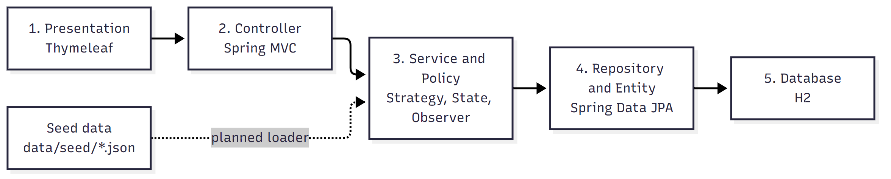
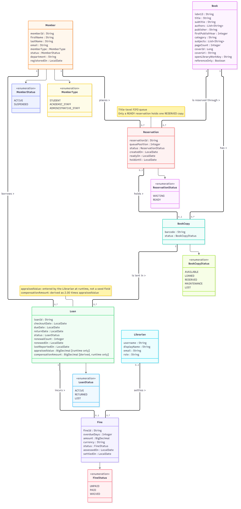
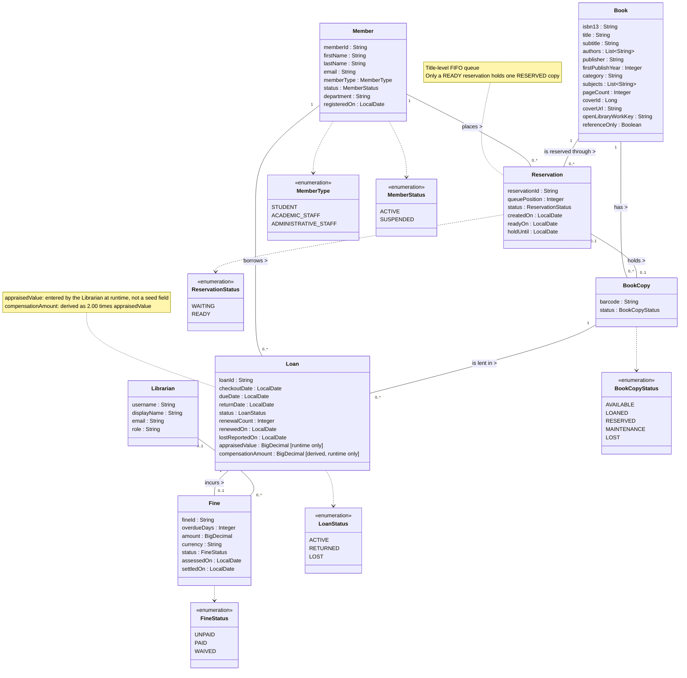

<!--
  Name(s) Surname(s) : Ibrahim Temur, Omer Faruk Kuş
  Student No(s)#: 231805033, 231805026
  General Comments: Single HW01 submission document consolidating the Problem Description, the Solution Outline, and the conceptual Domain Model of the CSE305 Library Management System.
-->
# HW01 — Problem Description, Solution Outline & Domain Model

## Library Management System (LMS)

| | |
|---|---|
| **Course** | CSE305 Software Engineering — Adnan Menderes University (ADU), Department of Computer Engineering |
| **Instructor** | Assoc. Prof. Dr. Fatih Soygazi |
| **Project** | Library Management System (LMS) |
| **Team & Scrum roles** | **Ibrahim Temur** (`231805033`) — Product Owner · **Omer Faruk Kuş** (`231805026`) — Scrum Master (both: Developer, Architect, QA, Reviewer) |
| **Document version** | `1.2` |
| **Document date** | 2026-10-30 |
| **Submission** | HW01 — due **Tuesday 2026-11-03** (postponed from 2026-10-27 by the instructor's announcement of 2026-10-27; the document now has three parts: Problem Description, Solution Outline, Domain Model) |
| **Archive** | `cse305_hw01_231805033_231805026.zip` (created with `tools\package 01`) |

> [!NOTE]
> **How to read this document.** Parts 1 and 2 are concise consolidations. Details live in the companion documents [`PROJECT_PROPOSAL.md`](PROJECT_PROPOSAL.md) and [`SOLUTION_OUTLINE.md`](SOLUTION_OUTLINE.md) (both version `1.2`), and in the Inception documents [`BUSINESS_RULES.md`](../02-inception/BUSINESS_RULES.md) (`BR-001`..`BR-018`), [`DOMAIN_GLOSSARY.md`](../02-inception/DOMAIN_GLOSSARY.md), [`REQUIREMENTS.md`](../02-inception/REQUIREMENTS.md) (`FR-001`..`FR-032`), and [`USE_CASES.md`](../02-inception/USE_CASES.md) (`UC-01`..`UC-11`). Part 3 (Domain Model) is specified in full here. The seed data is documented in [`data/README.md`](../../data/README.md).

**Contents:** [Part 1 — Problem Description](#part-1--problem-description) · [Part 2 — Solution Outline](#part-2--solution-outline) · [Part 3 — Domain Model](#part-3--domain-model) · [Revision History](#revision-history)

---

# Part 1 — Problem Description

## 1.1 Problem Statement

University, faculty, and departmental libraries that still use paper ledgers or ad-hoc spreadsheets lose time and accuracy at the circulation desk:

1. **Manual tracking errors** — checkouts, due dates, renewals, and returns are recorded by hand (mistyped ISBNs, duplicate members, overwritten return dates, books borrowed on someone else's behalf).
2. **Untracked physical copies** — several copies of one title cannot be told apart; copies that are loaned, held for a reservation, under repair, or lost look like shelf stock.
3. **Inconsistent overdue and fine handling** — member-type quotas, overdue days, fines, and borrowing blocks are applied inconsistently.
4. **No real-time visibility** — borrowers cannot check shelf availability, their own due dates and fines, or join a fair waiting queue for a high-demand title.

## 1.2 Motivation

The LMS is a self-contained, offline-capable web application that automates catalog management, copy-level circulation, FIFO reservation queues, and deterministic fine calculation under the **confirmed lending rules of the ADU Library** (verified on 2026-10-22, see `BUSINESS_RULES.md`). For CSE305 the domain is a realistic vehicle for Agile Scrum, UP-style modeling, GoF/GRASP patterns, UI-first prototyping, and TDD.

## 1.3 Stakeholders and Roles

| Role (`BR-001`) | Who & representative seeded personas ([`PERSONAS.md`](../02-inception/PERSONAS.md)) | Main goals |
|---|---|---|
| **Librarian / Admin** (`ROLE_LIBRARIAN`) | Circulation staff and administrator (one unified role, `ASSUMPTION-01`; e.g., `Enginiz Yıldırım` `syn-lib-0001`) | Maintain catalog and copies, manage members, run checkout/return/renewal, settle fines, process lost-book petitions, monitor the dashboard (`UC-03`..`UC-07`, `UC-09`, `UC-11`) |
| **Member** (`ROLE_MEMBER`) | `STUDENT` (`Tutkucan Ergül` `SYN-STU-0001`), `ACADEMIC_STAFF` (`Atasagun Öcalan` `SYN-STF-0003`), or `ADMINISTRATIVE_STAFF` (`Doğannur Güçlü` `SYN-ADM-0001`) | Search the catalog, see availability, track own loans/fines, renew, reserve (`UC-01`, `UC-07`, `UC-08`, `UC-10`) |
| **Guest** (`ROLE_GUEST`) | Unauthenticated visitor | Read-only catalog search and availability (`UC-01`) |
| Course instructor / Scrum team | Evaluator (`Assoc. Prof. Dr. Fatih Soygazi`) / PO (`Ibrahim Temur`) and SM (`Omer Faruk Kuş`) | Traceability from vision to tests; sustainable velocity ([`VISION_AND_CONTEXT.md`](../02-inception/VISION_AND_CONTEXT.md)) |

Confirmed borrowing parameters per member type (`BR-002`, `BR-003`):

| Member type | Max simultaneous `ACTIVE` loans | Loan period |
|---|---:|---:|
| `ACADEMIC_STAFF` | 7 | 30 calendar days |
| `ADMINISTRATIVE_STAFF` | 3 | 30 calendar days |
| `STUDENT` | 3 | 30 calendar days |

Other confirmed rules in force: overdue fine `0.25 TRY` (25 kuruş) per overdue day per loan with no cap and no grace period (`BR-007`..`BR-009`); no new loan or renewal while a loan is overdue or a fine is unpaid (`BR-011`); one renewal of +30 days if not overdue and not reserved (`BR-004`, `BR-005`); 30-day re-borrowing cooldown after returning a renewed title (`BR-006`); FIFO title-level reservations with a 3-day pickup hold (`BR-012`, `BR-013`); non-circulating reference works (`BR-014`); lost-book petition freezes fines, 30-day replacement window, then twice the appraised value (`BR-015`); personal ID card, no proxy borrowing (`BR-016`).

## 1.4 Scope

| In scope | Out of scope |
|---|---|
| Bibliographic catalog (books only, including `referenceOnly` works) seeded from Open Library | Periodicals and unpublished theses (`CON-002`) |
| Copy-level inventory with lifecycle states (`BR-017`) | Live ADU systems: OBIS/OBS, LDAP, SSO, smart-card readers (`CON-003`) |
| Member management for three member types | Payment gateways, banking APIs, SMTP/SMS (`CON-004`); fines are settled at the desk, hold notices are in-app |
| Checkout, return, renewal, overdue detection, fines, waivers, lost-book handling | RFID gates and scanner drivers (keyboard-emulated barcode input is supported) |
| FIFO reservation queue with pickup hold | E-book hosting and DRM |
| Role-based server-side web UI (Spring MVC + Thymeleaf), designed first in Stitch MCP | Multi-branch inter-library shipping |

## 1.5 Prioritized Features (MoSCoW)

| Priority | ID | Feature | `FR-*` | `UC-*` |
|---|---|---|---|---|
| Must | `M1` | Catalog & book copy management | `FR-001`..`FR-005` | `UC-01`, `UC-03` |
| Must | `M2` | Member management (3 member types) | `FR-006`..`FR-008` | `UC-04` |
| Must | `M3` | Loan checkout & return | `FR-009`..`FR-013` | `UC-05`, `UC-06` |
| Must | `M4` | Overdue detection & fine calculation | `FR-014`, `FR-015` | `UC-06`, `UC-09`, `UC-11` |
| Must | `M5` | Authentication, role-based views, self-service | `FR-016`..`FR-018` | `UC-02`, `UC-10` |
| Must | `M6` | Reproducible seed data pipeline & startup loader | `FR-019` | startup |
| Should | `S1` | Reservation (hold) queue & pickup hold | `FR-020`..`FR-023` | `UC-08` |
| Should | `S2` | Loan renewal | `FR-024` | `UC-07` |
| Should | `S3` | Fine settlement, waiver, lost-copy handling | `FR-025`..`FR-027` | `UC-09` |
| Should | `S4` | Librarian dashboard & overdue report | `FR-028`, `FR-029` | `UC-11` |
| Could | `C1`..`C3` | Guest portal; live ISBN lookup; CSV export | `FR-030`..`FR-032` | `UC-01`, `UC-03`, `UC-11` |
| Won't | `W1` | Online payments, external messaging, inter-library shipping | — | — |

---

# Part 2 — Solution Outline

## 2.1 Architecture

A five-tier layered web architecture (`NFR-010`): **Thymeleaf UI → Controller → Service/Policy → Repository/Entity → H2**. Controllers only coordinate HTTP requests (GRASP Controller); transactional services and policy/pattern classes hold the business rules (`NFR-003`); repositories map the persistent domain concepts to H2 (file mode at runtime, in-memory mode in tests). Details and the full diagram: [`SOLUTION_OUTLINE.md` §1](SOLUTION_OUTLINE.md).

## 2.2 Technology Stack

| Area | Choice | Status |
|---|---|---|
| Language / framework | Java 17 target (built on JDK 25 LTS), Spring Boot `3.5.16` | in `pom.xml` |
| Web / persistence | Spring MVC + Thymeleaf, Spring Data JPA / Hibernate, Jakarta Bean Validation, H2 | in `pom.xml` |
| Security | Spring Security with BCrypt (`FR-016`, `FR-017`, `NFR-007`, `NFR-008`) | **planned**, not yet in `pom.xml` |
| Build / tests | Maven `3.9.16` + wrapper (`.\mvnw.cmd`), JUnit 5, Mockito, Spring Boot Test / MockMvc | working |
| Seed tooling | Python 3.11 scripts in `tools/data/` (Open Library fetcher, `Faker` `tr_TR`), 80 offline `unittest` checks | working |
| UI design | Stitch MCP | working |

## 2.3 Data Strategy

Real bibliographic metadata plus 100% synthetic operational data, versioned under `data/seed/` so that startup and tests run offline (`NFR-004`, `NFR-009`, `RISK-03`). Seed v2 (reference date `2026-10-22`) contains:

| File | Rows | Content |
|---|---:|---|
| `books-openlibrary.json` | 782 | Open Library books, 3 of them `referenceOnly` |
| `members.json` | 60 | 40 `STUDENT`, 10 `ACADEMIC_STAFF`, 10 `ADMINISTRATIVE_STAFF` |
| `librarians.json` | 3 | `ROLE_LIBRARIAN` accounts, no credentials |
| `copies.json` | 1,706 | 1 to 4 copies per title |
| `loans.json` | 164 | 59 `ACTIVE`, 100 `RETURNED`, 5 `LOST` |
| `fines.json` | 47 | 26 `UNPAID`, 16 `PAID`, 5 `WAIVED` |
| `reservations.json` | 22 | 19 `WAITING`, 3 `READY`, across 12 titles |

Conventions: members `SYN-STU-####`, `SYN-STF-####`, `SYN-ADM-####`; librarians `syn-lib-####`; e-mail domain `synthetic.lms.local`; barcodes `LMS-COPY-####`; UTF-8, LF, JSON arrays, ISO-8601 dates, natural-key references, fine `amount` as a two-decimal string. No passwords, real personal data, or book prices exist in the seed files (`BR-018`, `ASSUMPTION-15`); demo credentials are BCrypt-hashed at startup (`ASSUMPTION-16`). Full format description: [`data/README.md`](../../data/README.md).

## 2.4 UI-First Workflow

Requirements and personas → screen design in **Stitch MCP** → HTML prototype and screenshot saved under `docs/03-design/ui/` → Thymeleaf template and Spring MVC controller → MockMvc and browser verification (`AGENTS.md` §6, `NFR-001`). Eight core screens are planned (login, catalog and book detail, circulation desk, catalog/copy management, member management, self-service portal, fines and lost-book desk, dashboard); see [`SOLUTION_OUTLINE.md` §3](SOLUTION_OUTLINE.md).

## 2.5 Design Patterns (design level, elaborated in HW03)

| Pattern | Where | Why |
|---|---|---|
| Strategy | `LoanPolicyStrategy`, `FineCalculationStrategy` | Quotas (7/3/3), loan period, and fine tariff are policy parameters that may change (protected variations); simplified if HW03 shows a parameter table suffices |
| State | `BookCopyState` | Strict copy lifecycle (`BR-017`, `FR-005`) |
| Observer | `BookReturnedEvent` and listeners | Return triggers hold promotion and notification without coupling services (`FR-022`) |
| Factory / Builder | `LoanFactory`, test builders | Valid aggregates by construction |
| Adapter / Facade | `OpenLibraryCatalogAdapter` | Keeps third-party JSON out of entities and controllers |
| GRASP | Information Expert, Creator, Controller, Low Coupling, High Cohesion, Protected Variations | Responsibility assignment |

None of these design-level classes appear in the Domain Model of Part 3.

## 2.6 Agentic Development Approach

AI agents draft documents, prototypes, and test/code scaffolding under the five engineering hats and the `Plan → Execute → Record` cadence of [`AGENTS.md`](../../AGENTS.md); humans own scope, priorities, business rules, acceptance, and every merge into `main`. Quality gates: plan approval, automated tests, a cross-model reviewer pass, and honest audit logging in [`docs/process/ai-usage-log.md`](../process/ai-usage-log.md) (`Pending human review` unless a named person confirmed the review). Details: [`PROJECT_PROPOSAL.md` §6.3](PROJECT_PROPOSAL.md).

## 2.7 Test Strategy

| Level | Tooling | Scope |
|---|---|---|
| Domain and pattern unit tests | JUnit 5, no Spring context | Quotas 3 and 7, exact due date (0 overdue days) versus next day (1), `0.25 TRY/day` without cap, 30-day cooldown boundary, fine freeze on `lostReportedOn`, copy state transitions |
| Repository slices | `@DataJpaTest`, in-memory H2 | Mappings and unique keys (`isbn13`, `barcode`, `memberId`, `username`) |
| Service / web integration | `@SpringBootTest`, `@WebMvcTest`, MockMvc | Checkout, return with hold promotion, blocks, role-based access |
| Seed data | Python `unittest` (80 checks) | Counts, foreign keys, rule invariants, reproducibility |

Gate: `.\mvnw.cmd -q test` and `tools\data\.venv\Scripts\python.exe -m unittest discover -s tools\data\tests` must pass before every merge.

---

# Part 3 — Domain Model

The domain model follows Larman, *Applying UML and Patterns* (3rd Ed., domain model chapter): it shows **conceptual classes** of the problem domain with attributes, named associations, and multiplicities. It deliberately contains **no** controllers, services, repositories, DTOs, strategies, or state classes — those are design concepts (HW03). Attribute names are the field names of `data/seed/*.json` and [`DOMAIN_GLOSSARY.md`](../02-inception/DOMAIN_GLOSSARY.md). **Foreign-key fields** (`isbn13` in a copy or reservation, `memberId`, `copyBarcode`, `loanId`, `readyCopyBarcode`, `settledBy`) are **not** shown as attributes; the corresponding **associations** express them (see the association table).

## 3.1 Class Diagram

*Figure 1 — Conceptual class diagram including the seven conceptual classes and six domain enumerations (vector version: [`images/domain-model.svg`](images/domain-model.svg); source: [`images/domain-model.mmd`](images/domain-model.mmd)). Attribute types follow the seed formats; the six enumeration types are also summarized with seed distributions in §3.2.*

Mermaid source (identical to <code>images/domain-model.mmd</code>)

## 3.2 Enumerations

| Enumeration | Used by | Values | Seed distribution |
|---|---|---|---|
| `MemberType` | `Member.memberType` | `STUDENT`, `ACADEMIC_STAFF`, `ADMINISTRATIVE_STAFF` | 40 / 10 / 10 |
| `MemberStatus` | `Member.status` | `ACTIVE`, `SUSPENDED` | 55 / 5 |
| `BookCopyStatus` | `BookCopy.status` | `AVAILABLE`, `LOANED`, `RESERVED`, `MAINTENANCE`, `LOST` | 1,624 / 59 / 3 / 15 / 5 |
| `LoanStatus` | `Loan.status` | `ACTIVE`, `RETURNED`, `LOST` | 59 / 100 / 5 |
| `FineStatus` | `Fine.status` | `UNPAID`, `PAID`, `WAIVED` | 26 / 16 / 5 |
| `ReservationStatus` | `Reservation.status` | `WAITING`, `READY` | 19 / 3 |

`Librarian.role` is the constant string `ROLE_LIBRARIAN` (a single value, hence not an enumeration). `Guest` and the `ROLE_*` authorities are actors/roles of the system, not persistent conceptual classes (`BR-001`).

**Domain parameters by member type.** `memberType` is an enumeration, not a class hierarchy, because members differ only in rule parameters, not in attributes or associations (Larman: subclass only when attributes, associations, or behavior differ). The parameters are values of rules `BR-002` and `BR-003`, not model elements:

| `MemberType` | Max `ACTIVE` loans | Loan period |
|---|---:|---:|
| `ACADEMIC_STAFF` | 7 | 30 days |
| `ADMINISTRATIVE_STAFF` | 3 | 30 days |
| `STUDENT` | 3 | 30 days |

## 3.3 Conceptual Classes, Seed Files, and Traceability

| Conceptual class | Meaning in the domain | Seed file | Related `FR-*` | Related `BR-*` | Related `UC-*` |
|---|---|---|---|---|---|
| `Book` | A bibliographic title identified by a checksum-valid `isbn13`; may be `referenceOnly` (non-circulating) | `books-openlibrary.json` | `FR-001`, `FR-002`, `FR-003`, `FR-031` | `BR-014`, `BR-017` | `UC-01`, `UC-03` |
| `BookCopy` | One physical item of a title, identified by its `barcode`; has a lifecycle `status` | `copies.json` | `FR-003`, `FR-004`, `FR-005`, `FR-010`, `FR-012` | `BR-013`, `BR-014`, `BR-017` | `UC-03`, `UC-05`, `UC-06` |
| `Member` | A registered borrower (student, academic staff, or administrative staff) | `members.json` | `FR-006`, `FR-007`, `FR-008`, `FR-009` | `BR-002`, `BR-003`, `BR-006`, `BR-011`, `BR-016`, `BR-018` | `UC-04`, `UC-05`, `UC-10` |
| `Librarian` | Library staff member who operates the desk and settles fines (unified with the administrator, `ASSUMPTION-01`) | `librarians.json` | `FR-016`, `FR-017`, `FR-025`, `FR-026` | `BR-001`, `BR-010`, `BR-018` | `UC-02`, `UC-05`, `UC-06`, `UC-09` |
| `Loan` | The lending of one `BookCopy` to one `Member`, from checkout until return or loss | `loans.json` | `FR-009`..`FR-014`, `FR-024`, `FR-027` | `BR-003`..`BR-007`, `BR-011`, `BR-013`, `BR-015`, `BR-016`, `BR-017` | `UC-05`, `UC-06`, `UC-07`, `UC-09` |
| `Fine` | The monetary overdue penalty of one loan, with its settlement (`PAID` or `WAIVED`) | `fines.json` | `FR-014`, `FR-015`, `FR-025`, `FR-026`, `FR-029` | `BR-007`..`BR-011`, `BR-015` | `UC-06`, `UC-09`, `UC-11` |
| `Reservation` | A title-level hold in a FIFO queue; when `READY` it holds one `RESERVED` copy until `holdUntil` | `reservations.json` | `FR-020`, `FR-021`, `FR-022`, `FR-023` | `BR-012`, `BR-013`, `BR-014` | `UC-06`, `UC-08`, `UC-10` |

## 3.4 Attribute Dictionary

`?` marks attributes that may be `null` in the seed. Types follow `data/README.md` §6.

| Class | Attribute | Type | Meaning |
|---|---|---|---|
| `Book` | `isbn13` | String | Unique 13-digit ISBN with valid check digit |
| | `title`, `subtitle?` | String | Title; optional subtitle |
| | `authors` | List of String | 1 to 5 author names |
| | `publisher` | String | Publisher of the selected edition |
| | `firstPublishYear` | Integer | First publication year of the work |
| | `category` | String | One of 11 catalog categories |
| | `subjects` | List of String | Up to 5 raw Open Library subjects |
| | `pageCount` | Integer | Work-level median page count (may differ from the specific edition) |
| | `coverId`, `coverUrl` | Long, String | Open Library cover reference (image not stored) |
| | `openLibraryWorkKey` | String | Open Library work key |
| | `referenceOnly` | Boolean | `true` for non-circulating encyclopedias, dictionaries, catalogs (`BR-014`) |
| `BookCopy` | `barcode` | String | Unique `LMS-COPY-####` |
| | `status` | BookCopyStatus | Lifecycle state |
| `Member` | `memberId` | String | Unique `SYN-STU-####`, `SYN-STF-####`, or `SYN-ADM-####`; stands for the personal ID card (`BR-016`) |
| | `firstName`, `lastName` | String | Synthetic name |
| | `email` | String | `*@synthetic.lms.local` |
| | `memberType`, `status` | MemberType, MemberStatus | Member type and membership state |
| | `department` | String | Generic fictional department label |
| | `registeredOn` | LocalDate | Registration date |
| `Librarian` | `username` | String | Unique `syn-lib-####` |
| | `displayName`, `email` | String | Synthetic name and e-mail |
| | `role` | String | Constant `ROLE_LIBRARIAN`; no credential field in the seed |
| `Loan` | `loanId` | String | Unique `LOAN-####` |
| | `checkoutDate`, `dueDate` | LocalDate | `dueDate = checkoutDate + 30 * (1 + renewalCount)` days |
| | `returnDate?` | LocalDate | Set only for `RETURNED` loans |
| | `status` | LoanStatus | `ACTIVE`, `RETURNED`, or `LOST` |
| | `renewalCount` | Integer | `0` or `1` |
| | `renewedOn?` | LocalDate | Date of the renewal |
| | `lostReportedOn?` | LocalDate | Lost-book petition date; freezes fine accrual (`BR-015`) |
| | `appraisedValue` *(runtime only)* | BigDecimal | Valuation Commission value entered by the Librarian; **not in the seed** (`ASSUMPTION-15`) |
| | `compensationAmount` *(derived, runtime only)* | BigDecimal | `2.00 * appraisedValue`; **not in the seed** |
| `Fine` | `fineId` | String | Unique `FINE-####` |
| | `overdueDays` | Integer | Overdue days up to the effective end date (`BR-007`) |
| | `amount`, `currency` | BigDecimal, String | `0.25 * overdueDays`, no cap; `TRY` |
| | `status` | FineStatus | `UNPAID`, `PAID`, or `WAIVED` |
| | `assessedOn` | LocalDate | Return date, lost-petition date, or evaluation date |
| | `settledOn?` | LocalDate | Settlement date; `null` while `UNPAID` |
| `Reservation` | `reservationId` | String | Unique `RES-####` |
| | `queuePosition` | Integer | FIFO position `1..n` within the title's queue |
| | `status` | ReservationStatus | `WAITING` or `READY` |
| | `createdOn` | LocalDate | Placement date (FIFO order) |
| | `readyOn?`, `holdUntil?` | LocalDate | Hold start and `readyOn + 3 days`; only for `READY` |

## 3.5 Associations and Multiplicities

| # | Association (read direction) | Multiplicity | Seed foreign key | Rule / invariant |
|---|---|---|---|---|
| A1 | `Book` has `BookCopy` | 1 — `0..*` | `copies.isbn13` | A title is cataloged before copies are added (`FR-001`, `FR-004`); seed has 1 to 4 per title (`ASSUMPTION-09`, `BR-017`) |
| A2 | `Member` borrows `Loan` | 1 — `0..*` | `loans.memberId` | Active-loan quota per member type (`BR-002`); blocks (`BR-011`) |
| A3 | `BookCopy` is lent in `Loan` | 1 — `0..*` | `loans.copyBarcode` | At most one `ACTIVE` loan per copy at any time (`BR-017`) |
| A4 | `Loan` incurs `Fine` | 1 — `0..1` | `fines.loanId` (unique) | At most one overdue fine per loan (`BR-010`); every fine belongs to exactly one loan |
| A5 | `Librarian` settles `Fine` | `0..1` — `0..*` | `fines.settledBy` | `null` while `UNPAID`; set when `PAID` or `WAIVED` (`BR-010`) |
| A6 | `Member` places `Reservation` | 1 — `0..*` | `reservations.memberId` | Eligibility (`BR-012`) |
| A7 | `Book` is reserved through `Reservation` | 1 — `0..*` | `reservations.isbn13` | Title-level FIFO queue (`BR-012`); never on a `referenceOnly` book (`BR-014`) |
| A8 | `Reservation` holds `BookCopy` | `0..1` — `0..1` | `reservations.readyCopyBarcode` | Only a `READY` reservation holds a copy, and a `RESERVED` copy is held by exactly one `READY` reservation (`BR-013`, `BR-017`) |

**Derived association (not drawn).** `fines.memberId` duplicates `Loan.member` (verified for all 47 seed fines). Larman advises against redundant associations, so a `Member`'s fines are reached through `Member → Loan → Fine`.

**Cross-association invariants** (enforced in design and tests, shown here for completeness): `BookCopy.status = LOANED` ⇔ the copy has an `ACTIVE` loan; `BookCopy.status = LOST` ⇔ the copy has a `LOST` loan (`returnDate = null`, `lostReportedOn ≠ null`); `BookCopy.status = RESERVED` ⇔ a `READY` reservation holds it; all copies of a `referenceOnly` book stay `AVAILABLE` (`BR-014`, `BR-017`).

## 3.6 Key Modelling Decisions

1. **`Book` versus `BookCopy`.** A title (`isbn13`) and a physical item (`barcode`) have different identities, attributes, and lifecycles: availability, loans, loss, and maintenance concern copies; catalog data, reference status, and reservations concern the title. Merging them would make multi-copy lending and per-copy state impossible.
2. **`Member` with an enumerated `memberType`, no subclasses.** The three member types differ only in rule parameters (`BR-002`, `BR-003`), so an enumeration is enough; the parameters belong to the rules, not to the model.
3. **`Librarian` is a separate class.** Librarians and members are distinct people with different data (`librarians.json` versus `members.json`), roles, and responsibilities; a librarian appears in the domain as the person who settles a `Fine`.
4. **`Fine` is its own concept.** A fine has its own lifecycle (`UNPAID` → `PAID` or `WAIVED`), amount, assessment and settlement dates, and an accountable librarian; at most one overdue fine exists per loan (`BR-010`), and it blocks borrowing while unpaid (`BR-011`). Folding it into `Loan` would hide this lifecycle.
5. **Title-level FIFO reservations.** A `Reservation` is placed on a `Book`, not on a copy (`BR-012`); `queuePosition` and `createdOn` give the FIFO order. Only when a copy is returned does a `READY` reservation hold one specific `BookCopy` (`readyCopyBarcode`, `BR-013`).
6. **Why a lost loan has its own status.** `LOST` is a closed outcome that differs from `RETURNED`: the copy never came back (`returnDate = null`), fine accrual stopped on `lostReportedOn`, and the copy becomes `LOST`. Overloading `RETURNED` would falsely free the copy, break the invariant "`LOST` copy ⇔ `LOST` loan", and lose the fine-freeze date (`BR-015`, `BR-017`).
7. **Why `appraisedValue` is runtime-only.** Open Library data contains no prices, and inventing fake prices in the seed would be false data. The Valuation Commission's value is entered by the Librarian when a lost copy is not replaced within 30 days (`ASSUMPTION-15`); `compensationAmount` is derived as `2.00 * appraisedValue`. Both appear on `Loan` as attributes marked *runtime only* and are not seed fields.
8. **Associations instead of foreign keys.** Following Larman, relationships are drawn as named associations with multiplicities; the seed's natural-key fields are the implementation of those associations and are mapped in §3.5. The redundant `Fine`–`Member` link is omitted.
9. **`Reservation` states `WAITING` and `READY` only.** This equals the glossary and the seed. A reservation that is fulfilled, cancelled, or expired leaves the active queue (see Known Limitations).

## 3.7 Known Limitations

- **Lost-book compensation tracking is deferred to HW03.** The model records `appraisedValue` and the derived `compensationAmount` on `Loan` only. How the compensation charge is **tracked, paid, or waived** (for example its own status, `settledOn`, and `settledBy`, or an extension of `Fine`) is not modelled in HW01 and will be decided in the HW03 design documents. Until then, `FR-025`/`FR-026` (settlement and waiver) are fully modelled for overdue `Fine` records only.
- **Reservation terminal states and history are deferred to HW03.** `ReservationStatus` contains only `WAITING` and `READY`. `FR-011` (fulfilled by checkout) and `FR-023` (cancellation, expiry) remove a reservation from the active queue; whether terminal states such as fulfilled, cancelled, or expired, and a retained reservation history, are needed will be decided in HW03. The seed contains no such records.
- The model is conceptual: it carries no operations, visibility, or persistence mapping.
- Seed dates are relative to `REFERENCE_DATE = 2026-10-22`; shifting them at startup is open item `OPEN-04`.

## 3.8 Concepts Intentionally Left to the HW03 Design Documents

| Design-level concept | Why it is not in the domain model |
|---|---|
| `LoanPolicyStrategy`, `FineCalculationStrategy` and their implementations | Strategy classes are design solutions for policy variation, not domain concepts |
| `BookCopyState` and its state classes | State pattern realizes the `BookCopyStatus` lifecycle |
| `BookReturnedEvent`, `LoanOverdueEvent`, listeners | Observer mechanism |
| `LoanFactory`, builders | Creational design |
| `Notification` (in-app hold-ready message, `BR-013`) | Runtime artifact; its need as a persistent concept is a design decision |
| User account / credentials / security roles | Login data is created at startup (`ASSUMPTION-16`); not in the seed |
| Controllers, services, repositories, DTOs, JPA entity mappings | Layered-architecture elements |
| Compensation charge tracking; reservation history | See Known Limitations |

---

## Revision History

| Version | Date | Summary |
|---|---|---|
| `1.2` | 2026-10-30 | First consolidated HW01 submission document: Problem Description, Solution Outline, and Domain Model; aligned with confirmed ADU rules and seed v2; schedule updated (HW01 due 2026-11-03). |
