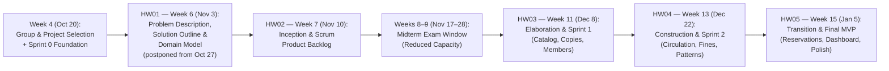

<!--
  Name(s) Surname(s) : Ibrahim Temur, Omer Faruk Kuş
  Student No(s)#: 231805033, 231805026
  General Comments: Project proposal defining problem statement, stakeholders, scope, MoSCoW feature prioritization, confirmed rules and domain assumptions, Scrum process, timeline, and risk management for the CSE305 Library Management System.
-->
# Project Proposal — Library Management System (LMS)

- **Course:** CSE305 Software Engineering — Adnan Menderes University (ADU), Department of Computer Engineering
- **Project Title:** Library Management System (LMS)
- **Team Members:**
  - **Ibrahim Temur** — Student No: `231805033` (Product Owner)
  - **Omer Faruk Kuş** — Student No: `231805026` (Scrum Master)
- **Engineering Methodology:** Agile Scrum & Test-Driven Development (TDD)
- **GitHub Repository:** [`https://github.com/ibrahimtemur/cse305-library-management-system`](https://github.com/ibrahimtemur/cse305-library-management-system)
- **Document Version:** `1.2` (2026-10-30)
- **Part of:** [`HW01_Problem_Solution_DomainModel.md`](HW01_Problem_Solution_DomainModel.md) (single HW01 submission document); detailed companion: [`SOLUTION_OUTLINE.md`](SOLUTION_OUTLINE.md)

> [!NOTE]
> **Authoritative sources.** Business rules are defined in [`BUSINESS_RULES.md`](../02-inception/BUSINESS_RULES.md) (`BR-001`..`BR-018`), the vocabulary in [`DOMAIN_GLOSSARY.md`](../02-inception/DOMAIN_GLOSSARY.md), requirements in [`REQUIREMENTS.md`](../02-inception/REQUIREMENTS.md) (`FR-*`), use cases in [`USE_CASES.md`](../02-inception/USE_CASES.md) (`UC-*`), and the seed data in [`data/README.md`](../../data/README.md). This proposal summarizes them and must not contradict them.

---

## 1. Problem Statement & Motivation

Small-scale university, faculty, and departmental libraries frequently rely on manual ledgers or ad-hoc spreadsheets to manage physical book inventories and lending operations. While inexpensive initially, informal tracking introduces critical operational bottlenecks as the collection and the community of borrowers grow:

1. **Manual Tracking Overhead & Clerical Errors:** Recording checkouts, due dates, renewals, and returns by hand or in unvalidated spreadsheets is slow at the circulation desk and prone to data-entry inconsistencies (e.g., mistyped ISBNs, duplicate member entries, overwritten return dates, or books borrowed on someone else's behalf).
2. **Unaccounted & Lost Physical Copies:** Without copy-level lifecycle tracking, librarians cannot reliably distinguish between multiple physical copies of the same title. Books that are misplaced, under maintenance, held for a reservation, or reported lost quietly become "lost" inventory because there is no strict state machine governing copy availability.
3. **Inconsistent Overdue Detection & Fine Calculation:** Calculating overdue days, applying member-type borrowing quotas, and tracking unpaid penalties manually leads to inconsistent enforcement, calculation mistakes, and checkout privileges being granted to members who still hold overdue items or owe fines.
4. **Lack of Real-Time Catalog Visibility:** Students, academic staff, and administrative staff cannot easily check whether a specific book copy is currently on the shelf before visiting the library desk, nor can they place a structured hold/reservation when all copies of a high-demand textbook are checked out.

### Motivation
The goal of the **Library Management System (LMS)** project is to design, implement, and verify a clean, self-contained, web-based application that automates catalog management, copy-level circulation, reservation queues, and deterministic overdue fine calculation under the confirmed lending rules of the ADU Library. From a software engineering perspective (CSE305), this domain provides a rich, realistic problem space for applying **Agile Scrum**, **GoF and GRASP Object-Oriented Design Patterns**, **UI-First Prototyping (Stitch MCP)**, and **Test-Driven Development (JUnit 5)**.

---

## 2. Stakeholders & User Roles

The system serves three distinct user roles (`BR-001`) with clearly separated responsibilities and permissions. The `Member` role covers three member types: `STUDENT`, `ACADEMIC_STAFF`, and `ADMINISTRATIVE_STAFF` (`BR-002`).

| Role | Stakeholder Profile | Core Responsibilities & Capabilities |
|---|---|---|
| **Librarian / Admin** (`ROLE_LIBRARIAN`) | Library circulation staff and system administrator | - Manage the bibliographic catalog (add, update, archive books, mark non-circulating reference works) and import metadata via Open Library (`UC-03`). - Register and manage physical book copies (`AVAILABLE`, `LOANED`, `RESERVED`, `LOST`, `MAINTENANCE`). - Register, update, and activate/suspend library members (`UC-04`). - Execute circulation desk operations: issue loans (checkout), process returns, and approve renewals (`UC-05`..`UC-07`). - Monitor overdue loans, collect/waive overdue fines, process lost-book petitions, and view operational dashboard metrics (`UC-09`, `UC-11`). |
| **Member** (`ROLE_MEMBER`) | University students (`STUDENT`), academic staff (`ACADEMIC_STAFF`), and administrative staff (`ADMINISTRATIVE_STAFF`) borrowing books | - Search and filter the book catalog by title, author, ISBN, or subject category (`UC-01`). - View real-time copy availability and shelf status. - View personal active loans, due dates, historical borrowing records, and accrued overdue fines (`UC-10`). - Request loan renewals and place holds/reservations on titles when no copy is currently available (`UC-07`, `UC-08`). |
| **Guest (Optional)** (`ROLE_GUEST`) | Unauthenticated visitor browsing the catalog | - Browse and search the public bibliographic catalog and inspect copy availability in read-only mode (`UC-01`). - Cannot borrow books, place reservations, or view member-specific circulation data without signing in. |

---

## 3. Project Scope

### 3.1 In-Scope
- **Bibliographic Catalog Management:** Full CRUD operations for book titles, authors, categories/subjects, and ISBN-13 identifiers, seeded with real bibliographic metadata from the public **Open Library API**; non-circulating reference works (encyclopedias, dictionaries, catalogs) are flagged with `referenceOnly` (`BR-014`).
- **Physical Copy Inventory Tracking:** One-to-many relationship between a `Book` title and its physical `BookCopy` instances, each tracked by a unique barcode (`LMS-COPY-1001`..) and an explicit lifecycle state (`BR-017`).
- **Member Management:** Registration and lifecycle management (`ACTIVE`, `SUSPENDED`) for synthetic `STUDENT`, `ACADEMIC_STAFF`, and `ADMINISTRATIVE_STAFF` profiles.
- **Core Circulation Engine:** Issuing loans with policy-driven due dates, validating member eligibility and copy state prior to checkout, processing returns, and handling loan renewals (`BR-002`..`BR-006`, `BR-011`, `BR-016`).
- **Automated Overdue & Fine Management:** Deterministic calculation of overdue days and monetary penalties upon return or periodic inspection, recording fine payments or librarian waivers, and handling lost-book petitions (`BR-007`..`BR-010`, `BR-015`).
- **Hold / Reservation Queue:** Allowing eligible members to queue for a book when zero copies are `AVAILABLE`, and automatically prioritizing the queue upon book return with an in-app pickup notification (`BR-012`, `BR-013`).
- **Role-Based Web Interface:** Responsive server-side rendered web views designed first with **Stitch MCP** and implemented with **Spring MVC + Thymeleaf**.

### 3.2 Out-of-Scope
- **Periodicals and Unpublished Theses:** The system manages books only (`CON-002`).
- **Real University IT / SIS Integration:** No connection to Adnan Menderes University's live Student Information System (OBIS/OBS), LDAP, or institutional Single Sign-On (SSO) (`CON-003`).
- **Real Payment Gateways and External Messaging:** No integration with banking APIs, credit card processors, SMTP, or SMS; fine settlements are recorded as manual desk payments and hold notifications are shown in-app (`CON-004`).
- **Specialized Hardware Drivers:** No proprietary RFID gates or native USB laser scanner drivers (standard keyboard-emulated barcode text input is supported).
- **Digital E-Book Hosting & DRM:** The system manages physical library inventory and circulation only, not PDF/EPUB file streaming or digital rights management.

---

## 4. Prioritized Feature List (MoSCoW Method)

Features are prioritized using the **MoSCoW** framework to guarantee a shippable, well-tested Minimum Viable Product (MVP) by the final deadline while buffering against midterm exam capacity reductions. Each feature is traced to its functional requirements (`FR-*`) and use cases (`UC-*`).

### Must Have (Critical for MVP)
- **`M1` — Catalog & Book Copy Management** (`FR-001`..`FR-005`, `UC-01`, `UC-03`): Create, edit, search, and filter book titles (including the `referenceOnly` flag) and manage individual physical copies (`BookCopy`) with status tracking.
- **`M2` — Synthetic Member Management** (`FR-006`..`FR-008`, `UC-04`): Register, view, update, and activate/suspend library members with the three member types `STUDENT`, `ACADEMIC_STAFF`, and `ADMINISTRATIVE_STAFF`.
- **`M3` — Loan Checkout & Return Workflow** (`FR-009`..`FR-013`, `UC-05`, `UC-06`): Issue an available book copy to an eligible member with automatic due-date computation; process copy returns and restore availability or hold the copy for the next reservation.
- **`M4` — Automated Overdue Detection & Fine Calculation** (`FR-014`, `FR-015`): Identify loans past their due date and calculate accrued fines deterministically using pluggable policy rules.
- **`M5` — Authentication, Role-Based Views & Member Self-Service** (`FR-016`..`FR-018`, `UC-02`, `UC-10`): Separate Librarian operational views from Member self-service catalog and loan-tracking views.
- **`M6` — Reproducible Seed Data Pipeline** (`FR-019`): Populate the H2 database at startup with Open Library book metadata and strictly synthetic member and circulation records (seven JSON files under `data/seed/`).

### Should Have (High-Value Enhancements Planned for Sprint 2 / MVP)
- **`S1` — Book Reservation (Hold) Queue** (`FR-020`..`FR-023`, `UC-08`): Allow members to place a hold on a title when no copy is `AVAILABLE`, transitioning returned copies to `RESERVED` for the next queued member for the pickup window.
- **`S2` — Self-Service / Desk Loan Renewal** (`FR-024`, `UC-07`): Extend an active loan's due date if the loan is not overdue, has not been renewed before, and has no competing reservation.
- **`S3` — Fine Settlement, Waiver & Lost-Copy Handling** (`FR-025`..`FR-027`, `UC-09`): Allow librarians to mark accrued fines as `PAID` or `WAIVED` to restore a member's borrowing eligibility and to process lost-book petitions.
- **`S4` — Librarian Operational Dashboard** (`FR-028`, `FR-029`, `UC-11`): Display summary KPIs (total titles/copies, active loans, overdue count, unpaid fine total) and an actionable overdue loans report.

### Could Have (Stretch Goals if Velocity Permits)
- **`C1` — Public Guest Catalog Portal** (`FR-030`): Unauthenticated read-only catalog search and availability lookup.
- **`C2` — Live Open Library ISBN Lookup Form** (`FR-031`): Auto-populate book title, authors, publication year, and cover thumbnail in the Librarian "Add Book" form by querying Open Library by ISBN.
- **`C3` — CSV Export for Overdue & Inventory Reports** (`FR-032`): Downloadable tabular reports for library administrators.

### Won't Have (Explicitly Excluded from This Release)
- **`W1` — Online Credit Card Payment Processing, External SMTP/SMS Gateways, and Multi-Branch Inter-Library Shipping.**

---

## 5. Confirmed Rules & Domain Assumptions

> [!IMPORTANT]
> On **2026-10-22** the team verified the official circulation regulations of the ADU Library Directorate; the verified rules are marked `CONFIRMED` in [`BUSINESS_RULES.md`](../02-inception/BUSINESS_RULES.md) (sources and access dates are listed there). Every implementation detail that the official text does not fix remains an explicit **`ASSUMPTION`**. The original HW01 assumption IDs (`ASSUMPTION-01`..`09`) are kept for traceability; where a confirmed rule superseded an early assumption, the table below says so and points to the governing `BR-*` rule. All policy parameters are isolated behind configurable policy classes in the software architecture.

### 5.1 Assumption Register (`ASSUMPTION-01`..`ASSUMPTION-09`)

| ID | Category | Status | Current Statement (governing rule) |
|---|---|---|---|
| **`ASSUMPTION-01`** | **Role Unification** | Retained (`ASSUMPTION`) | The *Librarian* and *System Administrator* responsibilities are unified under one privileged operational role (`ROLE_LIBRARIAN`); *Members* (`ROLE_MEMBER`, all three member types) have self-service privileges and *Guests* (`ROLE_GUEST`) have optional read-only catalog access. → `BR-001` |
| **`ASSUMPTION-02`** | **Member Borrowing Limits** | **Superseded by confirmed rule** | An active member may hold at most **7 loans** (`ACADEMIC_STAFF`), **3 loans** (`ADMINISTRATIVE_STAFF`), or **3 loans** (`STUDENT`) simultaneously. → `BR-002` (`CONFIRMED`) |
| **`ASSUMPTION-03`** | **Standard Loan Duration** | **Superseded by confirmed rule** | The standard loan period is **30 calendar days** from the checkout date for all three member types. → `BR-003` (`CONFIRMED`) |
| **`ASSUMPTION-04`** | **Loan Renewal Rules** | Partially confirmed | A loan cannot be renewed while overdue or while another member holds a `WAITING` or `READY` reservation on the title (`BR-004`, `CONFIRMED`); at most **1 renewal** of **+30 days** (`BR-005`, `ASSUMPTION-11`); after returning a renewed book the same member cannot borrow that title again for **30 days** (`BR-006`, `CONFIRMED` + `ASSUMPTION-12`). |
| **`ASSUMPTION-05`** | **Overdue Fine Rate & Cap** | **Superseded by confirmed rule** | Overdue loans accrue **0.25 TRY (25 kuruş) per overdue calendar day** per loan with **no maximum cap** and no grace period: `amount = 0.25 * overdueDays` (`BR-007`, `BR-008` `CONFIRMED`; `BR-009` `ASSUMPTION-10`; fine lifecycle `BR-010`). |
| **`ASSUMPTION-06`** | **Borrowing Eligibility Block** | Confirmed + assumption | A member with any overdue active loan or any `UNPAID` fine/charge cannot borrow or renew (`CONFIRMED`); a `SUSPENDED` member is also blocked from borrowing, renewing, and reserving (`ASSUMPTION`). → `BR-011` |
| **`ASSUMPTION-07`** | **Reservation Queue Allocation** | Partially confirmed | Reservations are placed at the *book title* level (`isbn13`) in strict FIFO order, only when zero copies of the title are `AVAILABLE` (`BR-012`, `ASSUMPTION-13`); a returned copy becomes `RESERVED` for the head of the queue, the member is notified in-app, and the copy is held for **3 calendar days** within the confirmed 2–3 day pickup window (`BR-013`, `CONFIRMED` + `ASSUMPTION-13`). |
| **`ASSUMPTION-08`** | **Synthetic Identity & Local Auth** | Retained, extended | All user authentication and member records use local database credentials and 100% synthetic personal data; no real ADU student IDs, e-mails, or institutional systems are accessed. Identifier conventions: `SYN-STU-####`, `SYN-STF-####`, `SYN-ADM-####` (members), `syn-lib-####` (librarians), e-mail domain `synthetic.lms.local` (`ASSUMPTION-16`, `ASSUMPTION-17`). → `BR-018` |
| **`ASSUMPTION-09`** | **Seeded Physical Copies per Title** | Retained (`ASSUMPTION`) | Each seeded book title has **1 to 4 physical copies** (`BookCopy`) with deterministic barcodes `LMS-COPY-1001`.. (the seed contains 1,706 copies for 782 titles). → `BR-017` |

### 5.2 Additional Confirmed Rules Added After the First Proposal Draft

| Rule | Topic | Status | Summary |
|---|---|---|---|
| `BR-014` | Non-circulating reference works | `CONFIRMED` + `ASSUMPTION-14` | Encyclopedias, dictionaries, and catalogs (`Book.referenceOnly = true`; 3 of 782 seeded titles) can neither be borrowed nor reserved. |
| `BR-015` | Lost copies | `CONFIRMED` + `ASSUMPTION-12`, `ASSUMPTION-15` | A lost-book petition (`lostReportedOn`) freezes fine accrual; if the book is not replaced within 30 days, the loan closes with the status `LOST` and twice the appraised value is charged. The appraised value is a runtime librarian input, never stored in the seed data. |
| `BR-016` | Personal ID card | `CONFIRMED` | Checkout requires the borrower's own university ID (`memberId`); borrowing on behalf of another person is prohibited. |

---

## 6. Agile Scrum Process, Team Roles & Timeline

### 6.1 Scrum Roles & Engineering Hats
Because this is a two-person software engineering team, both members collaborate across the full stack while maintaining clear Scrum accountability and explicitly rotating/applying the five engineering hats defined in `AGENTS.md` (*Product Owner, Architect, Developer, QA Engineer, Reviewer*):

| Scrum / Engineering Role | Assigned Team Member(s) | Primary Responsibilities |
|---|---|---|
| **Product Owner (PO)** | **Ibrahim Temur** (`231805033`) | Owns product vision, prioritizes the Product Backlog (MoSCoW), clarifies domain rules and assumptions, and validates story acceptance criteria. |
| **Scrum Master (SM)** | **Omer Faruk Kuş** (`231805026`) | Facilitates Scrum ceremonies, tracks sprint velocity and midterm capacity buffer, removes technical blockers, and enforces Git/process hygiene. |
| **Developers & Architects** | **Ibrahim Temur** (`231805033`) & **Omer Faruk Kuş** (`231805026`) | Co-design layered architecture and GoF/GRASP patterns, design Stitch UI prototypes, implement Spring Boot + Thymeleaf features, and write JUnit 5 tests (TDD). |
| **QA & Peer Reviewers** | **Ibrahim Temur** (`231805033`) & **Omer Faruk Kuş** (`231805026`) | Cross-review pull/branch merges, verify test coverage (`mvn test`), audit file headers, and validate synthetic data compliance. |

### 6.2 Sprint Cadence & Course Milestone Timeline
The project follows an iterative **Agile Scrum** schedule aligned directly with the CSE305 deliverable deadlines and the university academic calendar.

> [!NOTE]
> **Schedule change.** On 2026-10-27 the course instructor announced that **HW01 is postponed by one week to Tuesday 2026-11-03** and that the HW01 document must now consist of three parts: **Problem Description, Solution Outline, and Domain Model**. The HW02–HW05 deadlines are unchanged.

| Milestone / Homework | Course Week | Target Deadline | Key Deliverables & Focus |
|---|---|---|---|
| **Group & Project Selection + Sprint 0** | Week 4 | **October 20–21** *(Done)* | Project group & topic selection (*Library Management System*); toolchain setup (JDK 25 / Java 17 target, Maven 3.9.16 Wrapper, Spring Boot 3.5.16, H2, JUnit 5), Git/GitHub repo, `AGENTS.md`, automation scripts. |
| **HW01 — Problem Description, Solution Outline & Domain Model** | Week 6 | **November 3** *(postponed from October 27 by the instructor's announcement of 2026-10-27)* | `HW01_Problem_Solution_DomainModel.md` (single submission document) with `PROJECT_PROPOSAL.md` and `SOLUTION_OUTLINE.md` as detailed companions (`docs/01-proposal/`), packaged as `cse305_hw01_231805033_231805026.zip`. |
| **HW02 — Inception Phase** | Week 7 | **November 10** | Vision & system context diagram, Personas, Functional/Non-Functional Requirements (Supplementary Specification), Use Cases, Domain Glossary, Business Rules, Themes/Epics/User Stories/Tasks, Sprint Planning, Product Backlog, and PSI/MVP definition (`docs/02-inception/`). |
| **Midterm Exam Period** | Weeks 8–9 | *Nov 17 – Nov 28* | **Reduced Capacity Window (~35% normal velocity):** Focus on lightweight JPA entity modeling, unit test scaffolding, and seed data preparation without heavy UI sprints. |
| **HW03 — Elaboration / Sprint 1** | Weeks 10–11 | **December 8** | Use-case diagram, system sequence diagrams (SSD), design class diagrams, TDD/Git/Maven plan (`docs/03-design/`), Stitch UI prototypes, and working **Sprint 1** increment (Catalog, Physical Copies, Synthetic Members, seed data loader, JUnit 5 tests). |
| **HW04 — Construction / Sprint 2** | Weeks 12–13 | **December 22** | Working **Sprint 2** increment: Circulation Service (Checkout, Return, Renewal), Overdue Detection & Fine Calculation Engine, core GoF/GRASP pattern implementations (*Strategy*, *State*, *Builder/Factory*), librarian circulation UI, and integration tests. |
| **HW05 — Transition / MVP Release** | Weeks 14–15 | **January 5** | Complete **MVP Release (Sprint 3)**: Book Reservation/Hold queue (*Observer*/*State* integration), Fine payment/waiver workflow, Librarian Dashboard & KPIs, Guest catalog view, full regression testing (`mvn test`), sprint retrospectives, and final submission archive (`cse305_hw05_231805033_231805026.zip`). |

### 6.3 Agentic Development Approach

 In alignment with Week 15 of the CSE305 syllabus (*AI-based Software Development Lifecycle*), this project uses a disciplined, human-governed **Agentic Development Approach**:

1. **Division of Responsibilities (AI Agents vs. Human Engineers):**
   - **AI Agent Activities:** Drafting and structuring Markdown documentation, generating UI screen prototypes via the **Stitch MCP** server, writing TDD unit/integration test scaffolding (JUnit 5) and Spring Boot implementation code, and performing automated checklist/code review passes.
   - **Human Engineering Decisions:** Defining project scope and MoSCoW priorities, establishing domain business rules and `ASSUMPTION` boundaries, resolving architectural trade-offs, verifying acceptance criteria, inspecting runtime behavior, and approving merges into the `main` branch.
2. **Governance via `AGENTS.md`:**
   - Every AI session is strictly bound by [`AGENTS.md`](../../AGENTS.md), which enforces:
     - **Role-Based Working "Hats":** Explicit perspective switching across *Product Owner*, *Architect*, *Developer*, *QA Engineer*, and *Reviewer*.
     - **`Plan -> Execute -> Record` Cadence:** Every task begins with an explicit plan in Turkish for human approval before modifying repository files, followed by test verification (`mvn test`) and state updates in [`docs/process/PROJECT_STATE.md`](../process/PROJECT_STATE.md).
     - **Language & Header Rules:** Chat communication with the team occurs in Turkish, while 100% of repository content (code, identifiers, comments, Javadoc, tests, documentation, commits) is written in English and starts with the mandatory CSE305 student authorship header.
3. **Human-in-the-Loop Quality Gates:**
   - **Plan & Merge Gate:** No implementation starts without plan approval, and merging `develop` into `main` requires explicit human authorization.
   - **Cross-Model Review Pass:** Significant code and documentation increments undergo a dedicated `Reviewer` hat pass using a **different AI model** than the model that authored the work, reducing single-model blind spots before human sign-off.
   - **Automated Test Gate:** All production changes must pass `mvn test` (`.\mvnw.cmd test`) against the isolated in-memory H2 test database.
4. **Academic Transparency (`docs/process/ai-usage-log.md`):**
   - Every AI-assisted task is recorded in [`docs/process/ai-usage-log.md`](../process/ai-usage-log.md) with the date, active student name, prompt summary, the exact model selected in the Antigravity model selector, generated outputs, and truthful human review status (`Reviewed by ...` vs. `Pending human review`).
5. **Known Limitations of AI Assistance:**
   - Large language models do not possess intrinsic knowledge of local institutional policies, can hallucinate framework methods or subtly flawed state transitions, lose context across separate chat sessions without structured state files (`PROJECT_STATE.md`), and can over-engineer design patterns unless constrained by human architectural review and automated tests.

---

## 7. Risks & Mitigation Matrix

| Risk ID | Risk Description | Likelihood | Impact | Mitigation Strategy |
|---|---|---|---|---|
| **RISK-01** | **Midterm Exam Capacity Drop (Nov 17–28):** Team availability drops sharply during the two-week university midterm examination period, risking Sprint 1 slippage before the Dec 8 deadline. | High | High | Complete all Inception, Architecture, and Stitch UI design artifacts by **Nov 10**; treat Nov 17–28 as a planned low-velocity buffer (~35% capacity) and scope Sprint 1 stories conservatively around core Catalog & Member CRUD. |
| **RISK-02** | **Shared Computer Git Authorship Mix-Up:** Both team members share a single workstation, creating a risk of committing work under the teammate's Git identity. | Medium | Medium | Enforce the mandatory start-of-session check in `AGENTS.md` and run `tools\set-author ibrahim` or `tools\set-author omer` (`--local` Git scope) prior to every commit. |
| **RISK-03** | **External Open Library API Downtime or Rate Limiting:** Live HTTP requests to `openlibrary.org` could fail or time out during grading or offline demos. | Medium | High | Pre-fetch and version-control the curated Open Library book dataset inside `data/seed/` (JSON) so application startup and automated tests run 100% deterministically offline, while keeping optional live ISBN lookup gracefully fallback-safe. |
| **RISK-04** | **OneDrive File-Locking on H2 or Maven `target/`:** The workspace resides under a OneDrive-synced path, which can occasionally lock rapidly changing binary files during builds or H2 writes. | Medium | Low | Exclude `target/` and `data/db/` from Git, use in-memory H2 (`jdbc:h2:mem:lms_test`) for all automated JUnit 5 tests, and relocate the local clone outside OneDrive if file-locking occurs. |
| **RISK-05** | **Artificial or Over-Engineered Design Patterns:** Forcing GoF patterns where simple object-oriented code suffices can bloat the codebase and obscure business logic. | Low | Medium | Apply GoF/GRASP patterns strictly where domain variation exists (e.g., *Strategy* for member-type lending/fine policies, *State* for `BookCopy` lifecycle) and document the problem-solution rationale in `docs/03-design/`. |
| **RISK-06** | **Scope Creep on Secondary Features:** Spending excessive time on optional features (Guest portal, live API enrichment, complex charts) could delay core circulation reliability. | Medium | Medium | Enforce strict MoSCoW prioritization: all **Must Have (`M1`–`M6`)** items and their JUnit 5 test suites must pass before starting **Should Have** or **Could Have** stories. |
| **RISK-07** | **Incorrect or Hallucinated AI Output & Over-Reliance on Agents:** AI agents may generate hallucinated APIs, unverified domain rules, or subtle logic defects if outputs are accepted uncritically. | Medium | High | Enforce human review of every artifact, strict Test-Driven Development (`mvn test`), cross-model review passes (using a different model for the `Reviewer` hat than the authoring model), explicit `ASSUMPTION` tagging, and full audit logging in `docs/process/ai-usage-log.md`. |

---

## 8. Revision History

| Version | Date | Summary |
|---|---|---|
| `1.0` | 2026-10-21 | First proposal draft: problem statement, stakeholders, scope, MoSCoW features, assumptions, timeline, risks. |
| `1.1` | 2026-10-22 | Added the agentic development approach, `ASSUMPTION-09`, and `RISK-07`. |
| `1.2` | 2026-10-30 | Aligned with confirmed ADU rules and seed v2, Domain Model added (in the HW01 submission document), schedule updated. |
