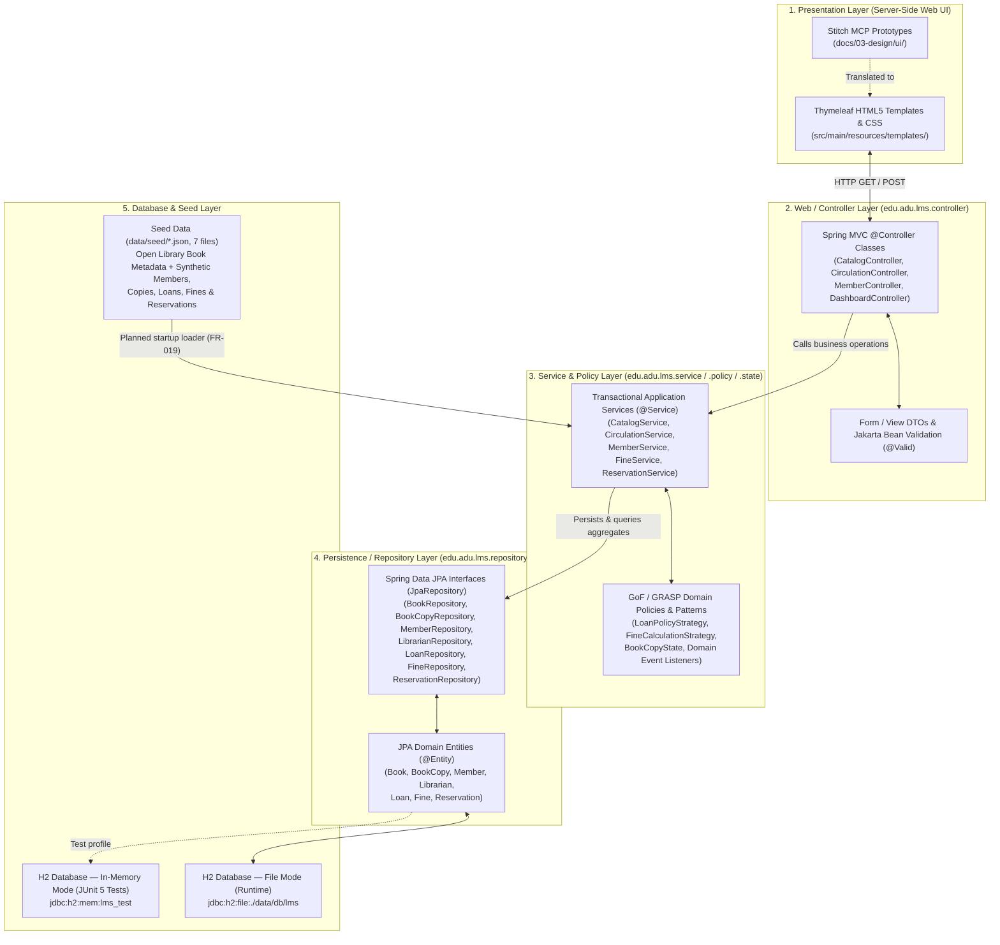
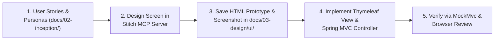

<!--
  Name(s) Surname(s) : Ibrahim Temur, Omer Faruk Kuş
  Student No(s)#: 231805033, 231805026
  General Comments: Technical solution outline covering layered web architecture, technology stack, Stitch MCP UI workflow, Open Library + synthetic data strategy, candidate GoF/GRASP design patterns, and the test strategy.
-->
# Solution Outline — Library Management System (LMS)

- **Course:** CSE305 Software Engineering — Adnan Menderes University (ADU), Department of Computer Engineering
- **Project Title:** Library Management System (LMS)
- **Team Members:**
  - **Ibrahim Temur** — Student No: `231805033` (Product Owner)
  - **Omer Faruk Kuş** — Student No: `231805026` (Scrum Master)
- **Base Package:** `edu.adu.lms`
- **Document Version:** `1.2` (2026-10-30)
- **Part of:** [`HW01_Problem_Solution_DomainModel.md`](HW01_Problem_Solution_DomainModel.md) (single HW01 submission document); companion: [`PROJECT_PROPOSAL.md`](PROJECT_PROPOSAL.md)

> [!NOTE]
> This outline describes the planned solution. Items that are **not yet implemented** (for example the security dependency, the seed loader, or any `edu.adu.lms` domain class) are explicitly marked *planned*. Business rules (`BR-*`) are defined in [`BUSINESS_RULES.md`](../02-inception/BUSINESS_RULES.md); this outline references them and must not contradict them.

---

## 1. Layered Web Architecture

The Library Management System follows a strict five-tier **Layered Web Architecture** (`Thymeleaf UI -> Controller -> Service -> Repository -> H2`) to enforce separation of concerns, high cohesion, low coupling, and isolated testability across tiers (`NFR-010`).

### Layer Responsibilities & Boundaries
1. **Presentation Layer (`src/main/resources/templates/`, `static/`):**
   - Renders dynamic HTML5 views using **Thymeleaf** fragments (navigation bar, status badges, pagination, validation error banners).
   - Contains zero business logic or direct database queries; all state changes occur via standard HTTP `POST` form submissions to Spring MVC controllers.
2. **Controller Layer (`edu.adu.lms.controller`, `edu.adu.lms.dto`):**
   - Implements the **GRASP Controller** pattern: receives HTTP requests, binds and validates request payloads using Jakarta Bean Validation (`@Valid`), invokes the appropriate transactional service method, and populates the Spring `Model` or `RedirectAttributes` for the view.
3. **Service & Policy Layer (`edu.adu.lms.service`, `edu.adu.lms.policy`, `edu.adu.lms.state`):**
   - Houses core domain rules, transactional boundaries (`@Transactional`, `NFR-003`), borrowing eligibility checks (`BR-002`, `BR-006`, `BR-011`), state transitions (`BR-017`), and overdue fine calculations (`BR-007`..`BR-009`).
   - Coordinates GoF design pattern collaborators (*Strategy*, *State*, *Observer*, *Factory/Builder*) so business policies remain modular and unit-testable without starting a web server or database.
4. **Repository & Entity Layer (`edu.adu.lms.repository`, `edu.adu.lms.entity`):**
   - Maps the persistent domain concepts (`Book`, `BookCopy`, `Member`, `Librarian`, `Loan`, `Fine`, `Reservation` — the conceptual classes of the Domain Model in Part 3 of the HW01 document) to relational tables via JPA/Hibernate annotations and exposes type-safe query methods through Spring Data JPA `JpaRepository` interfaces.
5. **Database Layer (`H2 Database`):**
   - Uses embedded **H2** in persistent file mode (`./data/db/lms`) during local development/demos so data survives application restarts, and switches automatically to isolated in-memory mode (`jdbc:h2:mem:lms_test`) during `mvn test`.

---

## 2. Technology Stack

| Component | Technology / Version | Status | Architectural Justification |
|---|---|---|---|
| **Language** | **Java 17** (`--release 17`, compiled on JDK 25 LTS) | In `pom.xml` | Long-Term Support (LTS) baseline required by Spring Boot 3.x; offers records, sealed classes, pattern matching, and strong static typing. |
| **Application Framework** | **Spring Boot `3.5.16`** | In `pom.xml` | Provides production-grade dependency injection, declarative transactions, Spring MVC, and zero-boilerplate configuration. |
| **View Engine** | **Spring MVC + Thymeleaf** (`spring-boot-starter-thymeleaf`) | In `pom.xml` | Natural HTML5 templating that allows Stitch MCP HTML prototypes to be converted directly into server-rendered templates with minimal friction. |
| **Persistence & ORM** | **Spring Data JPA / Hibernate** (`spring-boot-starter-data-jpa`) | In `pom.xml` | Clean repository abstraction, automatic schema generation, and rich entity lifecycle management. |
| **Validation** | **Jakarta Bean Validation** (`spring-boot-starter-validation`) | In `pom.xml` | Declarative input validation (`@NotBlank`, `@Pattern`, `@Positive`, custom ISBN/barcode validators) at controller and entity boundaries (`NFR-007`). |
| **Authentication & Authorization** | **Spring Security** (`spring-boot-starter-security`, BCrypt password hashing) | *Planned — not yet in `pom.xml`; added in the authentication story* | Required by `FR-016`, `FR-017`, `NFR-007`, and `NFR-008`: role-based access (`ROLE_LIBRARIAN`, `ROLE_MEMBER`, `ROLE_GUEST`) and BCrypt-hashed demo passwords seeded at startup (`ASSUMPTION-16`). |
| **Database** | **H2 Database** (`com.h2database:h2`) | In `pom.xml` | Zero-install embedded SQL database supporting both persistent file storage (`./data/db/lms`) and fast, isolated in-memory test execution (`mem:lms_test`). |
| **Build & Packaging** | **Apache Maven `3.9.16`** + Maven Wrapper (`mvnw` / `mvnw.cmd`) | Working | Standardized build lifecycle (`mvn test`, `mvn package`) with wrapper scripts ensuring reproducible builds on any machine. |
| **Automated Testing (Java)** | **JUnit 5 + Mockito + Spring Boot Test / MockMvc** (`spring-boot-starter-test`) | In `pom.xml` | Full support for TDD across unit tests, `@DataJpaTest` repository slice tests, and `@WebMvcTest` / `@SpringBootTest` integration tests. |
| **Seed Data Tooling** | **Python 3.11** scripts in `tools/data/` (Open Library fetcher, `Faker` with the `tr_TR` locale, `unittest` suite with 80 offline checks) | Working | Reproducible, offline-verifiable generation and validation of `data/seed/*.json` (`NFR-011`). |
| **UI Design Tooling** | **Stitch MCP Server** | Working | AI-assisted UI-first design workflow generating structured HTML prototypes and visual references before coding templates (`NFR-001`). |

---

## 3. UI-First Design Workflow (Stitch MCP)

In accordance with `AGENTS.md` (Section 6), no Thymeleaf screen is coded ad-hoc. Every user interface screen follows a strict **UI-First Design Pipeline**:

### Planned Core UI Screens (`docs/03-design/ui/`)
1. **Login (`UC-02`):** Librarian (`username`) or Member (`memberId` / e-mail) sign-in and sign-out.
2. **Public / Member Catalog & Book Detail View (`UC-01`):** Search bar (title, author, ISBN, category), availability badges (`AVAILABLE`, `ALL COPIES UNAVAILABLE`, `REFERENCE ONLY`), copy table, and "Reserve Book" action (`UC-08`).
3. **Librarian Circulation Desk (`UC-05`, `UC-06`, `UC-07`):** Fast lookup by `memberId` and copy barcode, real-time eligibility check banner (quota, blocks, cooldown, reference-only), due-date preview, and one-click return/renewal processing with hold-shelf prompt.
4. **Catalog & Physical Copy Management (`UC-03`):** Book creation/editing form (with optional Open Library ISBN metadata lookup) and physical copy status management (`AVAILABLE`, `MAINTENANCE`, `LOST`).
5. **Member Management & Profile View (`UC-04`):** Synthetic member directory with the three member types, borrowing quota indicator, active loans list, loan history, and unpaid fine settlement controls.
6. **Member Self-Service Portal (`UC-10`):** Own loans and due dates, renewal action, fines, reservations with queue position, and in-app hold-ready notifications.
7. **Fines & Lost-Book Desk (`UC-09`):** Mark fines `PAID` or `WAIVED`, record a lost-book petition.
8. **Librarian Operational Dashboard & Overdue Report (`UC-11`):** High-level KPI cards (Total Titles, Total Copies by state, Active Loans, Overdue Loans, Unpaid Fines) and prioritized overdue table.

---

## 4. Data Strategy & Privacy Compliance

To make the system realistic during demonstrations while strictly enforcing academic privacy and data protection rules (`AGENTS.md` Section 7), the project employs a hybrid **Real Bibliographic Metadata + 100% Synthetic Operational Data** strategy. The pipeline is documented in [`data/README.md`](../../data/README.md) and is already implemented and tested (feature `M6`).

### 4.1 Real Bibliographic Metadata via Open Library
- **Source:** Public **Open Library Search API** (`https://openlibrary.org/search.json`); the raw responses are cached in the git-ignored folder `data/raw/openlibrary/`. Open Library catalog data is treated as CC0/public domain (see `data/README.md` §4). Cover images are **not** downloaded; only `coverId` and the derived `coverUrl` are stored.
- **Captured fields:** `isbn13`, `title`, `subtitle`, `authors`, `publisher`, `firstPublishYear`, `category` (one of 11), `subjects`, `pageCount` (work-level median), `coverId`, `coverUrl`, `openLibraryWorkKey`, and the boolean `referenceOnly`.
- **Offline-first snapshot:** `data/seed/books-openlibrary.json` holds 782 books (3 of them `referenceOnly`: non-circulating encyclopedias/dictionaries/catalogs, `BR-014`), so application startup and tests need no internet connection (`NFR-004`, `RISK-03`).

### 4.2 Strictly Synthetic Operational Data
- **Zero Real Personal Data:** No real ADU student or staff names, student numbers, national ID numbers (TCKN), phone numbers, or real e-mails exist in the repository. No passwords and no book price appraisals are stored in the seed files (`BR-018`, `ASSUMPTION-15`, `ASSUMPTION-16`).
- **Identifier and e-mail conventions (`ASSUMPTION-08`, `ASSUMPTION-17`):** members `SYN-STU-0001`.. (`STUDENT`), `SYN-STF-0001`.. (`ACADEMIC_STAFF`), `SYN-ADM-0001`.. (`ADMINISTRATIVE_STAFF`) with e-mails such as `syn-stu-0001@synthetic.lms.local`; librarians `syn-lib-0001`..; copy barcodes `LMS-COPY-1001`..; loans `LOAN-0001`..; fines `FINE-0001`..; reservations `RES-0001`...
- **Circulation & fines:** pre-configured synthetic loans spanning active on-time loans, due-soon loans, overdue loans (with deterministic fines `0.25 * overdueDays` and no cap), returned historical loans, `LOST` loans (fine frozen on `lostReportedOn`), and FIFO hold queues (`READY` holds with `readyOn` and `holdUntil = readyOn + 3 days`).

### 4.3 Seed Files (`data/seed/`, `REFERENCE_DATE = 2026-10-22`)

| File | Rows | Content |
|---|---:|---|
| `books-openlibrary.json` | 782 | Real Open Library books (3 `referenceOnly`) |
| `members.json` | 60 | 40 `STUDENT`, 10 `ACADEMIC_STAFF`, 10 `ADMINISTRATIVE_STAFF` |
| `librarians.json` | 3 | `ROLE_LIBRARIAN` accounts without any credential field |
| `copies.json` | 1,706 | Physical copies, 1 to 4 per title (`ASSUMPTION-09`) |
| `loans.json` | 164 | `ACTIVE`, `RETURNED`, and `LOST` loans |
| `fines.json` | 47 | Overdue fines, at most one per loan |
| `reservations.json` | 22 | `WAITING` and `READY` holds across 12 titles |

All files are UTF-8 (no BOM) with LF line endings, each a JSON array of objects; dates are ISO-8601 `YYYY-MM-DD`; `null` means "not applicable"; records reference each other by natural keys; `fines.json` stores `amount` as a two-decimal string to preserve the `BigDecimal` scale. Because JSON cannot hold comments, these generated files carry no file header (documented exception in `AGENTS.md` §2). Generation is deterministic (`RANDOM_SEED = 20261022`); seed dates are relative to `REFERENCE_DATE`, and shifting them to the application start date is tracked as `OPEN-04` for the planned seed loader (`FR-019`).

---

## 5. Initial List of Expected Design Patterns (GoF & GRASP)

In compliance with `AGENTS.md` (Section 4), design patterns are selected to solve concrete domain variations in library circulation rather than being forced artificially. Full UML class/sequence diagrams and pattern rationales will be elaborated in `docs/03-design/` (HW03). The conceptual **Domain Model** (Part 3 of the HW01 document) deliberately contains none of these design-level classes.

### 5.1 Gang of Four (GoF) Patterns

| Pattern Name | Category | Target Domain Area | Architectural Rationale & Problem Solved |
|---|---|---|---|
| **1. Strategy Pattern** | Behavioral | `LoanPolicyStrategy` & `FineCalculationStrategy` | **Problem:** Borrowing quotas (`7` for `ACADEMIC_STAFF`, `3` for `ADMINISTRATIVE_STAFF` and `STUDENT`, `BR-002`), loan periods (`BR-003`), and the overdue fine tariff (`BR-008`, `BR-009`) are institutional policy parameters that may change. **Solution:** Encapsulate lending and fine algorithms behind `LoanPolicyStrategy` and `FineCalculationStrategy` interfaces (`AcademicStaffLoanPolicy`, `AdministrativeStaffLoanPolicy`, `StudentLoanPolicy`, `StandardDailyFineStrategy`), allowing `CirculationService` and `FineService` to compute limits, due dates, and fines polymorphically without conditional `if/else` chains. **Honest note:** the loan period is identical for all member types, so only the quota differs today; the pattern is justified by *protected variations* (policy change). If the HW03 design shows that a simple parameter table is sufficient, the pattern will be simplified rather than forced. |
| **2. State Pattern** | Behavioral | `BookCopy` Lifecycle (`BookCopyState`) | **Problem:** A physical `BookCopy` transitions through strict states (`AVAILABLE`, `LOANED`, `RESERVED`, `MAINTENANCE`, `LOST`, `BR-017`). Illegal transitions (e.g., checking out a `LOST` or already `LOANED` copy) corrupt inventory integrity. **Solution:** Model copy lifecycle behavior using the State pattern (or state-driven transition objects) so each state explicitly validates allowed operations (`checkout()`, `returnCopy()`, `markHold()`, `markLost()`) and throws a domain exception on invalid transitions (`FR-005`). |
| **3. Observer Pattern** | Behavioral | Circulation Events (`BookReturnedEvent`, `LoanOverdueEvent`) | **Problem:** Returning a book copy must not only close the `Loan` record, but also check the reservation queue, allocate the copy to the next waiting member (`BR-012`, `BR-013`), and record an in-app notification—without tightly coupling `CirculationService` to `ReservationService` and `NotificationService`. **Solution:** Publish domain events via Spring's event mechanism (Observer pattern) when a copy is returned or becomes overdue, allowing independent listeners to update reservation holds and notifications (`FR-022`). |
| **4. Factory Method / Builder Pattern** | Creational | `LoanFactory` & Domain Aggregate Builders | **Problem:** Creating a valid `Loan` or `Fine` requires assembling multiple invariants (resolved `LoanPolicyStrategy`, calculated `dueDate`, initial `LoanStatus.ACTIVE`, copy state transition) and constructing expressive test fixtures in JUnit 5. **Solution:** Use a dedicated factory/builder to guarantee that newly instantiated `Loan`, `Fine`, and test aggregates always satisfy domain invariants upon creation. |
| **5. Adapter / Facade Pattern** | Structural | `OpenLibraryCatalogAdapter` | **Problem:** External JSON payloads from the Open Library API use nested, third-party schemas that should never leak into our internal JPA entities or controllers. **Solution:** Wrap Open Library data ingestion (both offline JSON seed parsing and optional live ISBN lookup, `FR-031`) behind an Adapter/Facade that translates external bibliographic structures into clean internal `BookMetadataDto` / `Book` domain objects. |

### 5.2 GRASP Principles Applied

| GRASP Principle | Application in LMS Architecture |
|---|---|
| **Information Expert** | Domain entities hold the methods that operate directly on their own state—for example, `Loan.isOverdue(LocalDate today)` and `Loan.getOverdueDays(LocalDate today)` live on `Loan`, while `Member.hasReachedLoanLimit(int maxAllowed)` lives on `Member`. |
| **Creator** | `Book` acts as the natural creator/owner of its `BookCopy` instances, and `CirculationService` / `LoanFactory` creates `Loan` instances because it aggregates the `Member`, `BookCopy`, and `LoanPolicyStrategy`. |
| **Controller** | Spring MVC `@Controller` classes act purely as system-event coordinators at the HTTP boundary, delegating all business work to `@Service` classes. |
| **Low Coupling & High Cohesion** | Each service (`CatalogService`, `CirculationService`, `MemberService`, `FineService`, `ReservationService`) focuses on a single bounded responsibility and communicates via well-defined interfaces and domain events. |
| **Polymorphism & Protected Variations** | Wrapping policy parameters (borrowing quota, loan period, daily fine rate) inside `LoanPolicyStrategy` and `FineCalculationStrategy` shields the core circulation engine from policy changes. |

---

## 6. Verification & TDD Strategy

Every architectural layer is verified continuously via `mvn test` (`.\mvnw.cmd test`), and the seed data is verified by the offline Python suite (`tools\data\.venv\Scripts\python.exe -m unittest discover -s tools\data\tests`, 80 checks):
1. **Domain & Pattern Unit Tests (`src/test/java/edu/adu/lms/...`):** Fast, zero-Spring-context JUnit 5 tests verifying `FineCalculationStrategy`, `LoanPolicyStrategy`, `BookCopy` state transitions, and boundary conditions (e.g., `0` days overdue on the exact due date versus `1` day overdue the next day, quota boundaries `3` and `7`, the `0.25 TRY/day` arithmetic with no upper cap, the 30-day post-renewal cooldown boundary, and the fine freeze on `lostReportedOn`).
2. **Repository Slice Tests (`@DataJpaTest`):** Validate entity mappings, unique constraints (ISBN-13, copy barcode, `memberId`, `username`), and custom finder queries against in-memory H2 (`jdbc:h2:mem:lms_test`).
3. **Service & Controller Integration Tests (`@SpringBootTest`, `@WebMvcTest`):** Verify end-to-end checkout, return, overdue block enforcement, reservation queue promotion, role-based access, and HTTP view rendering with MockMvc.

### 6.1 Agentic Development & Verification Governance
Development is executed through an AI-assisted, human-governed workflow governed by [`AGENTS.md`](../../AGENTS.md). AI agents operate under explicit engineering hats (*Product Owner*, *Architect*, *Developer*, *QA Engineer*, *Reviewer*) following the `Plan -> Execute -> Record` cadence to draft documentation, prototype UI screens in **Stitch MCP**, and generate TDD test suites and Spring Boot code, while all scope, prioritization, business rule (`ASSUMPTION`), acceptance, and `main`-branch merge decisions remain strictly with the human team. Every increment is gated by passing `mvn test` execution, a separate cross-model `Reviewer` pass (using a different model than the authoring model), human inspection, and full audit logging in [`docs/process/ai-usage-log.md`](../process/ai-usage-log.md) to mitigate AI hallucination and over-reliance risks.

---

## 7. Revision History

| Version | Date | Summary |
|---|---|---|
| `1.0` | 2026-10-21 | First solution outline: layered architecture, technology stack, UI-first workflow, data strategy, candidate patterns. |
| `1.1` | 2026-10-22 | Added the agentic development and verification governance section. |
| `1.2` | 2026-10-30 | Aligned with confirmed ADU rules and seed v2 (member types, seed files, patterns, tests), planned security dependency made explicit, schedule updated. |
