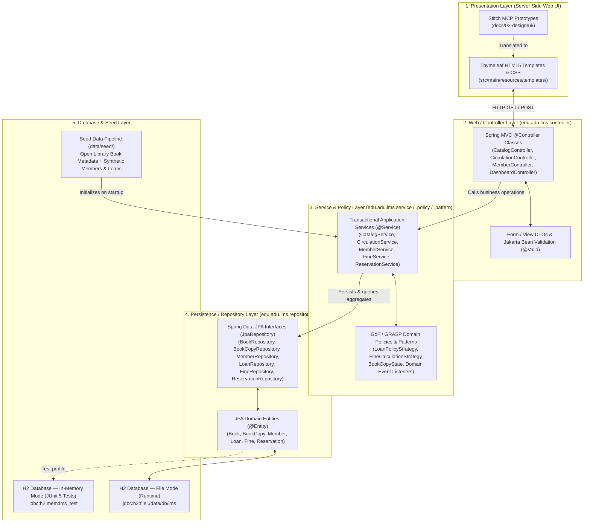
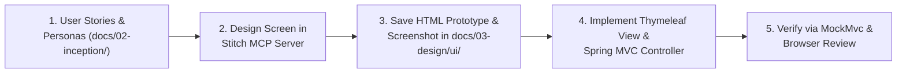

<!--
  Name(s) Surname(s) : Ibrahim Temur, Omer Faruk Kuş
  Student No(s)#: 231805033, 231805026
  General Comments: Technical solution outline covering layered web architecture, technology stack, Stitch MCP UI workflow, Open Library + synthetic data strategy, and candidate GoF/GRASP design patterns.
-->
# Solution Outline — Library Management System (LMS)

- **Course:** CSE305 Software Engineering — Adnan Menderes University (ADU), Department of Computer Engineering
- **Project Title:** Library Management System (LMS)
- **Team Members:**
  - **Ibrahim Temur** — Student No: `231805033`
  - **Omer Faruk Kuş** — Student No: `231805026`
- **Base Package:** `edu.adu.lms`
- **Document Version:** `1.1` (2026-10-22)

---

## 1. Layered Web Architecture

The Library Management System follows a strict five-tier **Layered Web Architecture** (`Thymeleaf UI -> Controller -> Service -> Repository -> H2`) to enforce separation of concerns, high cohesion, low coupling, and isolated testability across tiers.

### Layer Responsibilities & Boundaries
1. **Presentation Layer (`src/main/resources/templates/`, `static/`):**
   - Renders dynamic HTML5 views using **Thymeleaf** fragments (navigation bar, status badges, pagination, validation error banners).
   - Contains zero business logic or direct database queries; all state changes occur via standard HTTP `POST` form submissions to Spring MVC controllers.
2. **Controller Layer (`edu.adu.lms.controller`, `edu.adu.lms.dto`):**
   - Implements the **GRASP Controller** pattern: receives HTTP requests, binds and validates request payloads using Jakarta Bean Validation (`@Valid`), invokes the appropriate transactional service method, and populates the Spring `Model` or `RedirectAttributes` for the view.
3. **Service & Policy Layer (`edu.adu.lms.service`, `edu.adu.lms.policy`, `edu.adu.lms.state`):**
   - Houses core domain rules, transactional boundaries (`@Transactional`), borrowing eligibility checks, state transitions, and overdue fine calculations.
   - Coordinates GoF design pattern collaborators (*Strategy*, *State*, *Observer*, *Factory/Builder*) so business policies remain modular and unit-testable without starting a web server or database.
4. **Repository & Entity Layer (`edu.adu.lms.repository`, `edu.adu.lms.entity`):**
   - Maps domain aggregates (`Book`, `BookCopy`, `Member`, `Loan`, `Fine`, `Reservation`) to relational tables via JPA/Hibernate annotations and exposes type-safe query methods through Spring Data JPA `JpaRepository` interfaces.
5. **Database Layer (`H2 Database`):**
   - Uses embedded **H2** in persistent file mode (`./data/db/lms`) during local development/demos so data survives application restarts, and switches automatically to isolated in-memory mode (`jdbc:h2:mem:lms_test`) during `mvn test`.

---

## 2. Technology Stack

| Component | Technology / Version | Architectural Justification |
|---|---|---|
| **Language** | **Java 17** (`--release 17`, compiled on JDK 25 LTS) | Long-Term Support (LTS) baseline required by Spring Boot 3.x; offers records, sealed classes, pattern matching, and strong static typing. |
| **Application Framework** | **Spring Boot `3.5.16`** | Provides production-grade dependency injection, declarative transactions, Spring MVC, and zero-boilerplate configuration. |
| **View Engine** | **Spring MVC + Thymeleaf** (`spring-boot-starter-thymeleaf`) | Natural HTML5 templating that allows Stitch MCP HTML prototypes to be converted directly into server-rendered templates with minimal friction. |
| **Persistence & ORM** | **Spring Data JPA / Hibernate** (`spring-boot-starter-data-jpa`) | Clean repository abstraction, automatic schema generation, and rich entity lifecycle management. |
| **Validation** | **Jakarta Bean Validation** (`spring-boot-starter-validation`) | Declarative input validation (`@NotBlank`, `@Pattern`, `@Positive`, custom ISBN/barcode validators) at controller and entity boundaries. |
| **Database** | **H2 Database** (`com.h2database:h2`) | Zero-install embedded SQL database supporting both persistent file storage (`./data/db/lms`) and fast, isolated in-memory test execution (`mem:lms_test`). |
| **Build & Packaging** | **Apache Maven `3.9.16`** + Maven Wrapper (`mvnw` / `mvnw.cmd`) | Standardized build lifecycle (`mvn test`, `mvn package`) with wrapper scripts ensuring reproducible builds on any machine. |
| **Automated Testing** | **JUnit 5 + Mockito + Spring Boot Test / MockMvc** | Full support for TDD across unit tests, `@DataJpaTest` repository slice tests, and `@WebMvcTest` / `@SpringBootTest` integration tests. |
| **UI Design Tooling** | **Stitch MCP Server** | AI-assisted UI-first design workflow generating structured HTML prototypes and visual references before coding templates. |

---

## 3. UI-First Design Workflow (Stitch MCP)

In accordance with `AGENTS.md` (Section 6), no Thymeleaf screen is coded ad-hoc. Every user interface screen follows a strict **UI-First Design Pipeline**:

### Planned Core UI Screens (`docs/03-design/ui/`)
1. **Public / Member Catalog & Book Detail View:** Search bar (title, author, ISBN, category), availability badges (`AVAILABLE`, `ALL COPIES LOANED`), copy table, and "Reserve Book" action.
2. **Librarian Circulation Desk (Checkout & Return):** Fast lookup by member number and copy barcode, real-time eligibility check banner, due-date preview, and one-click return/renewal processing.
3. **Catalog & Physical Copy Management (Librarian):** Book creation/editing form (with optional Open Library ISBN metadata lookup) and physical copy status management (`AVAILABLE`, `MAINTENANCE`, `LOST`).
4. **Member Management & Profile View:** Synthetic member directory, borrowing quota indicator, active loans list, loan history, and unpaid fine settlement controls.
5. **Librarian Operational Dashboard & Overdue Report:** High-level KPI cards (Total Titles, Total Copies, Active Loans, Overdue Loans, Unpaid Fines) and prioritized overdue table.

---

## 4. Data Strategy & Privacy Compliance

To make the system realistic during demonstrations while strictly enforcing academic privacy and data protection rules (`AGENTS.md` Section 7), the project employs a hybrid **Real Bibliographic Metadata + 100% Synthetic Operational Data** strategy:

### 4.1 Real Bibliographic Metadata via Open Library API
- **Source:** Public **Open Library API** (`https://openlibrary.org/api/books`, Search & Covers APIs).
- **Captured Fields:** `ISBN-13`, `Title`, `Subtitle`, `Authors`, `Publisher`, `Publication Year`, `Subject / Category`, `Page Count`, and `Cover URL`.
- **Offline-First Seed Caching (`data/seed/`):**
  - Rather than requiring a live internet connection on every boot or test run, a curated catalog of real computer science, engineering, and literature books fetched from Open Library is stored in versioned seed files under `data/seed/` (e.g., `data/seed/books-openlibrary.json`).
  - **ASSUMPTION (`ASSUMPTION-09`):** Each seeded book title is initialized with **1 to 4 physical copies (`BookCopy`)** assigned deterministic synthetic barcode identifiers (e.g., `LMS-COPY-1001`) so multi-copy lending and reservation queues can be demonstrated immediately.

### 4.2 Strictly Synthetic Operational Data (`data/seed/`)
- **Zero Real Personal Data:** No real Adnan Menderes University (ADU) student names, real student ID numbers, national ID numbers (TCKN), personal phone numbers, or real emails are ever stored in the repository or database.
- **Synthetic Entities:**
  - **Members:** Clearly fictional student and academic staff profiles (e.g., synthetic IDs such as `SYN-STU-0001`, `@synthetic.lms.local` email addresses, and fictional names).
  - **Circulation & Fines:** Pre-configured synthetic loans spanning active on-time loans, due-soon loans, overdue loans (triggering deterministic fine calculations), completed historical loans, and active hold queues.

---

## 5. Initial List of Expected Design Patterns (GoF & GRASP)

In compliance with `AGENTS.md` (Section 4), design patterns are selected to solve concrete domain variations in library circulation rather than being forced artificially. Full UML class/sequence diagrams and pattern rationales will be elaborated in `docs/03-design/`.

### 5.1 Gang of Four (GoF) Patterns

| Pattern Name | Category | Target Domain Area | Architectural Rationale & Problem Solved |
|---|---|---|---|
| **1. Strategy Pattern** | Behavioral | `LoanPolicyStrategy` & `FineCalculationStrategy` | **Problem:** Borrowing limits, loan durations (`14` vs. `30` days), and overdue fine calculations vary by member type (`STUDENT` vs. `ACADEMIC_STAFF`) or institutional policy (`ASSUMPTION-02`..`05`). **Solution:** Encapsulate lending and fine algorithms behind `LoanPolicyStrategy` and `FineCalculationStrategy` interfaces (`StudentLoanPolicy`, `AcademicStaffLoanPolicy`, `StandardDailyFineStrategy`), allowing `CirculationService` and `FineService` to compute due dates and fines polymorphically without conditional `if/else` chains. |
| **2. State Pattern** | Behavioral | `BookCopy` Lifecycle (`BookCopyState`) | **Problem:** A physical `BookCopy` transitions through strict states (`AVAILABLE`, `LOANED`, `RESERVED`, `MAINTENANCE`, `LOST`). Illegal transitions (e.g., checking out a `LOST` or already `LOANED` copy) corrupt inventory integrity. **Solution:** Model copy lifecycle behavior using the State pattern (or state-driven transition objects) so each state explicitly validates allowed operations (`checkout()`, `returnCopy()`, `markHold()`, `markLost()`) and throws a domain exception on invalid transitions. |
| **3. Observer Pattern** | Behavioral | Circulation Events (`BookReturnedEvent`, `LoanOverdueEvent`) | **Problem:** Returning a book copy must not only close the `Loan` record, but also check the reservation queue, allocate the copy to the next waiting member (`ASSUMPTION-07`), and record a notification—without tightly coupling `CirculationService` to `ReservationService` and `NotificationService`. **Solution:** Publish domain events via Spring's event mechanism (Observer pattern) when a copy is returned or becomes overdue, allowing independent listeners to update reservation holds and audit notifications. |
| **4. Factory Method / Builder Pattern** | Creational | `LoanFactory` & Domain Aggregate Builders | **Problem:** Creating a valid `Loan` or `Fine` requires assembling multiple invariants (resolved `LoanPolicyStrategy`, calculated `dueDate`, initial `LoanStatus.ACTIVE`, copy state transition) and constructing expressive test fixtures in JUnit 5. **Solution:** Use a dedicated factory/builder to guarantee that newly instantiated `Loan`, `Fine`, and test aggregates always satisfy domain invariants upon creation. |
| **5. Adapter / Facade Pattern** | Structural | `OpenLibraryCatalogAdapter` | **Problem:** External JSON payloads from the Open Library API use nested, third-party schemas that should never leak into our internal JPA entities or controllers. **Solution:** Wrap Open Library data ingestion (both offline JSON seed parsing and optional live ISBN lookup) behind an Adapter/Facade that translates external bibliographic structures into clean internal `BookMetadataDto` / `Book` domain objects. |

### 5.2 GRASP Principles Applied

| GRASP Principle | Application in LMS Architecture |
|---|---|
| **Information Expert** | Domain entities hold the methods that operate directly on their own state—for example, `Loan.isOverdue(LocalDate today)` and `Loan.getOverdueDays(LocalDate today)` live on `Loan`, while `Member.hasReachedLoanLimit(int maxAllowed)` lives on `Member`. |
| **Creator** | `Book` acts as the natural creator/owner of its `BookCopy` instances, and `CirculationService` / `LoanFactory` creates `Loan` instances because it aggregates the `Member`, `BookCopy`, and `LoanPolicyStrategy`. |
| **Controller** | Spring MVC `@Controller` classes act purely as system-event coordinators at the HTTP boundary, delegating all business work to `@Service` classes. |
| **Low Coupling & High Cohesion** | Each service (`CatalogService`, `CirculationService`, `MemberService`, `FineService`, `ReservationService`) focuses on a single bounded responsibility and communicates via well-defined interfaces and domain events. |
| **Polymorphism & Protected Variations** | Wrapping `ASSUMPTION`-tagged policy parameters (loan duration, max books, daily fine rate) inside `LoanPolicyStrategy` and `FineCalculationStrategy` shields the core circulation engine from policy changes. |

---

## 6. Verification & TDD Strategy

Every architectural layer is verified continuously via `mvn test` (`.\mvnw.cmd test`):
1. **Domain & Pattern Unit Tests (`src/test/java/edu/adu/lms/...`):** Fast, zero-Spring-context JUnit 5 tests verifying `FineCalculationStrategy`, `LoanPolicyStrategy`, `BookCopy` state transitions, and boundary conditions (e.g., `0` days overdue, exact due date, maximum fine cap).
2. **Repository Slice Tests (`@DataJpaTest`):** Validate entity mappings, unique constraints (ISBN, copy barcode, member number), and custom finder queries against in-memory H2 (`jdbc:h2:mem:lms_test`).
3. **Service & Controller Integration Tests (`@SpringBootTest`, `@WebMvcTest`):** Verify end-to-end checkout, return, overdue block enforcement, reservation queue promotion, and HTTP view rendering with MockMvc.

### 6.1 Agentic Development & Verification Governance
Development is executed through an AI-assisted, human-governed workflow governed by [`AGENTS.md`](../../AGENTS.md). AI agents operate under explicit engineering hats (*Product Owner*, *Architect*, *Developer*, *QA Engineer*, *Reviewer*) following the `Plan -> Execute -> Record` cadence to draft documentation, prototype UI screens in **Stitch MCP**, and generate TDD test suites and Spring Boot code, while all scope, prioritization, business rule (`ASSUMPTION`), acceptance, and `main`-branch merge decisions remain strictly with the human team. Every increment is gated by passing `mvn test` execution, a separate cross-model `Reviewer` pass (using a different model than the authoring model), human inspection, and full audit logging in [`docs/process/ai-usage-log.md`](../process/ai-usage-log.md) to mitigate AI hallucination and over-reliance risks.
