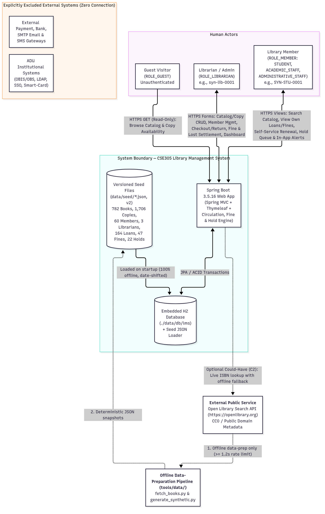
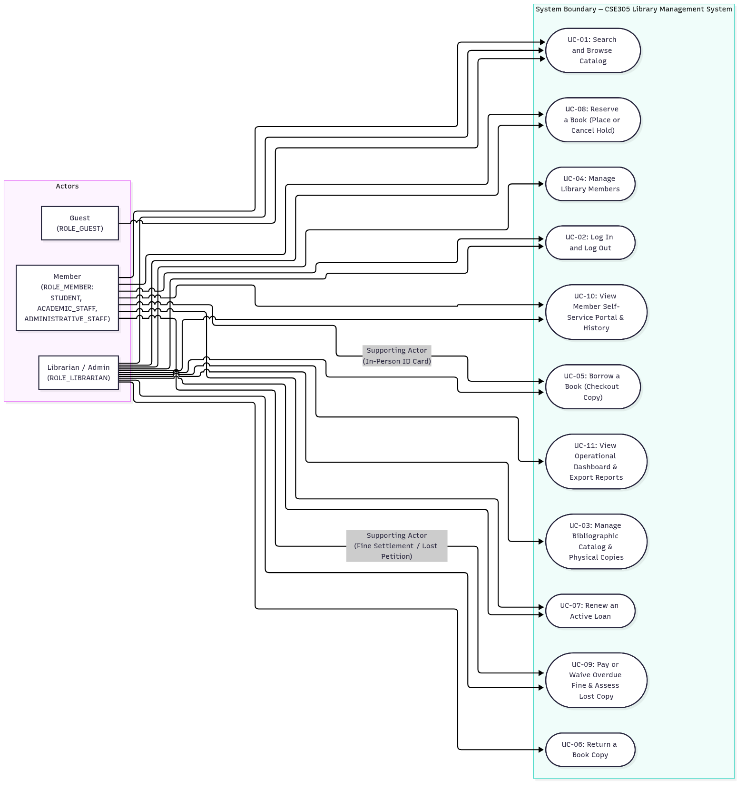
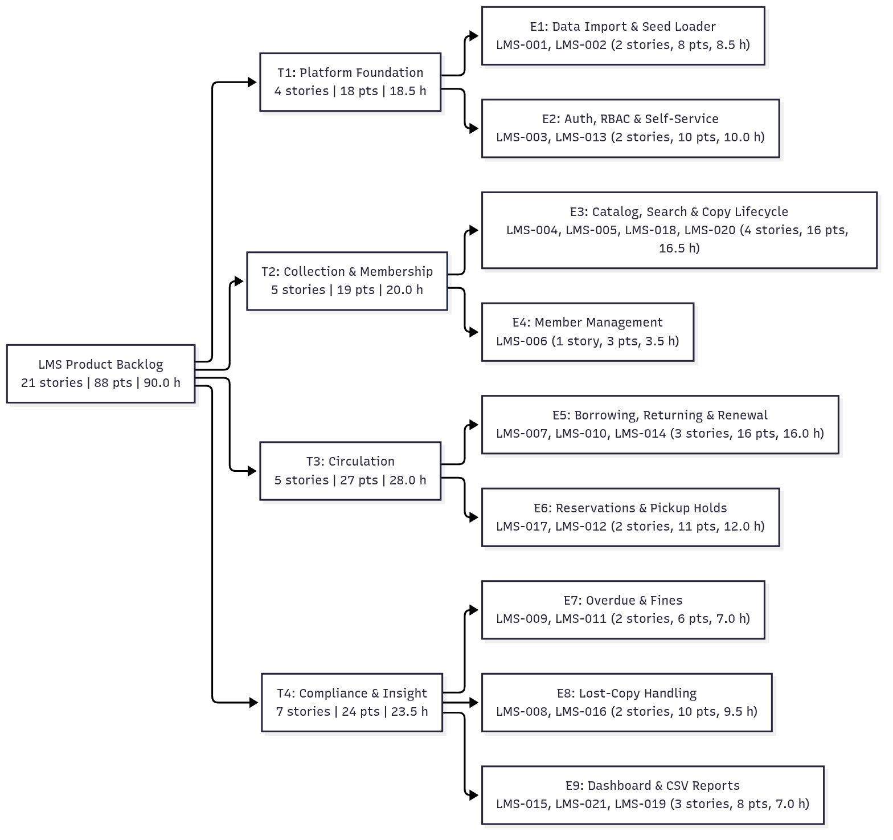
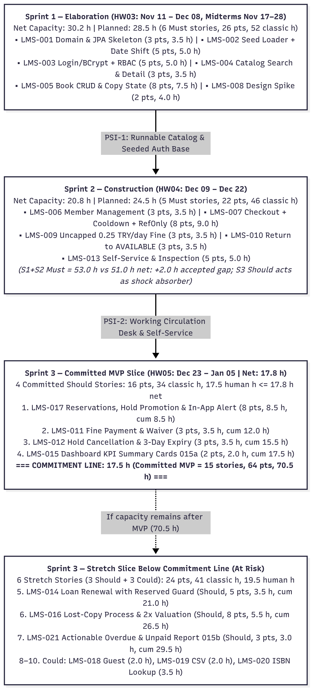
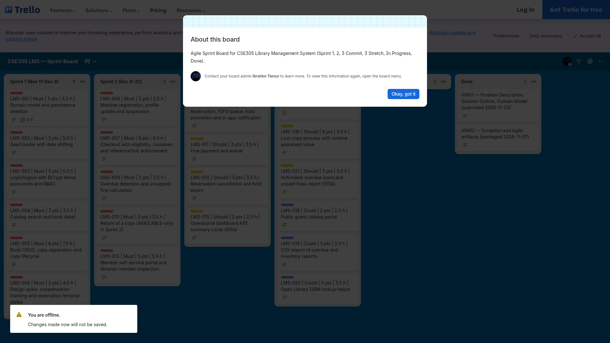

<!--
  Name(s) Surname(s) : Ibrahim Temur, Omer Faruk Kuş
  Student No(s)#: 231805033, 231805026
  General Comments: Consolidated HW02 submission document uniting the UP Inception Overview (Vision, Personas, Requirements, Business Rules, Use Cases, Glossary) and the Agile Scrum Product Backlog, Themes/Epics, User Stories, Tasks, Sprint Plan, and PSI/MVP definition for the CSE305 Library Management System.
-->
# HW02 — UP Inception Overview & Agile Scrum Product Backlog

## Library Management System (LMS)

| | |
|---|---|
| **Course** | CSE305 Software Engineering — Adnan Menderes University (ADU), Department of Computer Engineering |
| **Instructor** | Assoc. Prof. Dr. Fatih Soygazi |
| **Project** | Library Management System (LMS) |
| **Team & Scrum roles** | **Ibrahim Temur** (`231805033`) — Product Owner · **Omer Faruk Kuş** (`231805026`) — Scrum Master (both: Developer, Architect, QA, Reviewer) |
| **Document version** | `1.1` |
| **Document date** | 2026-11-11 |
| **Submission** | HW02 — due **2026-11-24 (extended from 2026-11-10)** (UP Inception + Agile Scrum Product Backlog & Iteration Plan) |
| **Archive** | `cse305_hw02_231805033_231805026.zip` (created with `python3 tools/package.py 02`) |
| **GitHub repository** | [`https://github.com/ibrahimtemur/cse305-library-management-system`](https://github.com/ibrahimtemur/cse305-library-management-system) |

> [!NOTE]
> **How to read this document.** Part 1 provides a self-contained executive consolidation of the Unified Process (UP) Inception artifacts and links to the authoritative detail files in `docs/02-inception/`: [`VISION_AND_CONTEXT.md`](VISION_AND_CONTEXT.md), [`PERSONAS.md`](PERSONAS.md), [`REQUIREMENTS.md`](REQUIREMENTS.md) (`FR-001`..`FR-032`, `NFR-001`..`NFR-012`, `CON-001`..`CON-006`, `DR-001`..`DR-007`), [`BUSINESS_RULES.md`](BUSINESS_RULES.md) (`BR-001`..`BR-018`), [`USE_CASES.md`](USE_CASES.md) (`UC-01`..`UC-11`), and [`DOMAIN_GLOSSARY.md`](DOMAIN_GLOSSARY.md). Part 2 presents the complete Agile Scrum deliverables: Themes & Epics ([`THEMES_EPICS.md`](THEMES_EPICS.md)), User Stories ([`USER_STORIES.md`](USER_STORIES.md), `LMS-001`..`LMS-021`), Ordered Product Backlog ([`PRODUCT_BACKLOG.md`](PRODUCT_BACKLOG.md)), Three-Sprint Iteration Plan ([`SPRINT_PLAN.md`](SPRINT_PLAN.md)), Task Breakdown ([`TASKS.md`](TASKS.md), `105` tasks), and Potentially Shippable Increment / MVP Definition ([`PSI_AND_MVP.md`](PSI_AND_MVP.md)). Every story point, classic hour, human hour, capacity calculation, commitment line, and traceability check is verified deterministically by [`tools/agile/validate_backlog.py`](../../tools/agile/validate_backlog.py).

**Contents:** [Part 1 — UP Inception Overview](#part-1--up-inception-overview) · [Part 2 — Agile Scrum Product Backlog & Iteration Plan](#part-2--agile-scrum-product-backlog-iteration-plan) · [Revision History](#revision-history)

---

# Part 1 — UP Inception Overview

## 1.1 Vision, Problem Recap, Goals & System Context

Full specification: [`VISION_AND_CONTEXT.md`](VISION_AND_CONTEXT.md).

### Product Vision Statement
**For** university, faculty, and departmental libraries that manage physical book collections for academic staff, administrative staff, and students, **who** struggle with error-prone manual ledgers, untracked physical book copies, inconsistent overdue penalty calculations, and lack of real-time shelf visibility, **the Library Management System (LMS)** is a self-contained, web-based library catalog and circulation management application **that** automates bibliographic cataloging, barcode-level physical copy lifecycle tracking (`AVAILABLE`, `LOANED`, `RESERVED`, `MAINTENANCE`, `LOST`), policy-driven lending and renewal rules, First-In-First-Out (FIFO) title reservation queues, and deterministic overdue fine calculation. **Unlike** informal spreadsheet tracking or heavyweight commercial integrated library systems requiring external institutional infrastructure, **our product** operates 100% offline out-of-the-box with an embedded H2 database seeded from public-domain Open Library metadata (`782` books, `1,706` physical copies) and strictly synthetic operational data (`60` members, `3` librarians, `164` loans, `47` fines, `22` reservations), enforcing the confirmed Adnan Menderes University (ADU) library lending rules through modular GoF/GRASP design patterns and a JUnit 5 Test-Driven Development (TDD) test suite.

### Problem Recap & Project Goals (`GOAL-01`..`GOAL-05`)
Small-to-medium academic libraries using paper logs or unvalidated spreadsheets face four bottlenecks: (1) clerical overhead and manual date/ID errors at checkout/return, (2) inability to distinguish shelf-available copies from loaned, reserved, maintenance, or lost copies (or non-circulating reference works), (3) inconsistent enforcement of member quotas (`7`/`3`/`3`), `0.25 TRY/day` fines, post-renewal cooldowns, and borrowing blocks, and (4) zero self-service visibility for members.

| Goal / Metric ID | Category | Summary Statement & Verification Basis |
|---|---|---|
| **`GOAL-01` / `MET-01`** | **Operational Automation & Policy Accuracy** | Replace manual ledgers with transactional checkout, return, renewal, reservation, and fine settlement governed by `BR-001`..`BR-018`. **Target (`ASSUMPTION`):** `100%` pass rate across JUnit 5 tests covering quotas (`7`/`3`/`3`), `30`-day periods, `0.25 TRY/day` uncapped fines, `30`-day post-renewal cooldown, and blocks. |
| **`GOAL-02` / `MET-02`** | **Copy-Level Inventory & State Integrity** | Track every physical `BookCopy` (`LMS-COPY-1001`..) via `BookCopyState` and block checkout of `referenceOnly` books (`BR-014`, `BR-017`). **Target (`ASSUMPTION`):** `0` illegal transitions or double-loaned copies; `100%` 1-to-1 invariant between `LOANED` copies and `ACTIVE` loans, and between `RESERVED` copies and `READY` holds. |
| **`GOAL-03` / `MET-03`** | **Self-Service & Local Query Latency** | Empower members to search the catalog, inspect loans/fines/cooldowns, renew, and place/cancel holds (`UC-01`, `UC-07`, `UC-08`, `UC-10`). **Target (`ASSUMPTION`):** `< 200 ms` local server response time on the reference workstation against the seeded H2 dataset (`NFR-005`). |
| **`GOAL-04` / `MET-04`** | **CSE305 Engineering Rigor & Startup Speed** | Apply UP modeling, Agile Scrum, UI-First prototyping via **Stitch MCP** (`NFR-001`), GoF/GRASP patterns (`NFR-010`), and TDD (`NFR-011`). **Target (`ASSUMPTION`):** `< 10 seconds` offline startup and seed initialization time with zero runtime internet calls (`NFR-004`, `NFR-006`). |
| **`GOAL-05` / `MET-05`** | **Offline Reproducibility & Synthetic Privacy** | `0` real personal names, student IDs, emails, or plaintext secrets in Git history; `100%` of seeded emails use `@synthetic.lms.local` and demo passwords are BCrypt-hashed at startup (`NFR-008`, `NFR-009`, `BR-018`). |

### System Scope & Explicit Exclusions
- **In Scope:** Printed books only (including non-circulating `referenceOnly` encyclopedias, dictionaries, and catalogs, `BR-014`); copy-level inventory (`1,706` seeded copies); synthetic `STUDENT`, `ACADEMIC_STAFF`, and `ADMINISTRATIVE_STAFF` members; desk checkout/return, self-service/desk renewal, `0.25 TRY/day` uncapped fine calculation, desk payment/waiver, lost-copy petition (`lostReportedOn`, fine freeze, 30-day replacement window, `2x` runtime `appraisedValue`), FIFO title reservation queue with 3-day pickup hold and in-app notification, librarian KPI dashboard, and Stretch enhancements (`ROLE_GUEST` portal, CSV export, live Open Library ISBN lookup helper).
- **Explicitly Out of Scope (`CON-002`..`CON-004`):** (1) **Periodicals/serials and unpublished theses** (although ADU regulations allow borrowing 2 non-latest periodical issues for 2 days and restrict unpublished theses, LMS manages books only); (2) **Live ADU OBIS/OBS, LDAP/SSO, or RFID/smart-card hardware** (personal ID card verification `BR-016` is performed by the Librarian at the desk using `memberId`); (3) **External payment/banking APIs and external SMTP email/SMS gateways** (fines are settled at the desk as `PAID`/`WAIVED`; hold-ready alerts are rendered in-app).

---

## 1.2 Stakeholders & User Personas

Full specification and circulation scenarios: [`PERSONAS.md`](PERSONAS.md). Every persona is anchored to real synthetic records in `data/seed/*.json`.

| # | Persona & Role | Member Type (`memberType`) | Representative Seed Record (`data/seed/*.json`) | Confirmed Quota (`BR-002`) | Confirmed Period (`BR-003`) | Core Operational / Self-Service Goals |
|---|---|---|---|---:|---:|---|
| **1** | **Librarian / Admin** (`ROLE_LIBRARIAN`) | Staff Account (`ASSUMPTION-01`) | `syn-lib-0001` (`Enginiz Yıldırım`) in `librarians.json` *(colleagues: `syn-lib-0002`, `syn-lib-0003`)* | N/A | N/A | Fast desk checkout/return by `memberId` & `barcode`, catalog/copy CRUD, member management, fine settlement/waiver (`settledBy`), lost-copy assessment, KPI dashboard (`UC-03`..`UC-07`, `UC-09`, `UC-11`). |
| **2** | **Student Member** (`ROLE_MEMBER`) | `STUDENT` | `SYN-STU-0001` (`Tutkucan Ergül`, Chemistry, `LOAN-0099`) & `SYN-STU-0003` (`Hazrat Yorulmaz`, Computer Eng., `RES-0009` `READY` on `LMS-COPY-1599`) | **3 books** | **30 days** | Search course textbooks, check availability & `referenceOnly` badges, view own active/historical loans, cooldowns & fines, renew once online, join FIFO hold queue (`UC-01`, `UC-07`, `UC-08`, `UC-10`). |
| **3** | **Academic Staff Member** (`ROLE_MEMBER`) | `ACADEMIC_STAFF` | `SYN-STF-0003` (`Atasagun Öcalan`, Computer Eng., `RES-0007`) & `SYN-STF-0002` (`Baydu Arsoy`, Mathematics, `RES-0001`) | **7 books** | **30 days** | Borrow up to `7` research titles simultaneously (`AcademicStaffLoanPolicy`), inspect copy counts for course reading lists, renew non-reserved titles, reserve high-demand literature (`UC-01`, `UC-07`, `UC-08`, `UC-10`). |
| **4** | **Administrative Staff Member** (`ROLE_MEMBER`) | `ADMINISTRATIVE_STAFF` | `SYN-ADM-0001` (`Doğannur Güçlü`, Business Admin.) & `SYN-ADM-0004` (`Peren Erdoğan`, Computer Eng.) | **3 books** | **30 days** | Browse general & professional books, borrow up to `3` books in person with university staff ID card (`AdministrativeStaffLoanPolicy`), track due dates and renew online (`UC-01`, `UC-07`, `UC-10`). |
| **5** | **Guest Visitor** (`ROLE_GUEST`) | Unauthenticated | Anonymous browser session | **0 books** | N/A | Browse and filter the public catalog and inspect shelf availability without logging in, with zero access to member or loan data (`UC-01`, `FR-030`). |

---

## 1.3 Supplementary Specification Overview (`FR`, `NFR`, `CON`, `DR`)

Full specification of all `32` Functional Requirements, `12` Non-Functional Requirements, `6` Constraints, and `7` Data Requirements: [`REQUIREMENTS.md`](REQUIREMENTS.md) and [`data/README.md`](../../data/README.md).

### Summary of Requirement Categories & Seed v2 Counts

| Category | ID Range | Count | Breakdown & Scope Summary |
|---|---|---:|---|
| **Functional Requirements** | `FR-001`..`FR-032` | **32** | **19 Must Have** (`FR-001`..`FR-019` across `M1`–`M6`), **10 Should Have** (`FR-020`..`FR-029` across `S1`–`S4`), **3 Could Have** (`FR-030`..`FR-032` across `C1`–`C3`). |
| **Non-Functional Requirements** | `NFR-001`..`NFR-012` | **12** | Usability (`NFR-001` Stitch MCP UI-first, `NFR-002` desk barcode efficiency), Reliability (`NFR-003` `@Transactional` ACID, `NFR-004` 100% offline runtime), Performance targets (`NFR-005` `< 200 ms`, `NFR-006` `< 10 s` startup), Security/Privacy (`NFR-007` RBAC/validation, `NFR-008` BCrypt/no secrets, `NFR-009` synthetic PII), Maintainability/Testability/Portability (`NFR-010`..`NFR-012`). |
| **System Constraints** | `CON-001`..`CON-006` | **6** | English & mandatory header policy (`CON-001`), books-only scope (`CON-002`), no live ADU integration (`CON-003`), no payment/SMTP/SMS gateways (`CON-004`), `tools/set-author` shared-PC rule (`CON-005`), protected `main` & dual ADUZEM upload (`CON-006`). |
| **Seed Data Requirements** | `DR-001`..`DR-007` | **7** | `books-openlibrary.json` (**`782` books**: `779` circulating, `3` `referenceOnly`), `copies.json` (**`1,706` copies**: `1,624` `AVAILABLE`, `59` `LOANED`, `15` `MAINTENANCE`, `5` `LOST`, `3` `RESERVED`), `members.json` (**`60` members**: `40` `STUDENT`, `10` `ACADEMIC_STAFF`, `10` `ADMINISTRATIVE_STAFF`; `55` `ACTIVE`, `5` `SUSPENDED`), `librarians.json` (**`3` librarians**), `loans.json` (**`164` loans**: `59` `ACTIVE`, `100` `RETURNED`, `5` `LOST`), `fines.json` (**`47` fines**: `26` `UNPAID` totaling `187.50 TRY`, `16` `PAID`, `5` `WAIVED`), `reservations.json` (**`22` reservations**: `19` `WAITING`, `3` `READY`). |

### Highlights of the Most Critical Functional & Non-Functional Requirements

| ID(s) | Priority / Category | Condensed Requirement Statement | Linked `BR-*` / `UC-*` |
|---|---|---|---|
| **`FR-001`..`FR-005`** | Must (`M1` Catalog & Copies) | Librarian CRUD on `Book` (`isbn13` checksum, 11 categories, `referenceOnly` flag for encyclopedias/dictionaries/catalogs), public/member search & detail view with `REFERENCE ONLY` badge, barcode registration (`LMS-COPY-*`), and GoF **State** machine (`BookCopyState`) over `AVAILABLE`, `LOANED`, `RESERVED`, `MAINTENANCE`, `LOST`. | `BR-001`, `BR-014`, `BR-015`, `BR-017` · `UC-01`, `UC-03` |
| **`FR-009`..`FR-013`** | Must (`M3` Checkout & Return) | Atomic `@Transactional` desk checkout verifying personal ID (`memberId`, no proxy), `ACTIVE` status, quota (`7`/`3`/`3`), zero overdue loans, zero `UNPAID` fines, 30-day post-renewal cooldown on `isbn13`, and copy eligibility (`!referenceOnly`, `AVAILABLE` or matching `READY` hold); atomic return computing overdue fines and setting copy state. | `BR-002`, `BR-003`, `BR-006`..`BR-008`, `BR-011`, `BR-013`, `BR-014`, `BR-016`, `BR-017` · `UC-05`, `UC-06` |
| **`FR-014`, `FR-015`** | Must (`M4` Overdue & Fines) | Zero-grace-period overdue calculation `overdueDays = max(0, (effectiveEndDate - dueDate).days)` (using `lostReportedOn`, `returnDate`, or `currentDate`) and uncapped daily fine `amount = 0.25 * overdueDays` TRY via `FineCalculationStrategy`. | `BR-007`..`BR-010`, `BR-015` · `UC-06`, `UC-09`, `UC-11` |
| **`FR-016`..`FR-019`** | Must (`M5` Auth/Self-Service & `M6` Seed Loader) | Local login/logout with startup-seeded BCrypt demo passwords (`OPEN-05`), endpoint RBAC (`ROLE_LIBRARIAN`, `ROLE_MEMBER`, `ROLE_GUEST`), member self-service portal + librarian inspection (`FR-008`, `FR-018`), and startup JSON seed loader with date shifting (`delta = today - 2026-10-22`, `OPEN-04`). | `BR-001`, `BR-002`, `BR-006`, `BR-010`, `BR-013`, `BR-017`, `BR-018` · `UC-02`, `UC-04`, `UC-10` |
| **`FR-020`..`FR-023`** | Should (`S1` FIFO Hold Queue) | Title-level reservation when `0` copies are `AVAILABLE` and `!referenceOnly`; strict FIFO `queuePosition = 1..n`; GoF **Observer** hold promotion on return (`copy -> RESERVED`, `reservation -> READY`, `holdUntil = readyOn + 3 days`, in-app notification); cancellation & 3-day expiry reallocation. | `BR-011`..`BR-014` · `UC-06`, `UC-08`, `UC-10` |
| **`FR-024`..`FR-029`** | Should (`S2` Renewal, `S3` Fine/Lost, `S4` Dashboard) | Single `+30`-day renewal if not overdue and unreserved (`FR-024`); desk fine `PAID` and `WAIVED` settlement (`FR-025`, `FR-026`); lost-copy petition (`lostReportedOn` freezes fine, 30-day window, `2.00 * appraisedValue`, `FR-027`); dashboard KPI cards (`FR-028`) and overdue/unpaid report (`FR-029`). | `BR-003`..`BR-005`, `BR-007`..`BR-011`, `BR-015`, `BR-017` · `UC-07`, `UC-09`, `UC-11` |
| **`NFR-001`, `003`, `004`, `008`..`011`** | Non-Functional Core | UI-first Stitch MCP prototypes in `docs/03-design/ui/` before Thymeleaf views; `@Transactional` ACID integrity; 100% offline build & test execution; zero committed passwords/PII; 5-tier layered architecture with GoF/GRASP patterns and JUnit 5 + Python `unittest` suites. | Architecture & QA gates |

---

## 1.4 Business Rules Overview (`BR-001`..`BR-018`)

Full catalog of all `18` business rules, official ADU source citations (verified `2026-10-22`), HW01 assumption disposition table (`ASSUMPTION-01`..`09`), new assumptions (`ASSUMPTION-10`..`17`), and exact `BigDecimal` / `LocalDate` formulas: [`BUSINESS_RULES.md`](BUSINESS_RULES.md).

| Rule ID(s) | Rule Name | Summary of Rule & Deterministic Formula | Verification Status |
|---|---|---|---|
| **`BR-002`, `BR-003`** | **Borrowing Quotas & 30-Day Loan Period** | Max simultaneous `ACTIVE` loans: **`ACADEMIC_STAFF = 7`**, **`ADMINISTRATIVE_STAFF = 3`**, **`STUDENT = 3`**. Standard loan duration is **`30 calendar days`** for all three member types (`dueDate = checkoutDate + 30 days`). | **`CONFIRMED`** *(ADU Official Rules, 2026-10-22)* |
| **`BR-004`, `BR-005`** | **Single Renewal & Renewal Prohibitions** | An `ACTIVE` loan may be extended at most **once** (`renewalCount: 0 -> 1`, `dueDate = checkoutDate + 60 days`), and **cannot** be renewed if `currentDate > dueDate` (overdue) or if any `WAITING`/`READY` reservation exists on `isbn13`. | **`CONFIRMED`** (`BR-004`) + `ASSUMPTION-11` (`BR-005`: max `1` renewal of `+30` days) |
| **`BR-006`** | **Post-Renewal 1-Month Re-Borrowing Cooldown** | When a renewed loan (`renewalCount >= 1`) is returned on `returnDate`, the same `memberId` cannot borrow any copy of the same `isbn13` until `returnDate + 30 calendar days` (`currentDate < returnDate + 30 days` is rejected). | **`CONFIRMED`** *(1-month rule)* + `ASSUMPTION-12` *(30-day mapping)* |
| **`BR-007`..`BR-010`** | **Overdue Days, `0.25 TRY/day` Tariff (No Cap) & Settlement** | Zero grace period: `overdueDays = max(0, (effectiveEndDate - dueDate).days)`. Daily fine is **`0.25 TRY` (25 kuruş) per overdue day** with **no maximum cap** (`amount = 0.25 * overdueDays`). At most one `Fine` per `loanId`; settled as `PAID` or `WAIVED` by a Librarian (`settledOn`, `settledBy`) after loan resolution. | **`CONFIRMED`** (`0.25 TRY/day`) + `ASSUMPTION-10` *(no cap; `250 TRY` cap removed)* |
| **`BR-011`** | **Borrowing & Renewal Block** | Any member holding **`>= 1` overdue active loan** OR **`>= 1` `UNPAID` fine (`amount > 0.00 TRY`)** OR `status == SUSPENDED` is blocked from borrowing new books or renewing existing loans. | **`CONFIRMED`** *(overdue & unpaid fine block)* + `ASSUMPTION-06` *(`SUSPENDED`)* |
| **`BR-012`, `BR-013`** | **FIFO Reservation Queue & 3-Day Pickup Hold** | Title-level hold (`isbn13`) allowed only when `0` copies are `AVAILABLE` (and member is `ACTIVE`, not already borrowing/queuing for `isbn13`). On copy return, `copy -> RESERVED`, `queuePosition == 1` reservation -> `READY` (`readyCopyBarcode`, `readyOn = returnDate`, `holdUntil = readyOn + 3 days`), and an **in-app notification** is created. | **`CONFIRMED`** *(notification & 2–3 day hold)* + `ASSUMPTION-13` *(FIFO, in-app, 3 days)* |
| **`BR-014`** | **Non-Circulating Reference Works (`referenceOnly`)** | **Encyclopedias, dictionaries, and catalogs** have `referenceOnly = true` and cannot be borrowed or reserved. *(Periodicals and unpublished theses are Out of Scope per `CON-002`).* | **`CONFIRMED`** *(ADU Official Rules)* + `ASSUMPTION-14` *(`referenceOnly` boolean)* |
| **`BR-015`** | **Lost-Copy Petition, Fine Freeze & 2x Valuation Penalty** | Filing a lost-book petition (`lostReportedOn`) **immediately freezes daily overdue fine accrual on `lostReportedOn`** and opens a 30-day replacement window. If unreplaced after 30 days, `copy -> LOST`, `loan -> LOST`, and the Librarian enters the Valuation Commission's `appraisedValue` at runtime to assess **`compensationAmount = 2.00 * appraisedValue`** plus frozen overdue fine. | **`CONFIRMED`** *(freeze, 1-month window, 2x valuation)* + `ASSUMPTION-12`, `ASSUMPTION-15` |
| **`BR-016`..`BR-018`** | **Personal ID Card, Copy State Invariant & Synthetic Auth** | Borrowers must present their own personal university ID card (`memberId`; **no proxy borrowing**, `BR-016`). Every copy has a single valid state (`BR-017`). Seed JSON contains 100% synthetic PII and zero passwords; BCrypt demo passwords are initialized at startup (`BR-018`). | **`CONFIRMED`** (`BR-016`) + `ASSUMPTION-08`, `09`, `16`, `17` |

---

## 1.5 Use Case Model Overview (`UC-01`..`UC-11`)

Full specifications (including the **4 fully-dressed** use cases `UC-01`, `UC-05`, `UC-06`, `UC-09` with preconditions, postconditions, main success scenarios, and alternative/exception flows, plus the **7 brief** use cases): [`USE_CASES.md`](USE_CASES.md).

| UC ID | Use Case Name | Primary Actor(s) | Detail Level in `USE_CASES.md` | Realized `FR-*` IDs | Enforced `BR-*` IDs | Implementing Stories |
|---|---|---|---|---|---|---|
| **`UC-01`** | **Search and Browse Catalog** | `Guest`, `Member`, `Librarian` | **Fully-Dressed** | `FR-002`, `FR-003`, `FR-030` | `BR-001`, `BR-014`, `BR-017` | `LMS-004` (S1), `LMS-018` (S3) |
| **`UC-02`** | **Log In and Log Out** | `Member`, `Librarian` | Brief | `FR-016`, `FR-017` | `BR-001`, `BR-018` | `LMS-003` (S1) |
| **`UC-03`** | **Manage Bibliographic Catalog & Physical Copies** | `Librarian` | Brief | `FR-001`, `FR-004`, `FR-005`, `FR-031` | `BR-001`, `BR-014`, `BR-017` | `LMS-005` (S1), `LMS-020` (S3) |
| **`UC-04`** | **Manage Library Members** | `Librarian` | Brief | `FR-006`, `FR-007`, `FR-008` | `BR-001`, `BR-002`, `BR-011`, `BR-018` | `LMS-006` (S2), `LMS-013` (S2) |
| **`UC-05`** | **Borrow a Book (Checkout Copy)** | `Librarian` *(Member in person)* | **Fully-Dressed** | `FR-005`, `FR-009`..`FR-011`, `FR-013` | `BR-002`, `BR-003`, `BR-006`, `BR-011`, `BR-013`, `BR-014`, `BR-016`, `BR-017` | `LMS-007` (S2), `LMS-017` (S3 hold pickup) |
| **`UC-06`** | **Return a Book Copy** | `Librarian` | **Fully-Dressed** | `FR-005`, `FR-012`..`FR-015`, `FR-022` | `BR-006`..`BR-010`, `BR-013`, `BR-017` | `LMS-010` (S2), `LMS-017` (S3 hold promo) |
| **`UC-07`** | **Renew an Active Loan** | `Member`, `Librarian` | Brief | `FR-024` | `BR-003`..`BR-006`, `BR-011` | `LMS-014` (S3) |
| **`UC-08`** | **Reserve a Book (Place or Cancel Hold)** | `Member`, `Librarian` | Brief | `FR-020`..`FR-023` | `BR-011`..`BR-014` | `LMS-017` (S3), `LMS-012` (S3) |
| **`UC-09`** | **Pay or Waive Overdue Fine & Assess Lost Copy** | `Librarian` *(Member)* | **Fully-Dressed** | `FR-005`, `FR-014`, `FR-015`, `FR-025`..`FR-027` | `BR-007`..`BR-011`, `BR-015`, `BR-017` | `LMS-009` (S2), `LMS-011` (S3), `LMS-016` (S3) |
| **`UC-10`** | **View Member Self-Service Portal & History** | `Member`, `Librarian` | Brief | `FR-008`, `FR-018` | `BR-001`, `BR-002`, `BR-006`, `BR-010`, `BR-013` | `LMS-013` (S2), `LMS-017` (S3 holds view) |
| **`UC-11`** | **View Operational Dashboard & Export Reports** | `Librarian` | Brief | `FR-014`, `FR-015`, `FR-028`, `FR-029`, `FR-032` | `BR-001`, `BR-007`, `BR-008`, `BR-011` | `LMS-015` (S3), `LMS-021` (S3), `LMS-019` (S3) |

---

## 1.6 Domain Glossary & Conceptual Domain Model Bridge

Full ubiquitous language glossary (`20` entity/policy definitions + `8` enumeration tables): [`DOMAIN_GLOSSARY.md`](DOMAIN_GLOSSARY.md). Conceptual domain model (`7` classes, `50` attributes, `6` enums, `8` associations `A1`..`A8`, and narrative traceability `D1`..`D8`): [`HW01_Problem_Solution_DomainModel.md` Part 3](../01-proposal/HW01_Problem_Solution_DomainModel.md).

| Ubiquitous Term | Seed File (`data/seed/`) | Natural Key & Core Attributes | Key Domain Invariant |
|---|---|---|---|
| **`Book`** | `books-openlibrary.json` (`782`: `779` circulating, `3` `referenceOnly`) | `isbn13` (13-digit ISBN), `title`, `subtitle`, `authors`, `publisher`, `firstPublishYear`, `category` (11), `subjects`, `pageCount`, `coverId`, `coverUrl`, `openLibraryWorkKey`, `referenceOnly` | Owns `1..4` physical `BookCopy` items (`A1`). If `referenceOnly == true` (`3` books), copies cannot be loaned or reserved (`BR-014`). |
| **`BookCopy`** | `copies.json` (`1,706`: `1,624` `AVAILABLE`, `59` `LOANED`, `15` `MAINTENANCE`, `5` `LOST`, `3` `RESERVED`) | `barcode` (`LMS-COPY-1001`..), `isbn13` (FK), `status` (`AVAILABLE`, `LOANED`, `RESERVED`, `MAINTENANCE`, `LOST`) | Governed by `BookCopyState`; at most one `ACTIVE` loan (`59`) or one `READY` reservation (`3`) per copy at any moment (`BR-017`). |
| **`Member`** | `members.json` (`60`: `40` `STUDENT`, `10` `ACADEMIC_STAFF`, `10` `ADMINISTRATIVE_STAFF`; `55` `ACTIVE`, `5` `SUSPENDED`) | `memberId` (`SYN-STU-*`, `SYN-STF-*`, `SYN-ADM-*`), `firstName`, `lastName`, `email` (`@synthetic.lms.local`), `memberType`, `status` (`ACTIVE`, `SUSPENDED`), `department`, `registeredOn` | `memberId` represents the personal university ID card (`BR-016`). Quotas resolved via `LoanPolicyStrategy` (`7` / `3` / `3`, `BR-002`). |
| **`Librarian`** | `librarians.json` (`3` `ROLE_LIBRARIAN`) | `username` (`syn-lib-0001`..), `displayName`, `email`, `role` (`ROLE_LIBRARIAN`) | Zero password fields in JSON; BCrypt demo hashes seeded at startup (`BR-018`). Settles fines (`A5`). |
| **`Loan`** | `loans.json` (`164`: `59` `ACTIVE`, `100` `RETURNED`, `5` `LOST`) | `loanId` (`LOAN-0001`..), `memberId`, `copyBarcode`, `checkoutDate`, `dueDate`, `returnDate`, `status` (`ACTIVE`, `RETURNED`, `LOST`), `renewalCount` (`0..1`), `renewedOn`, `lostReportedOn` | `dueDate = checkoutDate + 30 * (1 + renewalCount)`. Renewed return triggers 30-day cooldown (`BR-006`). Lost petition freezes fine (`BR-015`). |
| **`Fine`** | `fines.json` (`47`: `26` `UNPAID` [`187.50 TRY`], `16` `PAID`, `5` `WAIVED`) | `fineId` (`FINE-0001`..), `loanId` (unique FK), `memberId`, `overdueDays`, `amount` (`0.25 * overdueDays`), `currency` (`TRY`), `status` (`UNPAID`, `PAID`, `WAIVED`), `assessedOn`, `settledOn`, `settledBy` | Uncapped `0.25 TRY/day` (`BR-008`, `BR-009`). Any `UNPAID` fine blocks new checkouts and renewals (`BR-011`). |
| **`Reservation`** | `reservations.json` (`22`: `19` `WAITING`, `3` `READY`) | `reservationId` (`RES-0001`..), `isbn13`, `memberId`, `queuePosition` (`1..n`), `status` (`WAITING`, `READY`), `createdOn`, `readyCopyBarcode`, `readyOn`, `holdUntil` | Title-level FIFO queue when `0` copies are `AVAILABLE` (`BR-012`); `READY` hold binds `RESERVED` copy for `3` days (`holdUntil = readyOn + 3 days`, `BR-013`). |

---

# Part 2 — Agile Scrum Product Backlog & Iteration Plan

## 2.1 Themes & Epics (`T1`–`T4`, `E1`–`E9`)

Full specification: [`THEMES_EPICS.md`](THEMES_EPICS.md). The product is organized into **4 Themes** and **9 Epics** decomposing into **21 User Stories** (`88` Story Points, `173.0` classic hours, `90.0` human hours) and **105 Technical Tasks**.

| Theme | Epic | Goal | Stories | Points | Classic h | Human h | Assigned Story IDs (`Sprint`) |
|---|---|---|---:|---:|---:|---:|---|
| **T1 Platform Foundation** | — | Data and access foundations every feature relies on | **4** | **18** | **36** | **18.5** | — |
| ↳ `T1` | **E1 Data import & seed loader** | Load seed v2 reproducibly with dates shifted to startup day (`OPEN-04`). | 2 | 8 | 16 | 8.5 | `LMS-001` (S1), `LMS-002` (S1) |
| ↳ `T1` | **E2 Auth, RBAC & self-service** | Local login with BCrypt demo passwords (`OPEN-05`), RBAC, member self-service. | 2 | 10 | 20 | 10.0 | `LMS-003` (S1), `LMS-013` (S2) |
| **T2 Collection & Membership** | — | Who and what the library holds | **5** | **19** | **38** | **20.0** | — |
| ↳ `T2` | **E3 Catalog, search & copy lifecycle** | Find books, maintain books/copies, enforce `BookCopyState` & `referenceOnly`. | 4 | 16 | 32 | 16.5 | `LMS-004` (S1), `LMS-005` (S1), `LMS-018` (S3), `LMS-020` (S3) |
| ↳ `T2` | **E4 Member management** | Register, edit, and suspend synthetic members across 3 member types. | 1 | 3 | 6 | 3.5 | `LMS-006` (S2) |
| **T3 Circulation** | — | Lending, returning, renewing, and holding books | **5** | **27** | **55** | **28.0** | — |
| ↳ `T3` | **E5 Borrowing, returning & renewal** | Desk checkout, return, and single renewal under confirmed ADU rules. | 3 | 16 | 32 | 16.0 | `LMS-007` (S2), `LMS-010` (S2), `LMS-014` (S3) |
| ↳ `T3` | **E6 Reservations & pickup holds** | Title-level FIFO holds, in-app notification, 3-day pickup window, cancellation/expiry. | 2 | 11 | 23 | 12.0 | `LMS-017` (S3), `LMS-012` (S3) |
| **T4 Compliance & Insight** | — | Fines, lost copies, and management information | **7** | **24** | **44** | **23.5** | — |
| ↳ `T4` | **E7 Overdue & fines** | Deterministic overdue days, uncapped `0.25 TRY/day` fines, desk payment & waiver. | 2 | 6 | 13 | 7.0 | `LMS-009` (S2), `LMS-011` (S3) |
| ↳ `T4` | **E8 Lost-copy handling** | Design spike (`LMS-008`) + lost-copy petition, 30-day window, `2x` runtime `appraisedValue`. | 2 | 10 | 16 | 9.5 | `LMS-008` (S1), `LMS-016` (S3) |
| ↳ `T4` | **E9 Dashboard & CSV reports** | Operational KPI cards (`015a`), overdue/unpaid report (`015b`), CSV export. | 3 | 8 | 15 | 7.0 | `LMS-015` (S3), `LMS-021` (S3), `LMS-019` (S3) |
| **Total** | **9 Epics** | **Complete Product Backlog** | **21** | **88** | **173** | **90.0** | **11 Must, 7 Should, 3 Could** |

---

## 2.2 User Stories, Estimation Model & Task Breakdown (`LMS-001`..`LMS-021`)

Full Given/When/Then acceptance criteria for all 21 stories: [`USER_STORIES.md`](USER_STORIES.md). Full breakdown of all 105 technical tasks: [`TASKS.md`](TASKS.md).

### Estimation Methodology (Product Owner Approved)
1. **Fibonacci Story Points (`1, 2, 3, 5, 8`; total `88 pts`):** Relative complexity, rule density, and cross-entity touchpoints (`Must = 48 pts`, `Should = 32 pts`, `Could = 8 pts`). Estimates re-calibrated in commit `df7eaa4` from the initial 20-story draft (`6b4265c` / `28c40d9`), see reconciliation note in [`docs/process/BACKLOG_POINT_RECONCILIATION.md`](../process/BACKLOG_POINT_RECONCILIATION.md); the dashboard story was split into `LMS-015` (`015a` KPI cards, `2 pts`) and `LMS-021` (`015b` overdue/unpaid report table, `3 pts`) so the commitment line lands cleanly inside Sprint 3 net capacity.
2. **Classic Effort Hours (`Classic h`; total `173.0 h`, Must `98.0 h`):** Traditional two-student implementation time without AI coding assistants (`~2.0 h/pt`).
3. **Human Effort Hours (`Human h`; total `90.0 h`, Must `53.0 h`, Should `29.5 h`, Could `7.5 h`):** The actual human time of the two students—writing prompts, steering AI agents, reviewing generated code/docs, executing manual and automated tests, and reviewing Stitch UI screens. Agent runtime is **not** counted. Calculated from `~0.40 x` classic coding effort plus fixed human review/testing overhead, a `4.0 h` timeboxed design spike (`LMS-008`), and PO-approved safety reserves on the two most rule-dense stories (`LMS-005 = 7.5 h`, `LMS-007 = 9.0 h`). **All estimates are explicit planning assumptions to be re-calibrated with Sprint 1 actual hours.**
4. **Agent Sessions (`46` sessions):** Budgeted heavy AI coding/design sessions (`1..4` per story) tracked against weekly AI quota limits (`RISK-H03`).
5. **Task Breakdown (`105` tasks = `90.0` human h in [`TASKS.md`](TASKS.md)):** Every story is decomposed into `1.0`–`4.0 h` technical tasks covering Stitch MCP UI prototyping (`NFR-001`, scheduled strictly before Thymeleaf view tasks), domain/service/repository coding, and JUnit 5 TDD unit/integration tests (`NFR-011`), with an empty `Actual human h` column ready for Sprint 1–3 tracking.

### Catalog of User Stories (`LMS-001`..`LMS-021`)

| ID | Story Title & User Story Statement (*As a ... I want ... so that ...*) | Key Acceptance Criteria Highlights (`Given / When / Then`) | Traceability (`FR` / `UC` / `BR`) | Est. (`Pts` / `Classic` / `Human h` / `Tasks`) |
|---|---|---|---|---|
| **`LMS-001`** | **Domain model and persistence skeleton:** As a developer, I want the 7 JPA entities (`Book`, `BookCopy`, `Member`, `Librarian`, `Loan`, `Fine`, `Reservation`), 6 enums, and Spring Data repositories mapped to H2 so that all stories build on a tested persistence layer. | Schema starts cleanly on file H2 (`./data/db/lms`) and in-memory test H2 (`jdbc:h2:mem:lms_test`); `Book` (`9780002615075`) with `BookCopy` (`LMS-COPY-1002`), `Member` (`SYN-STU-0001`), and `Loan` (`LOAN-0099`) round-trip with all associations (`A1`..`A8`); unique `barcode` and `Fine.loanId` constraints reject duplicates. | `FR-001`, `FR-004`..`FR-006`, `FR-011`, `FR-015`, `FR-019` · `BR-010`, `BR-017` | `3 pts` / `6 h` / `3.5 h` (`5` tasks) |
| **`LMS-002`** | **Seed loader with date shifting (`OPEN-04`):** As a librarian/evaluator, I want the app to load `data/seed/*.json` on startup when H2 is empty and shift all seed dates by `delta = today - 2026-10-22` so that active, due-soon, and overdue scenarios stay fresh on any demo date. | Empty H2 loads exact seed v2 counts (`782` books with `3` `referenceOnly`, `1,706` copies [`1,624` `AVAILABLE`, `59` `LOANED`, `15` `MAINTENANCE`, `5` `LOST`, `3` `RESERVED`], `60` members [`40/10/10`; `55` `ACTIVE`, `5` `SUSPENDED`], `3` librarians, `164` loans [`59` `ACTIVE`, `100` `RETURNED`, `5` `LOST`], `47` fines [`26` `UNPAID` totaling `187.50 TRY`, `16` `PAID`, `5` `WAIVED`], `22` reservations [`19` `WAITING`, `3` `READY`]); non-empty H2 skips reload (idempotent); date shift preserves `overdueDays` (`FINE-0022` on `LOAN-0107`) and `holdUntil - readyOn == 3 days` (`RES-0009`). | `FR-019`, `DR-001`..`DR-007` · `BR-017`, `BR-018` | `5 pts` / `10 h` / `5.0 h` (`5` tasks) |
| **`LMS-003`** | **Login/logout with BCrypt demo passwords (`OPEN-05`) and RBAC:** As a librarian or member, I want to log in with a startup-seeded BCrypt password and see only endpoints permitted for my role so that desk operations are protected. | `data/seed/*.json` contains zero password fields; startup seeds BCrypt hashes for `syn-lib-0001`..`0003` (`ROLE_LIBRARIAN`) and `SYN-STU-*`/`SYN-STF-*`/`SYN-ADM-*` (`ROLE_MEMBER`); `ROLE_MEMBER` gets HTTP `403` on librarian CRUD/desk URLs; invalid credentials show safe error; logout invalidates session + CSRF. | `FR-016`, `FR-017`, `NFR-007`, `NFR-008` · `UC-02` · `BR-001`, `BR-018` | `5 pts` / `10 h` / `5.0 h` (`6` tasks) |
| **`LMS-004`** | **Catalog search and book detail:** As a member or librarian, I want to search books by partial title, author, or exact `isbn13`, filter by category, availability, or `referenceOnly`, and inspect copy states on the detail page. | Query `"Yaşar Kemal"` or `"9780002615075"` returns *İnce Memed* with available/total copy counts; `referenceOnly == true` (`9780824722876`) shows `REFERENCE ONLY — NOT FOR LOAN` badge and disables borrow/reserve; detail page lists all copies (`LMS-COPY-1002`..`1004`) and active hold queue count. | `FR-002`, `FR-003` · `UC-01` · `BR-001`, `BR-014`, `BR-017` | `3 pts` / `6 h` / `3.5 h` (`5` tasks) |
| **`LMS-005`** | **Book CRUD, copy registration and copy lifecycle:** As a librarian, I want to create/edit/archive `Book` records, register `LMS-COPY-XXXX` barcodes, and enforce `BookCopyState` transitions so that inventory stays accurate. | Invalid ISBN-13 checksum is rejected; valid book creation persists all fields including `referenceOnly`; new copy accepts `AVAILABLE`/`MAINTENANCE` and rejects duplicate barcode; `BookCopyState` allows `AVAILABLE <-> MAINTENANCE` and blocks `LOANED -> MAINTENANCE` or checkout of `LOANED`/`MAINTENANCE`/`LOST`. | `FR-001`, `FR-004`, `FR-005` · `UC-03` · `BR-014`, `BR-015`, `BR-017` | `8 pts` / `16 h` / `7.5 h` (`7` tasks) |
| **`LMS-008`** | **Design spike — compensation tracking & reservation terminal states:** As an architect, I want a timeboxed spike resolving HW01 §3.7 open design items before Sprint 3 coding starts so that `LMS-016` and `LMS-017` require zero schema rework. | Produces ADR in `docs/03-design/` specifying (a) how `2.00 * appraisedValue` lost-copy compensation is persisted and blocks borrowing under `BR-011`, and (b) whether fulfilled/cancelled/expired reservations use terminal enum values or deletion; updates JPA skeleton with green tests. | `FR-011`, `FR-023`, `FR-027` · `UC-05`, `UC-08`, `UC-09` · `BR-011`..`BR-013`, `BR-015` | `2 pts` / `4 h` / `4.0 h` (`3` tasks) |
| **`LMS-006`** | **Member registration, profile update and suspension:** As a librarian, I want to register synthetic `STUDENT`, `ACADEMIC_STAFF`, and `ADMINISTRATIVE_STAFF` members, edit profiles, and toggle `ACTIVE`/`SUSPENDED` status. | Validates `SYN-STU-*`/`SYN-STF-*`/`SYN-ADM-*` ID and `@synthetic.lms.local` email (`NFR-009`); displays confirmed quota (`7`/`3`/`3`); toggling status to `SUSPENDED` immediately blocks new checkouts, renewals, and reservations (`BR-011`). | `FR-006`, `FR-007` · `UC-04` · `BR-001`, `BR-002`, `BR-011`, `BR-018` | `3 pts` / `6 h` / `3.5 h` (`5` tasks) |
| **`LMS-007`** | **Checkout with eligibility, cooldown and `referenceOnly` enforcement:** As a librarian, I want to check out an eligible copy to an in-person member (`memberId` + `copyBarcode`) with full validation of ADU rules in one `@Transactional` step. | `LoanPolicyStrategy` enforces max `7` (`ACADEMIC_STAFF`) vs `3` (`ADMINISTRATIVE_STAFF`/`STUDENT`) and `dueDate = checkoutDate + 30 days`; blocks `SUSPENDED`, overdue active loan (`LOAN-0099`), `UNPAID` fine (`FINE-0022`), `referenceOnly == true` (`9780824722876`), non-`AVAILABLE` copy, or active 30-day post-renewal cooldown (`BR-006`). | `FR-009`..`FR-011`, `FR-013` · `UC-05` · `BR-002`, `BR-003`, `BR-006`, `BR-011`, `BR-013`, `BR-014`, `BR-016`, `BR-017` | `8 pts` / `18 h` / `9.0 h` (`7` tasks) |
| **`LMS-009`** | **Overdue detection and uncapped fine calculation:** As a librarian, I want deterministic overdue days (`effectiveEndDate > dueDate`, zero grace) and uncapped `0.25 TRY/day` fines (`FineCalculationStrategy`) so penalties match ADU rules. | `effectiveEndDate == dueDate` yields `0` overdue days and no fine; `1` day late yields `0.25 TRY` `UNPAID`; `1,200` days late yields `300.00 TRY` (no `250 TRY` cap, `BR-009`); `lostReportedOn` freezes `overdueDays` as of petition date (`LOAN-0103`, `BR-015`). | `FR-014`, `FR-015` · `UC-06`, `UC-09`, `UC-11` · `BR-007`..`BR-010`, `BR-015` | `3 pts` / `6 h` / `3.5 h` (`4` tasks) |
| **`LMS-010`** | **Return of a copy (`AVAILABLE`-only in Sprint 2):** As a librarian, I want to scan a returned `copyBarcode` to close its `ACTIVE` loan, finalize any overdue fine, record post-renewal cooldown anchor, and transition the copy to `AVAILABLE`. | Atomic `@Transactional` return sets `returnDate = currentDate`, `status = RETURNED`, transitions `copy -> AVAILABLE` (hold promotion to `RESERVED` is added in Sprint 3 by `LMS-017`), persists/updates `UNPAID` fine if `returnDate > dueDate`, and anchors 30-day cooldown if `renewalCount >= 1`. | `FR-012`..`FR-015` · `UC-06` · `BR-006`..`BR-010`, `BR-017` | `3 pts` / `6 h` / `3.5 h` (`5` tasks) |
| **`LMS-013`** | **Member self-service portal & librarian member inspection:** As a member (or librarian inspecting a member), I want to view active loans, due dates, historical loans, 30-day cooldown timers, and fines (`UNPAID`/`PAID`/`WAIVED`). | Authenticated member (`SYN-STU-0001`) sees own active/historical loans, cooldown end dates, and fines (`LOAN-0099`) and cannot access another member's profile (`403`); Librarian (`syn-lib-0001`) inspects any member with quota (`7`/`3`/`3`) and block reason banner. *(Holds/notifications added in `LMS-017`).* | `FR-008`, `FR-018` · `UC-04`, `UC-10` · `BR-001`, `BR-002`, `BR-006`, `BR-010`, `BR-011` | `5 pts` / `10 h` / `5.0 h` (`6` tasks) |
| **`LMS-017`** | **Reservation, FIFO queue, hold promotion & in-app notification:** As a member or librarian, I want to place a FIFO hold when `0` copies are `AVAILABLE`, and have a returned copy automatically held as `RESERVED` (`READY`) for 3 days with an in-app alert. | Rejects hold if `>= 1` copy is `AVAILABLE`, `referenceOnly == true`, member blocked (`BR-011`), or already borrowing/queuing `isbn13`; assigns FIFO `queuePosition = 1..n`; on return (`UC-06` Observer), promotes `queuePosition == 1` to `READY` (`readyCopyBarcode`, `holdUntil = readyOn + 3 days`), sets `copy -> RESERVED`, creates in-app notification, and allows checkout of `RESERVED` copy only to `queuePosition == 1` member. | `FR-010`..`FR-012`, `FR-018`, `FR-020`..`FR-022` · `UC-05`, `UC-06`, `UC-08`, `UC-10` · `BR-011`..`BR-014`, `BR-017` | `8 pts` / `16 h` / `8.5 h` (`7` tasks) |
| **`LMS-011`** | **Fine payment (`PAID`) and waiver (`WAIVED`):** As a librarian, I want to record desk payment or administrative waiver of an `UNPAID` fine on a resolved loan so that the member's financial block is cleared with auditability. | Marks `Fine.status = PAID` or `WAIVED` with `settledOn = currentDate` and `settledBy = librarian.username` (`syn-lib-0001`); rejects settlement while loan is still `ACTIVE`; clears `BR-011` block once all overdue loans and `UNPAID` balances reach zero. | `FR-025`, `FR-026` · `UC-09` · `BR-010`, `BR-011` | `3 pts` / `7 h` / `3.5 h` (`5` tasks) |
| **`LMS-012`** | **Reservation cancellation and 3-day hold expiry:** As a member or librarian, I want to cancel a reservation and have unclaimed `READY` holds expire after 3 days (`currentDate > holdUntil`) so `RESERVED` copies are never locked forever. | Cancelling `WAITING` decrements trailing `queuePosition`s; cancelling or expiring a `READY` hold promotes the next `WAITING` reservation (rebinding `readyCopyBarcode` and `holdUntil = currentDate + 3 days`) or returns `copy.status` to `AVAILABLE` if queue is empty. | `FR-023` · `UC-08` · `BR-012`, `BR-013`, `BR-017` | `3 pts` / `7 h` / `3.5 h` (`5` tasks) |
| **`LMS-015`** | **Operational dashboard KPI summary cards (`015a`):** As a librarian, I want a dashboard with real-time KPI cards (titles, copies by state, active loans, due-soon `0..3` days, overdue loans, total `UNPAID` fine TRY) for instant health visibility. | Seeded dataset renders `782` titles (`3` `referenceOnly`), `1,706` copies across all 5 states (`1,624` `AVAILABLE`, `59` `LOANED`, `15` `MAINTENANCE`, `5` `LOST`, `3` `RESERVED`), `59` active loans, `12` due-soon (`dueDate` in `[currentDate, currentDate + 3 days]`), `15` overdue active loans, and `187.50 TRY` across `26` `UNPAID` fines. | `FR-028` · `UC-11` · `BR-001`, `BR-007`, `BR-008` | `2 pts` / `4 h` / `2.0 h` (`4` tasks) |
| **`LMS-014`** | **Loan renewal with reserved guard (Stretch):** As a member or librarian, I want to renew an eligible `ACTIVE` loan once (`+30` days) when not overdue, not already renewed, and not reserved by another member. | `renewalCount: 0 -> 1`, `renewedOn = currentDate`, `dueDate = checkoutDate + 60 days`; rejects if `renewalCount >= 1`, `currentDate > dueDate`, any `WAITING`/`READY` reservation exists on `isbn13`, or borrower is blocked (`BR-011`). | `FR-024` · `UC-07` · `BR-003`..`BR-006`, `BR-011` | `5 pts` / `8 h` / `3.5 h` (`5` tasks) |
| **`LMS-016`** | **Lost-copy process with runtime `appraisedValue` (Stretch):** As a librarian, I want to record a lost-book petition (`lostReportedOn`), freeze daily overdue fines, and after 30 days enter `appraisedValue` to bill `2.00 * appraisedValue`. | Recording `lostReportedOn` freezes `overdueDays`; replacement within 30 days closes loan as `RETURNED`; after 30 days, Librarian enters `appraisedValue` (e.g., `450.00 TRY`), system charges `900.00 TRY` (`2x`) + frozen fine, sets `copy -> LOST` and `loan -> LOST` (`returnDate = null`). | `FR-005`, `FR-014`, `FR-027` · `UC-09` · `BR-007`, `BR-011`, `BR-015`, `BR-017` | `8 pts` / `12 h` / `5.5 h` (`6` tasks) |
| **`LMS-021`** | **Actionable overdue loans & unpaid fines report (`015b`, *Stretch*):** As a librarian, I want a prioritized table of overdue active loans and `UNPAID` fines with direct links to return/settle so I can act on delinquencies. | Displays `loanId`, `memberId`, member name, `copyBarcode`, `title`, `dueDate`, `overdueDays` (descending), accrued `amount` (`0.25 TRY/day`), and quick action links to member profile, return desk, and fine settlement. | `FR-014`, `FR-015`, `FR-029` · `UC-11` · `BR-001`, `BR-007`, `BR-008`, `BR-011` | `3 pts` / `6 h` / `3.0 h` (`3` tasks) |
| **`LMS-018`** | **Public guest catalog portal (`C1`, *Stretch*):** As an unauthenticated guest (`ROLE_GUEST`), I want to browse/search the catalog and view copy availability in read-only mode without seeing any member or loan data. | Anonymous `GET /catalog` and `/catalog/{isbn13}` succeed (`200 OK`) showing availability and `referenceOnly` badges; zero member/loan PII is rendered; reserve/borrow buttons redirect to `/login`. | `FR-002`, `FR-003`, `FR-030` · `UC-01` · `BR-001`, `BR-014` | `2 pts` / `4 h` / `2.0 h` (`4` tasks) |
| **`LMS-019`** | **CSV export of overdue & inventory reports (`C3`, *Stretch*):** As a librarian, I want to download the overdue loans report and physical copy inventory as UTF-8 CSV files for offline auditing. | `ROLE_LIBRARIAN` downloads valid UTF-8 CSV (`text/csv`) with escaped fields and Turkish diacritics (`ğ, ş, ı, ö, ü, ç`) intact; non-librarians receive HTTP `403`. | `FR-032` · `UC-11` · `BR-001` | `3 pts` / `5 h` / `2.0 h` (`4` tasks) |
| **`LMS-020`** | **Open Library ISBN lookup helper (`C2`, *Stretch*):** As a librarian adding a book, I want an optional "Fetch by ISBN" helper (`OpenLibraryCatalogAdapter`) that pre-fills metadata and degrades gracefully when offline. | Online lookup populates title, authors, publisher, year, and cover URL; offline or timeout (`<= 3 s`) shows a non-blocking banner (*"Offline mode: please enter book metadata manually"*) keeping manual form entry 100% functional (`NFR-004`). | `FR-001`, `FR-031` · `UC-03` · `BR-001` | `3 pts` / `6 h` / `3.5 h` (`4` tasks) |

---

## 2.3 Ordered Product Backlog & End-to-End Traceability

Authoritative source: [`PRODUCT_BACKLOG.md`](PRODUCT_BACKLOG.md), validated by `python3 tools/agile/validate_backlog.py`.

### Ordered Product Backlog (`LMS-001`..`LMS-021`)

| Order | ID | Epic | Story Title | MoSCoW | Pts | Classic h | Human h | Agent Sess. | Sprint | Depends On | Status |
|---:|---|---|---|---|---:|---:|---:|---:|---|---|---|
| 1 | `LMS-001` | E1 | Domain model and persistence skeleton | Must | 3 | 6 | 3.5 | 2 | S1 | — | Planned (S1) |
| 2 | `LMS-002` | E1 | Seed loader with date shifting | Must | 5 | 10 | 5.0 | 3 | S1 | `LMS-001` | Planned (S1) |
| 3 | `LMS-003` | E2 | Login/logout with BCrypt demo passwords and RBAC | Must | 5 | 10 | 5.0 | 3 | S1 | `LMS-001`, `LMS-002` | Planned (S1) |
| 4 | `LMS-004` | E3 | Catalog search and book detail | Must | 3 | 6 | 3.5 | 2 | S1 | `LMS-002`, `LMS-003` | Planned (S1) |
| 5 | `LMS-005` | E3 | Book CRUD, copy registration and copy lifecycle | Must | 8 | 16 | 7.5 | 3 | S1 | `LMS-003`, `LMS-004` | Planned (S1) |
| 6 | `LMS-008` | E8 | Design spike: compensation tracking and reservation terminal states | Must | 2 | 4 | 4.0 | 1 | S1 | `LMS-001` | Planned (S1) |
| 7 | `LMS-006` | E4 | Member registration, profile update and suspension | Must | 3 | 6 | 3.5 | 2 | S2 | `LMS-003` | Planned (S2) |
| 8 | `LMS-007` | E5 | Checkout with eligibility, cooldown and referenceOnly enforcement | Must | 8 | 18 | 9.0 | 4 | S2 | `LMS-005`, `LMS-006` | Planned (S2) |
| 9 | `LMS-009` | E7 | Overdue detection and uncapped fine calculation | Must | 3 | 6 | 3.5 | 2 | S2 | `LMS-001` | Planned (S2) |
| 10 | `LMS-010` | E5 | Return of a copy (copy to AVAILABLE only) | Must | 3 | 6 | 3.5 | 2 | S2 | `LMS-007`, `LMS-009` | Planned (S2) |
| 11 | `LMS-013` | E2 | Member self-service portal and librarian member inspection | Must | 5 | 10 | 5.0 | 3 | S2 | `LMS-007`, `LMS-009`, `LMS-010` | Planned (S2) |
| 12 | `LMS-017` | E6 | Reservation, FIFO queue, hold promotion and in-app notification | Should | 8 | 16 | 8.5 | 4 | S3 | `LMS-010`, `LMS-008` | Planned (S3: **commit**) |
| 13 | `LMS-011` | E7 | Fine payment and waiver | Should | 3 | 7 | 3.5 | 2 | S3 | `LMS-009`, `LMS-010` | Planned (S3: **commit**) |
| 14 | `LMS-012` | E6 | Reservation cancellation and hold expiry | Should | 3 | 7 | 3.5 | 2 | S3 | `LMS-017` | Planned (S3: **commit**) |
| 15 | `LMS-015` | E9 | Operational dashboard KPI summary cards (015a) | Should | 2 | 4 | 2.0 | 1 | S3 | `LMS-009`, `LMS-010` | Planned (S3: **commit**) |
| 16 | `LMS-014` | E5 | Loan renewal with reserved guard | Should | 5 | 8 | 3.5 | 2 | S3 | `LMS-007` | Planned (S3: *stretch*) |
| 17 | `LMS-016` | E8 | Lost-copy process with runtime appraised value | Should | 8 | 12 | 5.5 | 3 | S3 | `LMS-010`, `LMS-011`, `LMS-008` | Planned (S3: *stretch*) |
| 18 | `LMS-021` | E9 | Actionable overdue loans and unpaid fines report (015b) | Should | 3 | 6 | 3.0 | 1 | S3 | `LMS-009`, `LMS-010`, `LMS-015` | Planned (S3: *stretch*) |
| 19 | `LMS-018` | E3 | Public guest catalog portal | Could | 2 | 4 | 2.0 | 1 | S3 | `LMS-004` | Planned (S3: *stretch*) |
| 20 | `LMS-019` | E9 | CSV export of overdue and inventory reports | Could | 3 | 5 | 2.0 | 1 | S3 | `LMS-021` | Planned (S3: *stretch*) |
| 21 | `LMS-020` | E3 | Open Library ISBN lookup helper | Could | 3 | 6 | 3.5 | 2 | S3 | `LMS-005` | Planned (S3: *stretch*) |
| **Total** | **21** | **E1–E9** | **11 Must (`48 pts / 53.0 h`), 7 Should (`32 pts / 29.5 h`), 3 Could (`8 pts / 7.5 h`)** | — | **88** | **173** | **90.0** | **46** | **S1–S3** | **0 forward deps** | **`105` tasks (`90.0 h`)** |

### End-to-End Traceability Matrix (`FR-001`..`FR-032` -> `UC` -> `BR` -> `Story` -> `Sprint`)
Every Must Have functional requirement (`FR-001`..`FR-019`) is assigned to a story in Sprint 1 or Sprint 2 (`Must FR not covered in S1+S2: none`).

| `FR-*` ID | MoSCoW Priority | Realizing Use Case(s) | Enforced Business Rule(s) | Implementing Story | Target Sprint |
|---|---|---|---|---|---|
| `FR-001`, `FR-004`, `FR-005` | Must Have (`M1`) | `UC-03`, `UC-05`, `UC-06`, `UC-09` | `BR-014`, `BR-015`, `BR-017` | `LMS-005` | **S1** |
| `FR-002`, `FR-003` | Must Have (`M1`) | `UC-01` | `BR-001`, `BR-014`, `BR-017` | `LMS-004` | **S1** |
| `FR-006`, `FR-007` | Must Have (`M2`) | `UC-04` | `BR-001`, `BR-002`, `BR-011`, `BR-018` | `LMS-006` | **S2** |
| `FR-008`, `FR-018` | Must Have (`M2`, `M5`) | `UC-04`, `UC-10` | `BR-001`, `BR-002`, `BR-006`, `BR-010`, `BR-011`, `BR-013` | `LMS-013` | **S2** |
| `FR-009`, `FR-010`, `FR-011`, `FR-013` | Must Have (`M3`) | `UC-05`, `UC-06` | `BR-002`, `BR-003`, `BR-006`, `BR-011`, `BR-013`, `BR-014`, `BR-016`, `BR-017` | `LMS-007` | **S2** |
| `FR-012` | Must Have (`M3`) | `UC-06` | `BR-007`, `BR-008`, `BR-013`, `BR-017` | `LMS-010` | **S2** |
| `FR-014`, `FR-015` | Must Have (`M4`) | `UC-06`, `UC-09`, `UC-11` | `BR-007`, `BR-008`, `BR-009`, `BR-010`, `BR-015` | `LMS-009` | **S2** |
| `FR-016`, `FR-017` | Must Have (`M5`) | `UC-02` | `BR-001`, `BR-018` | `LMS-003` | **S1** |
| `FR-019` | Must Have (`M6`) | System Startup | `BR-017`, `BR-018` | `LMS-002` (on `LMS-001`) | **S1** |
| `FR-020`, `FR-021`, `FR-022` | Should Have (`S1`) | `UC-06`, `UC-08`, `UC-10` | `BR-011`, `BR-012`, `BR-013`, `BR-014` | `LMS-017` | **S3 (Commit)** |
| `FR-023` | Should Have (`S1`) | `UC-08` | `BR-012`, `BR-013` | `LMS-012` | **S3 (Commit)** |
| `FR-024` | Should Have (`S2`) | `UC-07` | `BR-003`, `BR-004`, `BR-005`, `BR-011` | `LMS-014` | **S3 (Stretch)** |
| `FR-025`, `FR-026` | Should Have (`S3`) | `UC-09` | `BR-010`, `BR-011` | `LMS-011` | **S3 (Commit)** |
| `FR-027` | Should / Could (`S3`) | `UC-09` | `BR-005`, `BR-015`, `BR-017` | `LMS-016` (on `LMS-008`) | **S3 (Stretch)** |
| `FR-028` | Should Have (`S4`) | `UC-11` | `BR-001`, `BR-007`, `BR-008` | `LMS-015` (`015a`) | **S3 (Commit)** |
| `FR-029` | Should Have (`S4`) | `UC-11` | `BR-007`, `BR-008`, `BR-011` | `LMS-021` (`015b`) | **S3 (Stretch)** |
| `FR-030` | Could Have (`C1`) | `UC-01` | `BR-001`, `BR-014` | `LMS-018` | **S3 (Stretch)** |
| `FR-031` | Could Have (`C2`) | `UC-03` | `BR-001` | `LMS-020` | **S3 (Stretch)** |
| `FR-032` | Could Have (`C3`) | `UC-11` | `BR-001` | `LMS-019` | **S3 (Stretch)** |

---

## 2.4 Three-Sprint Iteration Plan, Capacity Model & Commitment Line

Authoritative source: [`SPRINT_PLAN.md`](SPRINT_PLAN.md).

### Sprint Schedule & Capacity Model
- **Capacity Unit (`Human h`):** Two students' human effort (`8 h/person/week` in normal weeks, reduced to `3 h/person/week` during midterm weeks `Nov 17 – Nov 28`, prorated per calendar day).
- **Fixed Deductions per Sprint:** Scrum ceremonies = `4.0 h` (`2 people x 2 h`); Homework engineering/design documentation = `8.0 h` in Sprint 1 (`HW03`: Use Case diagram `1.5 h`, System Sequence Diagrams `2.0 h`, Class Diagram `2.0 h`, TDD/Git/Maven plan `1.0 h`, Stitch UI review `1.5 h`), `4.0 h` in Sprint 2 (`HW04`), and `7.0 h` in Sprint 3 (`HW05`: user guide, test report, final retrospective); Contingency buffer = **`10%` of gross capacity** (never reduced).
- **Sign Convention for `Planned - Net`:** Positive (`+`) = overrun / over net capacity (`over`); Negative (`-`) = unused net capacity (`slack`).

| Sprint | Calendar Window | Course Deliverable | Gross (`h`) | Ceremonies (`h`) | HW Docs (`h`) | 10% Buffer (`h`) | **Net Story Capacity (`h`)** | Planned Stories (`h`) | Must (`h`) | Should (`h`) | Could (`h`) | `Planned - Net` |
|---|---|---|---:|---:|---:|---:|---:|---:|---:|---:|---:|---:|
| **Sprint 1** | Nov 11 – Dec 08 (28 d, incl. midterms Nov 17–28) | `HW03` (Elaboration + S1) | `46.9` | `4.0` | `8.0` | `4.7` | **`30.2`** | `28.5` (`26 pts`) | `28.5` | `0.0` | `0.0` | `-1.7 h (slack)` |
| **Sprint 2** | Dec 09 – Dec 22 (14 d) | `HW04` (Construction + S2) | `32.0` | `4.0` | `4.0` | `3.2` | **`20.8`** | `24.5` (`22 pts`) | `24.5` | `0.0` | `0.0` | `+3.7 h (over)` |
| **Sprint 3** | Dec 23 – Jan 05 (14 d) | `HW05` (Transition + MVP) | `32.0` | `4.0` | `7.0` | `3.2` | **`17.8`** | `17.5` committed (`+19.5` stretch) | `0.0` | `29.5` | `7.5` | `-0.3 h (slack, committed)` / `+19.2 h (over w/ stretch)` |
| **Total** | **Nov 11 – Jan 05** | **`HW03`–`HW05`** | **`110.9`** | **`12.0`** | **`19.0`** | **`11.1`** | **`68.8`** | **`70.5` committed (`90.0` all)** | **`53.0`** | **`29.5`** | **`7.5`** | **S1+S2 Must: `+2.0 h (over)`** |

### Must Gap Analysis (`+2.0 h`, `4.0%` of S1+S2 Net Capacity — Accepted Risk `RISK-H01`)
All `11` Must stories require **`53.0` human hours** (`28.5 h` in S1 + `24.5 h` in S2) against a combined S1+S2 net story capacity of **`51.0` hours** (`30.2 + 20.8 h`), leaving a **known gap of `+2.0 h` (`4.0%` of net)**. Rather than artificially lowering the estimates of complex stories (`LMS-005` `7.5 h`, `LMS-007` `9.0 h`) or cutting the 10% buffer, the Product Owner approved three governance rules:
1. **Buffer Preservation:** The 10% buffer (`4.7 h` in S1, `3.2 h` in S2, `3.2 h` in S3) is **not** reduced.
2. **Sprint 3 Should Stories as Shock Absorber:** If Must stories overrun in Sprint 2, the overrun is absorbed by deferring Sprint 3 Should stories from the bottom of the commitment line upward.
3. **Quantitative Re-Plan Trigger:** If at the end of Sprint 1 the actual ratio `actual_human_h / classic_h` exceeds **`0.45`**, or if the remaining Sprint 2 Must estimate exceeds Sprint 2 net capacity (`20.8 h`) by more than **`10%`**, the Sprint 2 plan is re-baselined and any scope decision is brought to the Product Owner.

### Sprint 3 Value Ordering & Commitment Line (`17.5 h <= 17.8 h` Net Capacity)
Because total Sprint 3 Should (`29.5 h`) + Could (`7.5 h`) = `37.0 h` exceeds Sprint 3 net capacity (`17.8 h`), the Product Owner ordered the Sprint 3 stories by domain value and state-machine consistency and drew an explicit **commitment line at `17.5 h`**:

| S3 Rank | Story ID & Title | MoSCoW | Pts | Classic h | Human h | Cumulative Human h | Commitment Status & Domain Rationale |
|---:|---|---|---:|---:|---:|---:|---|
| **1** | `LMS-017` Reservation, FIFO queue, hold promotion & in-app notification | Should (`S1`) | 8 | 16 | `8.5` | `8.5 h` | **COMMIT** — Core FIFO hold queue, `RESERVED` copy promotion on return, and 3-day pickup notification (`FR-020`..`FR-022`, `BR-012`, `BR-013`). |
| **2** | `LMS-011` Fine payment and waiver | Should (`S3`) | 3 | 7 | `3.5` | `12.0 h` | **COMMIT** — Desk `PAID`/`WAIVED` settlement (`FR-025`, `FR-026`, `BR-010`). Required so members with fines accrued in S2 can clear their `BR-011` borrowing block. |
| **3** | `LMS-012` Reservation cancellation and hold expiry | Should (`S1`) | 3 | 7 | `3.5` | `15.5 h` | **COMMIT** — Cancellation & 3-day hold expiry reallocation (`FR-023`). Required for reservation state-machine completeness so an unclaimed `READY` hold never locks a `RESERVED` copy forever. |
| **4** | `LMS-015` Operational dashboard KPI summary cards (`015a`) | Should (`S4`) | 2 | 4 | `2.0` | **`17.5 h <= 17.8 h`** | **COMMIT (Commitment Line)** — Delivers real-time librarian KPI cards (`FR-028`: titles, copies by state, active/due-soon/overdue loans, unpaid fine total). |
| **5** | `LMS-014` Loan renewal with reserved guard | Should (`S2`) | 5 | 8 | `3.5` | `21.0 h` | *STRETCH (below line)* — Single `+30`-day self-service/desk renewal (`FR-024`, `BR-004`, `BR-005`). |
| **6** | `LMS-016` Lost-copy process with runtime `appraisedValue` | Should (`S3`) | 8 | 12 | `5.5` | `26.5 h` | *STRETCH (below line)* — Lost-book petition fine freeze, 30-day window, and `2.00 * appraisedValue` runtime charge (`FR-027`, `BR-015`). |
| **7** | `LMS-021` Actionable overdue loans & unpaid fines report (`015b`) | Should (`S4`) | 3 | 6 | `3.0` | `29.5 h` | *STRETCH (below line)* — Detailed overdue/unpaid report table with quick desk links (`FR-029`). |
| **8–10** | `LMS-018` Guest portal (`2.0 h`), `LMS-019` CSV export (`2.0 h`), `LMS-020` ISBN lookup (`3.5 h`) | Could (`C1`–`C3`) | 8 | 15 | `7.5` | `37.0 h` | *STRETCH (below line)* — Optional enhancements (`FR-030`..`FR-032`) attempted only if all committed and Should stretch items finish early. |

### Cross-Sprint Dependency Fixes, DoR, DoD & Risk Register
- **Dependency Hygiene (Verified by `validate_backlog.py` -> `OVERALL: PASS`):** No story depends on a story in a later sprint. Specifically: (1) `LMS-010` (S2 Return) transitions returned copies to `AVAILABLE` only, while `RESERVED` hold promotion is added in S3 by `LMS-017`; (2) `LMS-013` (S2 Self-Service) displays active/historical loans, cooldowns, and fines only, while holds and in-app notifications are added in S3 by `LMS-017`; (3) `LMS-014` (S3 Renewal) checks active reservations via a repository query; and (4) `LMS-008` (S1 Spike) resolves compensation and reservation terminal-state design before S3.
- **Definition of Ready (DoR):** Standard user story format + testable Given/When/Then criteria with `FR`/`UC`/`BR` tags; Fibonacci points, classic/human hours, and agent sessions estimated; zero forward dependencies; Stitch MCP UI task scheduled before any Thymeleaf task; required seed test data identified in `data/seed/*.json`.
- **Definition of Done (DoD):** `./mvnw -q test` (or `tools/mvnw-vm.sh -q test` on the VM) and `python3 -m unittest discover -s tools/data/tests` pass 100% offline; mandatory CSE305 header on all first-party files; `docs/process/ai-usage-log.md` updated with exact model selector name and `"Pending human review"` until explicitly confirmed by a team member; cross-model review completed; UI matches Stitch prototype; merged to `develop` with sprint review/retrospective notes.

| Risk ID | Risk Description | Impact | Mitigation & Trigger |
|---|---|---|---|
| **`RISK-H01`** | **Must gap of `+2.0 h` in S1+S2** (`53.0 h` Must vs `51.0 h` net) | Sprint 2 schedule pressure | Accepted by PO; 10% buffer kept intact; S3 Should stories absorb overrun; re-plan if S1 `human/classic > 0.45` or S2 Must exceeds net by `> 10%`. |
| **`RISK-H02`** | **Sprint 3 Stretch stories (`19.5 h`) exceed S3 net (`17.8 h`)** | Stretch items (`LMS-014`, `016`, `021`, `018`..`020`) not reached | Explicit commitment line at `17.5 h <= 17.8 h`; MVP (`70.5 h`) requires only the 4 committed Should stories above the line. |
| **`RISK-H03`** | **Weekly AI quota exhaustion** across `46` budgeted agent sessions | Interruption mid-story | Commit & push after every file/step; keep `docs/process/*_PROGRESS.md` updated; budget agent sessions per week. |
| **`RISK-H04`** | **Human-hour conversion ratio (`~0.40x`) is an assumption** | Velocity variance | Track actual human hours in `TASKS.md` during Sprint 1 and re-calibrate Sprint 2–3 estimates at Sprint 1 Review. |
| **`RISK-H05`..`H08`** | **Midterm capacity drop (`Nov 17–28`), VM proxy Maven wrapper, HW01 open design items, dual ADUZEM upload** | Schedule/build/submission issues | Midterms prorated (`3 h/wk`); `tools/mvnw-vm.sh` isolated from standard `./mvnw`; `LMS-008` spike in S1; mandatory dual-upload check. |

---

## 2.5 Potentially Shippable Increments (PSI) & MVP Definition

Authoritative source: [`PSI_AND_MVP.md`](PSI_AND_MVP.md).

| Increment | Included Stories | Committed Effort | End-to-End Demonstrable Capability (PSI / MVP) |
|---|---|---|---|
| **Sprint 1 PSI (`HW03`)** | `LMS-001`..`LMS-005`, `LMS-008` (`6` Must stories) | `26 pts` / `52` classic h / **`28.5` human h** | Application boots offline, loads seed v2 (`782` books, `1,706` copies) with shifted dates (`OPEN-04`), authenticates Librarians and Members via BCrypt demo passwords (`OPEN-05`) and RBAC, supports catalog search/filtering and `referenceOnly` badges, enforces `BookCopyState` on Book/Copy CRUD, and documents the `LMS-008` ADR. |
| **Sprint 2 PSI (`HW04`)** | + `LMS-006`, `LMS-007`, `LMS-009`, `LMS-010`, `LMS-013` (`5` Must stories) | `22 pts` / `46` classic h / **`24.5` human h** *(Cumulative Must: `48 pts` / `53.0 h`)* | Complete circulation desk without holds: Librarian registers/suspends members, executes atomic checkouts (`7`/`3`/`3` quotas, `30`-day period, `referenceOnly` & block checks, 30-day post-renewal cooldown) and returns (`AVAILABLE`), computes uncapped `0.25 TRY/day` fines, and Members inspect active/historical loans, cooldowns, and fines. |
| **Sprint 3 PSI — Committed MVP (`HW05`)** | + `LMS-017`, `LMS-011`, `LMS-012`, `LMS-015` (`4` Committed Should stories above the `17.5 h` line) | `16 pts` / `34` classic h / **`17.5` human h** *(**Total Committed MVP: `15` stories, `64 pts`, `132` classic h, `70.5` human h**)* | Adds title-level FIFO reservations, automatic `RESERVED` hold promotion on return with 3-day pickup window and in-app notification (`LMS-017`), desk fine `PAID`/`WAIVED` settlement (`LMS-011`), reservation cancellation and 3-day hold expiry reallocation (`LMS-012`), and operational dashboard KPI summary cards (`LMS-015`). |
| **Sprint 3 Stretch Slice *(Below Line, At Risk)*** | `LMS-014`, `LMS-016`, `LMS-021`, `LMS-018`..`LMS-020` (`3` Should + `3` Could stories) | `24 pts` / `41` classic h / **`19.5` human h** *(Full backlog if all stretch completed: `21` stories, `88 pts`, `90.0 h`)* | Self-service/desk renewal (`LMS-014`), lost-copy petition & `2x` runtime `appraisedValue` assessment (`LMS-016`), actionable overdue/unpaid report table (`LMS-021`), public guest catalog (`LMS-018`), CSV export (`LMS-019`), and live Open Library ISBN lookup helper (`LMS-020`). |

---

## 2.6 Sprint Tracking in Trello

Authoritative detail document: [`TRELLO_BOARD.md`](TRELLO_BOARD.md).

In accordance with the CSE305 HW02 Agile instructions (*"Use Trello to properly track and manage your sprints"*), sprint execution, work-in-progress visibility, and acceptance criteria verification are tracked using a dedicated, public Trello board.

- **Public Board URL:** [`https://trello.com/b/34K6O3Y1/cse305-lms-sprint-board`](https://trello.com/b/34K6O3Y1/cse305-lms-sprint-board)
- **Board Architecture:** Structured into **6 lists** corresponding to the three delivery sprints and workflow states:
  1. `Sprint 1 (Nov 11–Dec 8)` (6 cards, 26 pts, 28.5 h — Must)
  2. `Sprint 2 (Dec 9–22)` (5 cards, 22 pts, 24.5 h — Must)
  3. `Sprint 3 Commit (Dec 23–Jan 5)` (4 cards, 16 pts, 17.5 h — Should)
  4. `Sprint 3 Stretch` (6 cards, 24 pts, 19.5 h — Should & Could)
  5. `In Progress` (active work items; max 2 cards per developer)
  6. `Done` (milestone deliverables `HW01` and `HW02` + verified increments satisfying the DoD)
- **Story Card Uniform Syntax:** `LMS-xxx | MoSCoW | N pts | H h | title` with color-coded native labels (`Must` = Red, `Should` = Yellow, `Could` = Blue).
- **Backlog & Task Consistency:** All 21 user stories (`88 pts`, `90.0 h`) contain their Given/When/Then acceptance criteria and explicit story dependencies mirrored from [`USER_STORIES.md`](USER_STORIES.md). Story `LMS-001` embeds the 4 granular technical tasks (`T-001-1`..`T-001-4`) from [`TASKS.md`](TASKS.md) as a native checklist.

---

## Revision History

| Version | Date | Summary |
|---|---|---|
| `1.0` | 2026-11-07 | First consolidated HW02 submission document: Part 1 consolidates the UP Inception Overview (`VISION_AND_CONTEXT.md`, `PERSONAS.md`, `REQUIREMENTS.md`, `BUSINESS_RULES.md`, `USE_CASES.md`, `DOMAIN_GLOSSARY.md`) with embedded System Context and Use Case diagrams; Part 2 presents the Product Owner-approved Agile Scrum Product Backlog (`21` stories `LMS-001`..`LMS-021`, `88` story points, `173.0` classic hours, `90.0` human hours, `105` tasks), 3-sprint capacity model, accepted `+2.0 h` Must gap governance (`RISK-H01`), Sprint 3 commitment line (`17.5 h <= 17.8 h` net), Themes/Epics and Sprint Roadmap diagrams, dependency proof (`OVERALL: PASS`), and PSI/MVP definition (`64 pts / 70.5 h` committed). |
| `1.1` | 2026-11-11 | Added Section 2.6 for Trello sprint board tracking (HW02 r4): incorporated public board URL ([`https://trello.com/b/34K6O3Y1/cse305-lms-sprint-board`](https://trello.com/b/34K6O3Y1/cse305-lms-sprint-board)), 6-list workflow architecture, MoSCoW color labels, 21 story cards (88 pts, 90.0 h), LMS-001 technical task checklist, and cross-reference to `TRELLO_BOARD.md`. |
