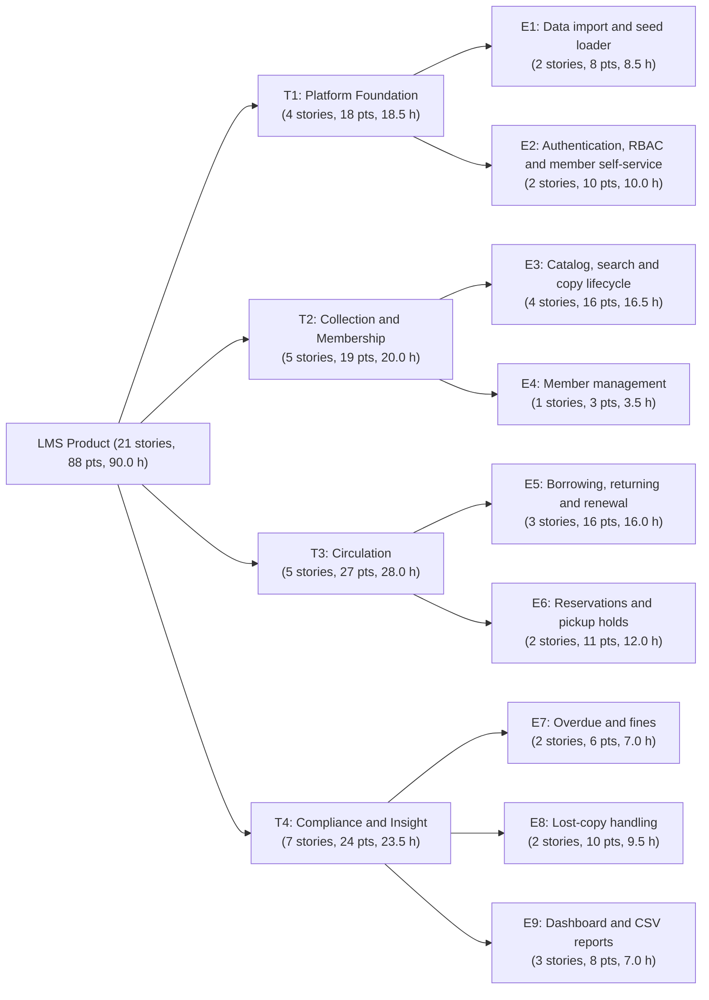

<!--
  Name(s) Surname(s) : Ibrahim Temur, Omer Faruk Kuş
  Student No(s)#: 231805033, 231805026
  General Comments: Four themes and nine epics of the LMS product with story assignment and totals generated from the product backlog.
-->
# Themes and Epics — Library Management System (LMS)

- **Version:** 1.0 — 2026-11-07
- **Hierarchy:** Theme -> Epic -> User story -> Task ([`USER_STORIES.md`](USER_STORIES.md), [`TASKS.md`](TASKS.md)). Counts, points, and hours are produced from [`PRODUCT_BACKLOG.md`](PRODUCT_BACKLOG.md) by `tools/agile/validate_backlog.py`.

## 1. Theme and Epic Overview

| Theme | Epic | Goal | Stories | Points | Classic h | Human h |
|---|---|---|---|---|---|---|
| **T1 Platform Foundation** | | Data and access foundations every other feature relies on | 4 | 18 | 36 | 18.5 |
| | E1 Data import and seed loader | Load seed v2 reproducibly with dates shifted to the start day (OPEN-04). | 2 | 8 | 16 | 8.5 |
| | E2 Authentication, RBAC and member self-service | Local login with BCrypt demo passwords (OPEN-05), role-based access, member self-service. | 2 | 10 | 20 | 10.0 |
| **T2 Collection and Membership** | | Who and what the library holds | 5 | 19 | 38 | 20.0 |
| | E3 Catalog, search and copy lifecycle | Find books, maintain books and copies, enforce copy states and referenceOnly display. | 4 | 16 | 32 | 16.5 |
| | E4 Member management | Register, edit and suspend synthetic members. | 1 | 3 | 6 | 3.5 |
| **T3 Circulation** | | Lending, returning, renewing and holding books | 5 | 27 | 55 | 28.0 |
| | E5 Borrowing, returning and renewal | Desk checkout, return and single renewal under confirmed ADU rules. | 3 | 16 | 32 | 16.0 |
| | E6 Reservations and pickup holds | Title-level FIFO holds, in-app notification, 3-day pickup window, cancellation and expiry. | 2 | 11 | 23 | 12.0 |
| **T4 Compliance and Insight** | | Fines, lost copies and management information | 7 | 24 | 44 | 23.5 |
| | E7 Overdue and fines | Deterministic overdue days and uncapped 0.25 TRY/day fines; payment and waiver. | 2 | 6 | 13 | 7.0 |
| | E8 Lost-copy handling | Lost-copy petition, 30-day window, 2x appraised value entered at runtime; design spike. | 2 | 10 | 16 | 9.5 |
| | E9 Dashboard and CSV reports | Operational dashboard KPI cards (015a), overdue/unpaid report (015b), CSV export. | 3 | 8 | 15 | 7.0 |
| **Total** | 9 epics | | 21 | 88 | 173 | 90.0 |

## 2. Diagram

## 3. Stories per Epic

| Epic | Stories |
|---|---|
| E1 Data import and seed loader | LMS-001 (Must, 3 pts, 3.5 h, S1), LMS-002 (Must, 5 pts, 5.0 h, S1) |
| E2 Authentication, RBAC and member self-service | LMS-003 (Must, 5 pts, 5.0 h, S1), LMS-013 (Must, 5 pts, 5.0 h, S2) |
| E3 Catalog, search and copy lifecycle | LMS-004 (Must, 3 pts, 3.5 h, S1), LMS-005 (Must, 8 pts, 7.5 h, S1), LMS-018 (Could, 2 pts, 2.0 h, S3), LMS-020 (Could, 3 pts, 3.5 h, S3) |
| E4 Member management | LMS-006 (Must, 3 pts, 3.5 h, S2) |
| E5 Borrowing, returning and renewal | LMS-007 (Must, 8 pts, 9.0 h, S2), LMS-010 (Must, 3 pts, 3.5 h, S2), LMS-014 (Should, 5 pts, 3.5 h, S3) |
| E6 Reservations and pickup holds | LMS-017 (Should, 8 pts, 8.5 h, S3), LMS-012 (Should, 3 pts, 3.5 h, S3) |
| E7 Overdue and fines | LMS-009 (Must, 3 pts, 3.5 h, S2), LMS-011 (Should, 3 pts, 3.5 h, S3) |
| E8 Lost-copy handling | LMS-008 (Must, 2 pts, 4.0 h, S1), LMS-016 (Should, 8 pts, 5.5 h, S3) |
| E9 Dashboard and CSV reports | LMS-015 (Should, 2 pts, 2.0 h, S3), LMS-021 (Should, 3 pts, 3.0 h, S3), LMS-019 (Could, 3 pts, 2.0 h, S3) |
