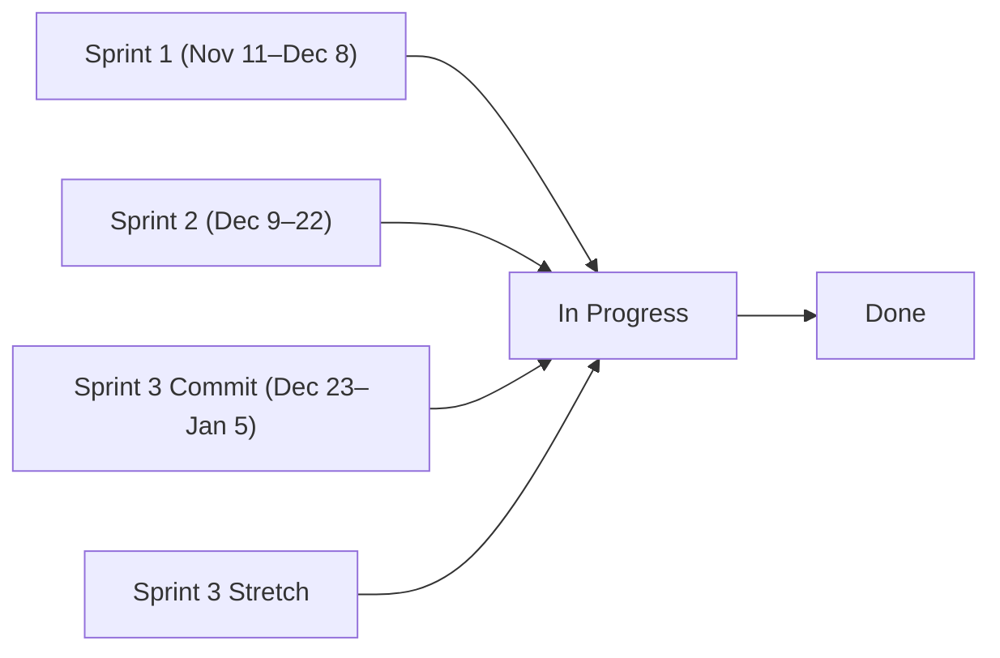
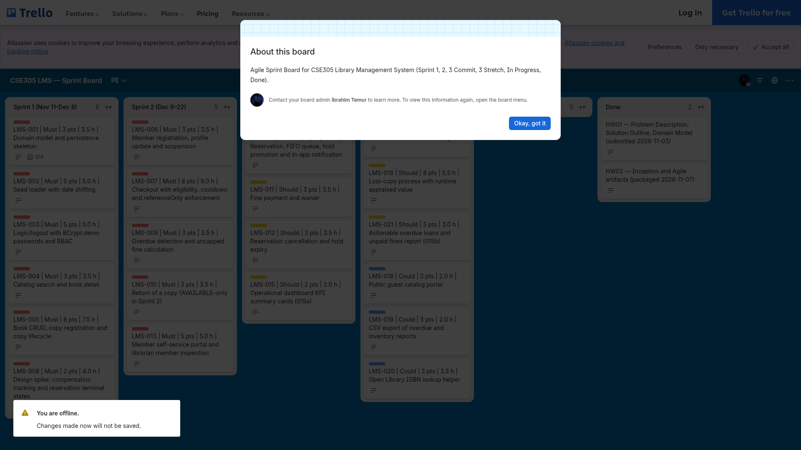

<!--
  Name(s) Surname(s) : Ibrahim Temur, Omer Faruk Kuş
  Student No(s)#: 231805033, 231805026
  General Comments: Trello sprint board structure, link, workflow rules, card conventions, and checklist tracking for HW02 Agile inception.
-->
# Trello Sprint Board — Library Management System (LMS)

- **Course:** CSE305 Software Engineering — Adnan Menderes University
- **Product Owner:** Ibrahim Temur (`231805033`) · **Scrum Master:** Omer Faruk Kuş (`231805026`)
- **Board Title:** `CSE305 LMS — Sprint Board`
- **Board URL:** [https://trello.com/b/34K6O3Y1/cse305-lms-sprint-board](https://trello.com/b/34K6O3Y1/cse305-lms-sprint-board)
- **Visibility:** Public (accessible without sign-in for external course review)
- **Traceability:** Grounded in [`PRODUCT_BACKLOG.md`](PRODUCT_BACKLOG.md), [`USER_STORIES.md`](USER_STORIES.md), and [`SPRINT_PLAN.md`](SPRINT_PLAN.md)

---

## 1. Overview and Purpose

In compliance with the CSE305 HW02 Agile process requirements (*"Use Trello to properly track and manage your sprints"*), the Scrum team maintains a centralized, publicly accessible Trello board to manage the product backlog execution across three planned sprints:
- **Sprint 1 (Nov 11 – Dec 08, 2026):** Foundation, core entities, seed loader, authentication, catalog search, book CRUD, and design spike.
- **Sprint 2 (Dec 09 – Dec 22, 2026):** Member lifecycle, borrowing/checkout desk, overdue fine engine, return processing, and self-service portal.
- **Sprint 3 Commit (Dec 23, 2026 – Jan 05, 2027):** Reservations FIFO queue, fine payment/waiver desk, reservation hold expiry, and operational KPI dashboard.
- **Sprint 3 Stretch:** Loan renewal, lost copy processing, actionable overdue reports, public catalog, CSV exports, and ISBN lookup helper.

---

## 2. Board Structure (Lists)

The board consists of **6 lists** representing the iteration cadence and card lifecycle:



1. **`Sprint 1 (Nov 11–Dec 8)`** (6 story cards, 26 pts, 28.5 h): Holds all Sprint 1 stories planned for implementation.
2. **`Sprint 2 (Dec 9–22)`** (5 story cards, 22 pts, 24.5 h): Holds Sprint 2 stories awaiting the Sprint 2 planning ceremony.
3. **`Sprint 3 Commit (Dec 23–Jan 5)`** (4 story cards, 16 pts, 17.5 h): Holds the prioritized commitment scope for Sprint 3.
4. **`Sprint 3 Stretch`** (6 story cards, 24 pts, 19.5 h): Holds contingency stories below the S3 commitment line, taken only if net capacity allows.
5. **`In Progress`** (0 cards initially): Active work item column during an iteration. Max WIP limit: 2 cards per developer.
6. **`Done`** (2 milestone cards + completed stories): Archive for completed deliverables satisfying the Definition of Done (DoD). Contains milestone cards for `HW01` and `HW02`.

### Board Snapshot


---

## 3. Card Naming and Label Conventions

### Card Title Format
Every user story card follows a strict uniform naming syntax:
```text
LMS-xxx | MoSCoW | N pts | H h | title
```
*Note:* The target sprint is indicated by list placement, avoiding redundant sprint names in titles.

### Color-Coded MoSCoW Labels
Each story card carries a native Trello label corresponding to its MoSCoW priority:
- **`Must`** (Red label): 11 stories (48 pts, 53.0 h) across S1 and S2.
- **`Should`** (Yellow label): 7 stories (32 pts, 29.5 h) across S3 Commit and Stretch.
- **`Could`** (Blue label): 3 stories (8 pts, 7.5 h) in S3 Stretch.

### Card Description Format
Every story card description includes:
- **Meta line:** Epic, MoSCoW priority, Story Points, Human Effort hours, Target Sprint.
- **Dependencies:** Explicit prerequisite stories (`Depends on: ...`).
- **Acceptance Criteria:** Given/When/Then criteria mirrored from [`USER_STORIES.md`](USER_STORIES.md).

---

## 4. Backlog Mapping Matrix

| List Name | Card ID | MoSCoW | Points | Human h | Dependencies |
|---|---|---|---|---|---|
| **Sprint 1 (Nov 11–Dec 8)** | `LMS-001` | Must | 3 pts | 3.5 h | None |
| | `LMS-002` | Must | 5 pts | 5.0 h | `LMS-001` |
| | `LMS-003` | Must | 5 pts | 5.0 h | `LMS-001`, `LMS-002` |
| | `LMS-004` | Must | 3 pts | 3.5 h | `LMS-002`, `LMS-003` |
| | `LMS-005` | Must | 8 pts | 7.5 h | `LMS-003`, `LMS-004` |
| | `LMS-008` | Must | 2 pts | 4.0 h | `LMS-001` |
| **Sprint 2 (Dec 9–22)** | `LMS-006` | Must | 3 pts | 3.5 h | `LMS-003` |
| | `LMS-007` | Must | 8 pts | 9.0 h | `LMS-005`, `LMS-006` |
| | `LMS-009` | Must | 3 pts | 3.5 h | `LMS-001` |
| | `LMS-010` | Must | 3 pts | 3.5 h | `LMS-007`, `LMS-009` |
| | `LMS-013` | Must | 5 pts | 5.0 h | `LMS-007`, `LMS-009`, `LMS-010` |
| **Sprint 3 Commit (Dec 23–Jan 5)** | `LMS-017` | Should | 8 pts | 8.5 h | `LMS-010`, `LMS-008` |
| | `LMS-011` | Should | 3 pts | 3.5 h | `LMS-009`, `LMS-010` |
| | `LMS-012` | Should | 3 pts | 3.5 h | `LMS-017` |
| | `LMS-015` | Should | 2 pts | 2.0 h | `LMS-009`, `LMS-010` |
| **Sprint 3 Stretch** | `LMS-014` | Should | 5 pts | 3.5 h | `LMS-007` |
| | `LMS-016` | Should | 8 pts | 5.5 h | `LMS-010`, `LMS-011`, `LMS-008` |
| | `LMS-021` | Should | 3 pts | 3.0 h | `LMS-009`, `LMS-010`, `LMS-015` |
| | `LMS-018` | Could | 2 pts | 2.0 h | `LMS-004` |
| | `LMS-019` | Could | 3 pts | 2.0 h | `LMS-021` |
| | `LMS-020` | Could | 3 pts | 3.5 h | `LMS-005` |
| **Done** | `HW01` | Milestone | — | — | Submitted 2026-11-03 |
| | `HW02` | Milestone | — | — | Packaged 2026-11-07 (r4 on 2026-11-11) |

- **Sprint 1 Subtotal:** 6 cards, 26 pts, 28.5 h (Must)
- **Sprint 2 Subtotal:** 5 cards, 22 pts, 24.5 h (Must)
- **Sprint 3 Commit Subtotal:** 4 cards, 16 pts, 17.5 h (Should)
- **Sprint 3 Stretch Subtotal:** 6 cards, 24 pts, 19.5 h (Should & Could)
- **Grand Totals:** **21 user story cards**, **88 story points**, **90.0 human hours** (+ 2 milestone cards = **23 cards total**).

---

## 5. Technical Task Checklist (`LMS-001`)

To demonstrate granular task tracking within Trello, story `LMS-001` contains the 4 technical implementation tasks defined in [`TASKS.md`](TASKS.md) as a native checklist:
- [ ] `T-001-1: Write persistence and invariant tests first (1.0 h)`
- [ ] `T-001-2: Steer agent: entities, enums, repositories (1.0 h)`
- [ ] `T-001-3: Review mapping against the HW01 domain model (1.0 h)`
- [ ] `T-001-4: Run tests, fix findings, update AI log (0.5 h)`

---

## 6. Sprint Board Workflow Rules

1. **Pull System:** At the start of an iteration, team members pull the top-priority story card from the active sprint list into **`In Progress`**.
2. **Work In Progress (WIP) Limit:** Maximum 2 cards in `In Progress` concurrently to ensure focus and flow.
3. **Definition of Done (DoD) Verification:** Before moving any card to **`Done`**, the card owner must verify:
   - All Given/When/Then acceptance criteria pass.
   - Automated unit/integration tests pass with `./mvnw -q test`.
   - Mandatory CSE305 file headers are present on all modified files.
   - Stitch UI designs (if applicable) are saved in `docs/03-design/ui/`.
   - Commit follows Conventional Commits format and has been pushed to `origin`.
4. **Hour Reconciliation:** At the sprint review, the actual human effort is recorded in card comments to calibrate future sprint velocity.
