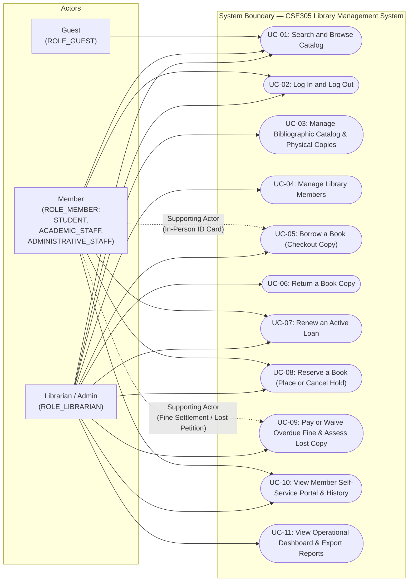

<!--
  Name(s) Surname(s) : Ibrahim Temur, Omer Faruk Kuş
  Student No(s)#: 231805033, 231805026
  General Comments: Use case diagram (Mermaid flowchart approximation), summary table, fully-dressed and brief use case specifications (UC-01..UC-11), and end-to-end traceability matrix (UC <-> FR <-> BR).
-->
# Use Case Model — Library Management System (LMS)

- **Course:** CSE305 Software Engineering — Adnan Menderes University (ADU)
- **Phase:** Inception (`HW02`)
- **Methodology Reference:** Craig Larman, *Applying UML and Patterns* (3rd Ed., Ch. 6 — Use Cases)
- **Date:** 2026-10-22

---

## 1. Use Case Diagram

> [!NOTE]
> Because Mermaid does not provide a native UML Use Case diagram syntax, the diagram below uses a Mermaid `flowchart` approximation to represent actors, the system boundary, and use-case associations.

---

## 2. Use Case Summary & Traceability Table

Every use case (`UC-01`..`UC-11`) explicitly lists the Functional Requirements (`FR-*` in [`REQUIREMENTS.md`](REQUIREMENTS.md)) and Business Rules (`BR-*` in [`BUSINESS_RULES.md`](BUSINESS_RULES.md)) that it realizes. *(Note: `FR-019` is an automated startup seed initialization requirement and is listed below for completeness.)*

| UC ID | Use Case Name | Primary Actor(s) | Supporting Actor(s) | Detail Level | One-Line Summary | Covered `FR-*` IDs | Covered `BR-*` IDs |
|---|---|---|---|---|---|---|---|
| **`UC-01`** | **Search and Browse Catalog** | `Guest`, `Member`, `Librarian` | — | **Fully-Dressed** | Search books by title, author, or `isbn13`, filter by category/availability, and inspect copy states and `referenceOnly` badges. | `FR-002`, `FR-003`, `FR-030` | `BR-001`, `BR-014`, `BR-017` |
| **`UC-02`** | **Log In and Log Out** | `Member`, `Librarian` | — | **Brief** | Authenticate a synthetic `Member` or `Librarian` account using startup-seeded BCrypt demo credentials and establish a role-bound session. | `FR-016`, `FR-017` | `BR-001`, `BR-018` |
| **`UC-03`** | **Manage Bibliographic Catalog & Physical Copies** | `Librarian` | Open Library API *(optional `C2`)* | **Brief** | Create/edit/archive `Book` records (including `referenceOnly`) and manage physical `BookCopy` barcodes (`LMS-COPY-*`) and states. | `FR-001`, `FR-004`, `FR-005`, `FR-031` | `BR-001`, `BR-014`, `BR-017` |
| **`UC-04`** | **Manage Library Members** | `Librarian` | — | **Brief** | Register synthetic `STUDENT`, `ACADEMIC_STAFF`, and `ADMINISTRATIVE_STAFF` members, edit profiles, and toggle `ACTIVE`/`SUSPENDED` status. | `FR-006`, `FR-007`, `FR-008` | `BR-001`, `BR-002`, `BR-011`, `BR-018` |
| **`UC-05`** | **Borrow a Book (Checkout Copy)** | `Librarian` | `Member` *(in person)* | **Fully-Dressed** | Verify member's personal ID card (`memberId`), quota (`7`/`3`/`3`), blocks, cooldowns, and copy state, then issue a `30`-day `ACTIVE` loan. | `FR-005`, `FR-009`, `FR-010`, `FR-011`, `FR-013` | `BR-002`, `BR-003`, `BR-006`, `BR-011`, `BR-013`, `BR-014`, `BR-016`, `BR-017` |
| **`UC-06`** | **Return a Book Copy** | `Librarian` | — | **Fully-Dressed** | Close an `ACTIVE` loan, compute any `0.25 TRY/day` overdue fine, enforce post-renewal cooldown, and transition copy to `RESERVED` or `AVAILABLE`. | `FR-005`, `FR-012`, `FR-013`, `FR-014`, `FR-015`, `FR-022` | `BR-006`, `BR-007`, `BR-008`, `BR-009`, `BR-010`, `BR-013`, `BR-017` |
| **`UC-07`** | **Renew an Active Loan** | `Member`, `Librarian` | — | **Brief** | Extend a non-overdue, unreserved `ACTIVE` loan once (`renewalCount: 0 -> 1`) by `+30 calendar days`. | `FR-024` | `BR-003`, `BR-004`, `BR-005`, `BR-006`, `BR-011` |
| **`UC-08`** | **Reserve a Book (Place or Cancel Hold)** | `Member`, `Librarian` | — | **Brief** | Place or cancel a FIFO title-level hold (`isbn13`) when zero copies are `AVAILABLE` and manage the `2–3 day` (`3-day`) pickup window. | `FR-020`, `FR-021`, `FR-022`, `FR-023` | `BR-011`, `BR-012`, `BR-013`, `BR-014` |
| **`UC-09`** | **Pay or Waive Overdue Fine & Assess Lost Copy** | `Librarian` | `Member` | **Fully-Dressed** | Settle (`PAID`) or waive (`WAIVED`) an `UNPAID` fine at the desk, or process a lost-copy petition (`lostReportedOn`, fine freeze, `2x` valuation charge). | `FR-005`, `FR-014`, `FR-015`, `FR-025`, `FR-026`, `FR-027` | `BR-007`, `BR-008`, `BR-009`, `BR-010`, `BR-011`, `BR-015`, `BR-017` |
| **`UC-10`** | **View Member Self-Service Portal & History** | `Member`, `Librarian` | — | **Brief** | Inspect personal active loans, due dates, historical loans, accrued fines, active reservations, cooldown timers, and in-app hold notifications. | `FR-008`, `FR-018` | `BR-001`, `BR-002`, `BR-006`, `BR-010`, `BR-013` |
| **`UC-11`** | **View Operational Dashboard & Export Reports** | `Librarian` | — | **Brief** | View real-time circulation KPIs, inspect the prioritized overdue loans and unpaid fines report, and export CSV reports. | `FR-014`, `FR-015`, `FR-028`, `FR-029`, `FR-032` | `BR-001`, `BR-007`, `BR-008`, `BR-011` |

---

## 3. Fully-Dressed Use Case Specifications

### 3.1 `UC-01` — Search and Browse Catalog (Fully-Dressed)

- **Use Case ID:** `UC-01`
- **Primary Actors:** `Guest` (`ROLE_GUEST`), `Member` (`ROLE_MEMBER`), `Librarian` (`ROLE_LIBRARIAN`)
- **Stakeholders and Interests:**
  - **Guest / Member:** Wants to quickly find books by title, author, `isbn13`, or subject category (`11` categories) and see whether at least one physical copy is `AVAILABLE` on the shelf or if the book is a non-circulating reference work (`referenceOnly`).
  - **Librarian:** Wants to inspect exact copy barcodes (`LMS-COPY-*`), copy lifecycle states, and reservation queue counts directly from the catalog detail view.
- **Preconditions:**
  - The embedded H2 database is initialized with bibliographic `Book` and physical `BookCopy` records loaded from [`data/seed/books-openlibrary.json`](../../data/seed/books-openlibrary.json) and [`data/seed/copies.json`](../../data/seed/copies.json) (`FR-019`).
- **Postconditions (Success Guarantee):**
  - Read-only operation: no database state is modified. Matching `Book` records and their real-time copy availability / `referenceOnly` badges are accurately displayed.
- **Main Success Scenario (Basic Flow):**
  1. The user navigates to the Catalog page and enters a search query (e.g., `"Algorithms"`, `"Yaşar Kemal"`, or `isbn13` `"9780321573513"`) and/or selects filters (`category` such as `"Programming"`, availability filter, or circulation type).
  2. The system queries matching `Book` entities and aggregates their physical `BookCopy` status counts (`AVAILABLE`, `LOANED`, `RESERVED`, `MAINTENANCE`, `LOST`).
  3. The system renders a paginated catalog list showing each book's cover thumbnail (`coverUrl`), `title`, `subtitle`, `authors`, `isbn13`, `category`, `firstPublishYear`, circulation badge (`CIRCULATING` vs. `REFERENCE ONLY`), and count of `AVAILABLE` copies out of total copies.
  4. The user selects a specific book (e.g., `isbn13: "9780002615075"`, *İnce Memed* by Yaşar Kemal) to open its Book Detail view.
  5. The system displays the full bibliographic metadata (including `publisher`, `subjects`, work-level median `pageCount`, and `openLibraryWorkKey`), the table of individual physical copies (`LMS-COPY-1002`, `LMS-COPY-1003`, `LMS-COPY-1004`) with their current states, and the active reservation queue count.
  6. Role-specific action controls are displayed:
     - For `ROLE_LIBRARIAN`: "Edit Book", "Add Copy", and quick checkout links.
     - For `ROLE_MEMBER`: "Reserve Book" button (enabled only when `referenceOnly == false` and `0` copies are `AVAILABLE`, invoking `UC-08`).
     - For `ROLE_GUEST`: Read-only view with a "Sign in to reserve or view member loans" link (`UC-02`).
- **Extensions (Alternative Flows):**
  - **2a. No Matching Books Found:**
    1. The system displays an empty-state message (*"No books match your search criteria"*) and a control to clear active filters.
  - **4a. Selected Book Is a Non-Circulating Reference Work (`referenceOnly == true`, `BR-014`):**
    1. When viewing an encyclopedia, dictionary, or catalog marked `referenceOnly == true`, the system displays a prominent **`REFERENCE ONLY — IN-LIBRARY USE ONLY`** banner and disables checkout and reservation controls.
  - **4b. All Circulating Copies Are Checked Out (`0 AVAILABLE`, `BR-012`):**
    1. For a title such as `isbn13: "9780321573513"` (*Algorithms*) where all copies are `LOANED` or `RESERVED`, the system displays **`ALL COPIES UNAVAILABLE`** along with the current FIFO hold queue length and enables the "Reserve Book" action (`UC-08`) for eligible authenticated members.
- **Linked Requirements & Business Rules:**
  - **Functional Requirements:** `FR-002`, `FR-003`, `FR-030` (Non-Functional: `NFR-001`, `NFR-005`)
  - **Business Rules:** `BR-001`, `BR-014`, `BR-017`

---

### 3.2 `UC-05` — Borrow a Book (Checkout Copy) (Fully-Dressed)

- **Use Case ID:** `UC-05`
- **Primary Actor:** `Librarian` (`ROLE_LIBRARIAN`, e.g., `syn-lib-0001` `Enginiz Yıldırım`)
- **Supporting Actor:** `Member` (`ROLE_MEMBER`, e.g., `SYN-STU-0001` `Tutkucan Ergül` or `SYN-STF-0003` `Atasagun Öcalan`, presenting their personal university ID card at the circulation desk)
- **Stakeholders and Interests:**
  - **Librarian:** Needs fast, deterministic validation of all confirmed ADU borrowing rules before handing over the physical copy.
  - **Member:** Wants to borrow an available copy (or pick up their `READY` reserved copy) with a clear `30`-day due date.
- **Preconditions:**
  - The Librarian is authenticated with `ROLE_LIBRARIAN` (`UC-02`).
  - Both the `Member` (`memberId`) and the physical `BookCopy` (`copyBarcode`) exist in the database.
- **Postconditions (Success Guarantee):**
  - A new `Loan` record (`status = ACTIVE`, `checkoutDate = currentDate`, `dueDate = currentDate + 30 days`, `renewalCount = 0`, `returnDate = null`) is persisted.
  - The `BookCopy` status is updated to `LOANED` (`BR-017`).
  - If the checkout fulfilled a `READY` reservation (`BR-013`), that reservation is marked fulfilled/completed and removed from the active hold queue.
- **Main Success Scenario (Basic Flow):**
  1. The `Member` arrives at the circulation desk in person and presents their personal university ID card (`memberId`, e.g., `"SYN-STU-0001"`) and the physical book copy (`copyBarcode`, e.g., `"LMS-COPY-1002"`).
  2. The `Librarian` opens the Circulation Checkout screen, verifies that the borrower is presenting their own personal ID card (`BR-016`), and enters `memberId` and `copyBarcode`.
  3. The system loads the `Member`, resolves the appropriate `LoanPolicyStrategy` for `member.memberType` (`AcademicStaffLoanPolicy`: max `7` books, `30` days; `AdministrativeStaffLoanPolicy`: max `3` books, `30` days; `StudentLoanPolicy`: max `3` books, `30` days — `BR-002`, `BR-003`), and validates member eligibility (`FR-009`):
     - `member.status == ACTIVE` (`BR-011`),
     - Member has `0` overdue active loans (`BR-011`),
     - Member has `0` `UNPAID` fines or lost-book charges (`amount > 0.00 TRY`) (`BR-011`),
     - Member's current `ACTIVE` loan count is strictly less than `MAX_ACTIVE_LOANS[memberType]` (`7` or `3`) (`BR-002`),
     - Member is not within the 1-month (`30 calendar days`) post-renewal re-borrowing cooldown for `copy.isbn13` (`BR-006`).
  4. The system loads the `BookCopy` (`copyBarcode`) and parent `Book` (`isbn13`) and validates copy eligibility via `BookCopyState` (`FR-010`):
     - `book.referenceOnly == false` (`BR-014`),
     - `copy.status == AVAILABLE` (or `copy.status == RESERVED` where the member holds the `READY` reservation at `queuePosition == 1` with `readyCopyBarcode == copy.barcode` within the 2–3 day pickup window, `BR-013`),
     - The member does not already hold another `ACTIVE` loan for the same `isbn13`.
  5. Inside a single `@Transactional` boundary (`FR-011`), the system instantiates the `Loan` via `LoanFactory` with `checkoutDate = currentDate` and `dueDate = currentDate + 30 days`, transitions `copy.status` to `LOANED`, and persists both entities.
  6. The system displays a checkout confirmation summary showing `loanId`, `memberId`, member name, `copyBarcode`, book `title`, `checkoutDate`, `dueDate` (`+30` days), and remaining borrowing quota.
- **Extensions (Alternative Flows):**
  - **2a. Attempted Proxy Borrowing (`BR-016` — Confirmed Rule):**
    1. If the person at the desk attempts to use another person's university ID card (`memberId`), the Librarian refuses the transaction per `BR-016`.
  - **3a. Member Status Is `SUSPENDED` (`BR-011`):**
    1. The system rejects checkout with error: *"Checkout blocked: Member account `<memberId>` is currently SUSPENDED (`BR-011`)."*
  - **3b. Member Holds an Overdue Loan or Unpaid Fine (`BR-011` — Confirmed Rule):**
    1. If the member has any active loan with `currentDate > dueDate` (e.g., `LOAN-0099`) or any `UNPAID` fine (e.g., `FINE-0019` for `SYN-STU-0025`), the system rejects checkout and displays a link to return the overdue item (`UC-06`) or settle the fine (`UC-09`).
  - **3c. Member Has Reached Borrowing Quota (`BR-002` — Confirmed Rule):**
    1. If `activeLoanCount >= 7` (`ACADEMIC_STAFF`) or `activeLoanCount >= 3` (`ADMINISTRATIVE_STAFF` / `STUDENT`), the system rejects checkout with error: *"Checkout blocked: Member has reached the maximum limit of `<7|3>` active loans for `<memberType>` (`BR-002`)."*
  - **3d. Post-Renewal 1-Month Cooldown Active (`BR-006` — Confirmed Rule):**
    1. If the member previously renewed (`renewalCount >= 1`) a loan for the same `isbn13` and returned it less than `30 calendar days` ago (`currentDate < previousLoan.returnDate + 30 days`), the system rejects checkout and displays the exact date when the 1-month cooldown expires (`earliestNextCheckoutDate`).
  - **4a. Book Is a Non-Circulating Reference Work (`referenceOnly == true`, `BR-014` — Confirmed Rule):**
    1. If the copy belongs to an encyclopedia, dictionary, or catalog (`referenceOnly == true`), the system rejects checkout with error: *"Checkout blocked: Reference works (encyclopedias, dictionaries, catalogs) cannot be loaned (`BR-014`)."*
  - **4b. Copy Is `RESERVED` for a Confirmed Hold Pickup (`BR-013`):**
    1. If `copy.status == RESERVED` and the requesting `memberId` matches the `READY` reservation (`queuePosition == 1`, `readyCopyBarcode == copy.barcode`, e.g., `RES-0009` for `SYN-STU-0003` on copy `LMS-COPY-1599`), the system permits checkout, transitions the copy to `LOANED`, and closes the `READY` reservation.
    2. If `copy.status == RESERVED` for a *different* member, the system rejects checkout with error: *"Checkout blocked: Copy `<copyBarcode>` is held in RESERVED status for another member (`BR-013`)."*
  - **4c. Copy Is `LOANED`, `MAINTENANCE`, or `LOST` (`BR-017`):**
    1. `BookCopyState` throws an illegal state transition exception and the system displays the current copy state.
- **Linked Requirements & Business Rules:**
  - **Functional Requirements:** `FR-005`, `FR-009`, `FR-010`, `FR-011`, `FR-013`
  - **Business Rules:** `BR-002`, `BR-003`, `BR-006`, `BR-011`, `BR-013`, `BR-014`, `BR-016`, `BR-017`

---

### 3.3 `UC-06` — Return a Book Copy (Fully-Dressed)

- **Use Case ID:** `UC-06`
- **Primary Actor:** `Librarian` (`ROLE_LIBRARIAN`, e.g., `syn-lib-0001` `Enginiz Yıldırım`)
- **Stakeholders and Interests:**
  - **Librarian:** Wants a single barcode scan/entry to close the loan, calculate any `0.25 TRY/day` overdue fine accurately, and clearly indicate whether the physical copy should be returned to the shelf (`AVAILABLE`) or placed on the reservation hold shelf (`RESERVED`).
  - **Returning Member:** Wants their loan closed so their quota is freed.
  - **Next Queued Member:** Wants immediate FIFO allocation of the returned copy (`READY`), an in-app notification, and a guaranteed `2–3 day` pickup window (`BR-013`).
- **Preconditions:**
  - The Librarian is authenticated with `ROLE_LIBRARIAN` (`UC-02`).
  - The `BookCopy` (`copyBarcode`) is currently in `LOANED` status with an `ACTIVE` `Loan` record (`BR-017`).
- **Postconditions (Success Guarantee):**
  - The `Loan` record is updated with `returnDate = currentDate` and `status = RETURNED`.
  - If `returnDate > dueDate`, an `UNPAID` `Fine` record (`amount = 0.25 * overdueDays` in `TRY`, no cap) is persisted (`BR-008`, `BR-009`).
  - If `loan.renewalCount >= 1`, the `returnDate` anchors a 1-month (`30-day`) re-borrowing cooldown on that `isbn13` for that `memberId` (`BR-006`).
  - The `BookCopy` transitions to `RESERVED` (if a `WAITING` reservation queue exists on `isbn13`) or `AVAILABLE` (otherwise) (`BR-013`, `BR-017`).
- **Main Success Scenario (Basic Flow — On-Time Return with No Reservation Queue):**
  1. The `Librarian` opens the Circulation Return screen and enters or scans `copyBarcode` (e.g., `"LMS-COPY-1758"`).
  2. The system looks up the active `Loan` for `copyBarcode` (e.g., `LOAN-0001`) and its associated `Member` and `Book` (`isbn13`).
  3. Inside a `@Transactional` boundary (`FR-012`), the system sets `loan.returnDate = currentDate` and `loan.status = RETURNED`.
  4. The system computes `overdueDays = max(0, (returnDate - dueDate).days)` (`FR-014`, `BR-007`). Because `returnDate <= dueDate`, `overdueDays == 0` and no `Fine` is created.
  5. The system publishes a `BookReturnedEvent` (GoF **Observer** pattern) and checks `ReservationRepository` for any `WAITING` reservations on `book.isbn13`. Finding none, `BookCopyState` transitions `copy.status` from `LOANED` to `AVAILABLE`.
  6. The system displays a return receipt instructing the Librarian: **`RESHELVE COPY — Status: AVAILABLE`**.
- **Extensions (Alternative Flows):**
  - **1a. Copy Is Not Currently `LOANED` (`BR-017`):**
    1. If `copy.status != LOANED` (or no `ACTIVE` loan exists for `copyBarcode`), the system rejects the operation with an informative message showing the copy's current status (`AVAILABLE`, `RESERVED`, `MAINTENANCE`, or `LOST`).
  - **4a. Book Is Returned Late (`returnDate > dueDate`, `BR-007`..`BR-010`):**
    1. The system calculates `overdueDays = (returnDate - dueDate).days` (or `(lostReportedOn - dueDate).days` if a lost petition had previously been filed and the copy was found within 30 days, `BR-015`).
    2. Using `FineCalculationStrategy` (`BR-008`, `BR-009`), the system computes `amount = 0.25 * overdueDays` in `TRY` (no cap) and saves/updates the `Fine` record with `status = UNPAID` and `assessedOn = returnDate` (`FR-015`).
    3. The return confirmation screen highlights the accrued `UNPAID` fine (`amount` TRY for `overdueDays` late days) and offers a direct button to settle (`PAID`) or waive (`WAIVED`) the fine (`UC-09`).
  - **4b. Returned Loan Had Previously Been Renewed (`loan.renewalCount >= 1`, `BR-006` — Confirmed Rule):**
    1. Because `loan.renewalCount >= 1`, the system records `returnDate` such that any subsequent checkout attempt by `loan.memberId` for `book.isbn13` before `returnDate + 30 days` will be blocked under `BR-006` (`FR-013`). The return receipt notes: *"Post-renewal cooldown active for this member on this title until `<returnDate + 30 days>`."*
  - **5a. Active `WAITING` Reservation Queue Exists for `book.isbn13` (`BR-013` — Confirmed Rule):**
    1. The `BookReturnedEvent` listener detects one or more `WAITING` reservations for `book.isbn13` ordered by `queuePosition`.
    2. The head reservation (`queuePosition == 1`) is promoted from `WAITING` to `status = READY` and bound to `readyCopyBarcode = copy.barcode` (`FR-022`).
    3. `BookCopyState` transitions `copy.status` from `LOANED` to `RESERVED` (instead of `AVAILABLE`).
    4. The system creates an **in-app notification** for the reserving member stating that `copy.barcode` is held for pickup for **2–3 days** (`3 calendar days` expiration target: `returnDate + 3 days`, `ASSUMPTION-13`).
    5. The system displays a prominent alert to the Librarian: **`PLACE ON HOLD SHELF — Status: RESERVED for Member <memberId> (Reservation <reservationId>, Hold until <returnDate + 3 days>)`**.
- **Linked Requirements & Business Rules:**
  - **Functional Requirements:** `FR-005`, `FR-012`, `FR-013`, `FR-014`, `FR-015`, `FR-022`
  - **Business Rules:** `BR-006`, `BR-007`, `BR-008`, `BR-009`, `BR-010`, `BR-013`, `BR-017`

---

### 3.4 `UC-09` — Pay or Waive Overdue Fine & Assess Lost Copy (Fully-Dressed)

- **Use Case ID:** `UC-09`
- **Primary Actor:** `Librarian` (`ROLE_LIBRARIAN`, e.g., `syn-lib-0001` `Enginiz Yıldırım`)
- **Supporting Actor:** `Member` (`ROLE_MEMBER`, settling a fine or submitting a lost-book petition at the circulation desk)
- **Stakeholders and Interests:**
  - **Librarian:** Needs an auditable workflow (`settledOn`, `settledBy`) to record desk cash/receipt payments (`PAID`), grant administrative waivers (`WAIVED`), or process lost-book petitions (`BR-015`).
  - **Member:** Wants their `UNPAID` fine resolved so their borrowing privileges (`BR-011`) are restored immediately.
- **Preconditions:**
  - The Librarian is authenticated with `ROLE_LIBRARIAN` (`UC-02`).
  - For fine settlement/waiver: an `UNPAID` `Fine` record exists for a returned (or lost-resolved) `Loan` (`BR-010`).
  - For lost-copy reporting: an `ACTIVE` `Loan` exists for the member (`BR-015`).
- **Postconditions (Success Guarantee):**
  - For settlement/waiver: `fine.status` becomes `PAID` or `WAIVED`, `fine.settledOn = currentDate`, and `fine.settledBy = librarian.username`. If the member has no other `UNPAID` fines, no overdue active loans, and `status == ACTIVE`, their borrowing block (`BR-011`) is lifted.
  - For lost-copy petition: daily overdue fine accrual freezes on `lostReportedOn`; if unreplaced after 1 month (`30 days`), `copy.status` becomes `LOST` and a `2.00 * appraisedValue` compensation charge is recorded (`BR-015`).
- **Main Success Scenario (Basic Flow — Desk Fine Payment `PAID`):**
  1. The `Librarian` navigates to the Member Profile (`UC-04` / `UC-10`) or Fines Management view and selects an `UNPAID` fine (e.g., `FINE-0019` on returned/resolved loan `LOAN-0105` for member `SYN-STU-0025`).
  2. The system verifies that the underlying `Loan` is no longer accruing daily fines (`loan.status == RETURNED` or lost-resolved, `BR-010`) and displays `fineId`, `loanId`, `overdueDays`, `amount` (computed at `0.25 TRY/day`), and `assessedOn`.
  3. The `Member` pays the fine at the desk, and the `Librarian` clicks **"Mark as Paid"** (`FR-025`).
  4. Inside a `@Transactional` boundary, the system updates `fine.status = PAID`, `fine.settledOn = currentDate`, and `fine.settledBy = librarian.username` (e.g., `"syn-lib-0001"`).
  5. The system re-evaluates the member's eligibility (`BR-011`) and displays an updated badge (`ELIGIBLE TO BORROW` if no other blocks exist).
- **Extensions (Alternative Flows):**
  - **2a. Attempt to Settle a Fine While the Book Is Still Checked Out (`loan.status == ACTIVE`, `BR-010`):**
    1. If the loan is still `ACTIVE` and has not been returned or resolved as lost, the system blocks premature settlement with message: *"Fine is still accruing daily (`0.25 TRY/day`). Return the book copy (`UC-06`) or record a lost-book petition (`BR-015`) before settling the fine."*
  - **3a. Administrative Fine Waiver (`WAIVED`, `FR-026`):**
    1. Instead of collecting payment, the `Librarian` selects **"Waive Fine"** (e.g., as in seeded record `FINE-0004` on `LOAN-0005` for `SYN-STU-0040`, settled as `WAIVED` by `syn-lib-0003`).
    2. The system sets `fine.status = WAIVED`, `fine.settledOn = currentDate`, and `fine.settledBy = librarian.username`, clearing the fine block (`BR-010`, `BR-011`).
  - **3b. Member Submits a Lost-Book Petition (`BR-015` — Confirmed Rule, `FR-027`):**
    1. If a member reports that they have lost a borrowed copy, the `Librarian` selects **"Record Lost-Book Petition"** on the active `Loan` and confirms `lostReportedOn = currentDate`.
    2. The system immediately **freezes daily overdue fine accrual as of `lostReportedOn`** (`overdueDays = max(0, (lostReportedOn - dueDate).days)`, `amount = 0.25 * overdueDays`) and sets a **1-month (`30 calendar days`) replacement deadline** (`lostReportedOn + 30 days`).
    3. **Case 3b-i (Replaced within 1 month):** If the member brings a replacement copy on or before `lostReportedOn + 30 days`, the Librarian records replacement; the loan closes (`RETURNED`) and only the frozen overdue fine (if any up to `lostReportedOn`) requires settlement.
    4. **Case 3b-ii (Not replaced within 1 month — 2x Valuation Penalty):** If the copy is not replaced within `30 calendar days`, the Librarian enters the Valuation Commission's determined book value (`appraisedValue` in `TRY`, `ASSUMPTION-15`). The system transitions `copy.status` to `LOST`, closes the loan, and records a compensation charge of `2.00 * appraisedValue` TRY (in addition to any frozen overdue fine up to `lostReportedOn`), which can then be settled as `PAID` or `WAIVED`.
- **Linked Requirements & Business Rules:**
  - **Functional Requirements:** `FR-005`, `FR-014`, `FR-015`, `FR-025`, `FR-026`, `FR-027`
  - **Business Rules:** `BR-007`, `BR-008`, `BR-009`, `BR-010`, `BR-011`, `BR-015`, `BR-017`

---

## 4. Brief Use Case Specifications

### 4.1 `UC-07` — Renew an Active Loan (Brief)
- **Actors:** `Member` (`ROLE_MEMBER`, self-service) or `Librarian` (`ROLE_LIBRARIAN`, desk)
- **Preconditions:** The user is authenticated (`UC-02`); the target `Loan` has `status == ACTIVE`.
- **Main Flow:** The Member (from their Self-Service Portal, `UC-10`) or the Librarian selects **"Renew Loan"** on an active loan. The system validates all renewal rules (`FR-024`): (1) `loan.renewalCount == 0` (`BR-005`), (2) the loan is not currently overdue (`currentDate <= loan.dueDate`, `BR-004`), (3) no other member holds a `WAITING` or `READY` reservation on `book.isbn13` (`BR-004`), and (4) the borrower is `ACTIVE` with zero overdue loans and zero `UNPAID` fines (`BR-011`). The system increments `loan.renewalCount` from `0` to `1`, sets `loan.renewedOn = currentDate`, extends `loan.dueDate` by `+30 calendar days` (`dueDate = checkoutDate + 60 days`, `BR-003`, `BR-005`), and notifies the user that upon returning this renewed book, a **1-month (`30-day`) re-borrowing cooldown** will apply for the same title (`BR-006`).
- **Alternative Flows:** If the loan is overdue (`BR-004`), already renewed once (`renewalCount == 1`, `BR-005`), reserved by another user (`BR-004`), or the member is blocked (`BR-011`), the system rejects the renewal and displays the specific rule reason.
- **Postconditions:** `loan.renewalCount == 1`, `loan.renewedOn == currentDate`, and `loan.dueDate` is increased by `30` days.
- **Linked `FR-*` & `BR-*`:** `FR-024`; `BR-003`, `BR-004`, `BR-005`, `BR-006`, `BR-011`.

---

### 4.2 `UC-08` — Reserve a Book (Place or Cancel Hold) (Brief)
- **Actors:** `Member` (`ROLE_MEMBER`, self-service) or `Librarian` (`ROLE_LIBRARIAN`, desk)
- **Preconditions:** The user is authenticated (`UC-02`). For placing a hold, the target `Book` (`isbn13`) exists in the catalog.
- **Main Flow (Place Hold):** When viewing a circulating book (`referenceOnly == false`, `BR-014`) that currently has **zero `AVAILABLE` copies** (e.g., `isbn13: "9780321573513"` *Algorithms*), the Member or Librarian clicks **"Reserve Book"** (`FR-020`). The system verifies that the member is `ACTIVE`, has no borrowing blocks (`BR-011`) or active post-renewal cooldown on that title (`BR-006`), does **not** currently hold an `ACTIVE` loan for any copy of that title (`BR-012`), and does **not** already hold a `WAITING` or `READY` reservation for that title (`BR-012`). The system creates a `Reservation` record (`reservationId`, `isbn13`, `memberId`, `createdOn = currentDate`, `status = WAITING`, `readyCopyBarcode = null`) assigned the next FIFO `queuePosition` (`1..n`, `FR-021`). When a copy of that title is later returned (`UC-06`), the `queuePosition == 1` reservation becomes `READY`, binds `readyCopyBarcode`, triggers an **in-app notification**, and holds the `RESERVED` copy for **2–3 days** (`3 calendar days` target, `BR-013`, `FR-022`).
- **Alternative Flows:**
  - **Cancel / Expire Hold (`FR-023`):** If the member or Librarian cancels a reservation (or if a `READY` hold is not picked up within `3 calendar days`), the reservation is removed from the active queue, trailing `WAITING` reservations shift up (`queuePosition - 1`), and any held `readyCopyBarcode` is reassigned to the new `queuePosition == 1` member or returned to `AVAILABLE`.
  - **Precondition Failure:** Rejected if `>= 1` copy is `AVAILABLE` on the shelf, if `referenceOnly == true`, or if the member already holds/queues for the book.
- **Postconditions:** A FIFO `Reservation` record is created, promoted, or cancelled while preserving `queuePosition` (`1..n`) and `BookCopy` `RESERVED` invariants (`BR-012`, `BR-013`, `BR-017`).
- **Linked `FR-*` & `BR-*`:** `FR-020`, `FR-021`, `FR-022`, `FR-023`; `BR-011`, `BR-012`, `BR-013`, `BR-014`.

---

### 4.3 `UC-02` — Log In and Log Out (Brief)
- **Actors:** `Member` (`ROLE_MEMBER`), `Librarian` (`ROLE_LIBRARIAN`)
- **Summary:** The user submits their synthetic identifier (`username` such as `syn-lib-0001` for Librarians; `memberId` such as `SYN-STU-0001` / `SYN-STF-0003` / `SYN-ADM-0001` or `@synthetic.lms.local` email for Members) and demo password. The system verifies the password against the BCrypt hash seeded at application startup (`ASSUMPTION-16`, `NFR-008`), establishes an authenticated session with `ROLE_LIBRARIAN` or `ROLE_MEMBER`, and redirects to the Librarian Dashboard (`UC-11`) or Member Self-Service Portal (`UC-10`). Logging out invalidates the session and returns the user to `ROLE_GUEST`.
- **Linked `FR-*` & `BR-*`:** `FR-016`, `FR-017`; `BR-001`, `BR-018`.

---

### 4.4 `UC-03` — Manage Bibliographic Catalog & Physical Copies (Brief)
- **Actor:** `Librarian` (`ROLE_LIBRARIAN`)
- **Summary:** The Librarian creates or edits `Book` records (`isbn13` checksum validation, `title`, `authors`, `category`, `referenceOnly` flag for encyclopedias/dictionaries/catalogs per `BR-014`), optionally using the live Open Library ISBN lookup helper (`FR-031`) with offline fallback. The Librarian also registers new physical `BookCopy` instances (`LMS-COPY-*`, `FR-004`) and updates copy states (`AVAILABLE`, `MAINTENANCE`, `LOST`) through valid `BookCopyState` transitions (`FR-005`, `BR-017`).
- **Linked `FR-*` & `BR-*`:** `FR-001`, `FR-004`, `FR-005`, `FR-031`; `BR-001`, `BR-014`, `BR-017`.

---

### 4.5 `UC-04` — Manage Library Members (Brief)
- **Actor:** `Librarian` (`ROLE_LIBRARIAN`)
- **Summary:** The Librarian registers new synthetic members (`STUDENT`, `ACADEMIC_STAFF`, `ADMINISTRATIVE_STAFF` with `@synthetic.lms.local` emails, `FR-006`), updates member details, toggles `ACTIVE` / `SUSPENDED` status (`FR-007`), and inspects any member's quota (`7`/`3`/`3`), active/historical loans, cooldowns, reservations, and fines (`FR-008`).
- **Linked `FR-*` & `BR-*`:** `FR-006`, `FR-007`, `FR-008`; `BR-001`, `BR-002`, `BR-011`, `BR-018`.

---

### 4.6 `UC-10` — View Member Self-Service Portal & Circulation History (Brief)
- **Actors:** `Member` (`ROLE_MEMBER`, viewing own profile), `Librarian` (`ROLE_LIBRARIAN`, inspecting any member)
- **Summary:** An authenticated Member opens their Self-Service Portal (`FR-018`) to view their active loans and `30`-day due dates, trigger online loan renewals (`UC-07`), view historical returned loans and any active 1-month (`30-day`) post-renewal cooldown dates (`BR-006`), inspect accrued `0.25 TRY/day` fines or lost-book charges (`BR-008`, `BR-010`, `BR-015`), check their FIFO `queuePosition` on active reservations, and read **in-app notifications** alerting them when a `READY` copy (`readyCopyBarcode`) is waiting on the hold shelf for `2–3 days` (`BR-013`).
- **Linked `FR-*` & `BR-*`:** `FR-008`, `FR-018`; `BR-001`, `BR-002`, `BR-006`, `BR-010`, `BR-013`.

---

### 4.7 `UC-11` — View Operational Dashboard & Export Reports (Brief)
- **Actor:** `Librarian` (`ROLE_LIBRARIAN`)
- **Summary:** The Librarian views real-time summary KPIs (total titles, copy counts by state, active loans, due-soon loans within `0..3` days, overdue active loans, and unpaid fine totals in `TRY`, `FR-028`), inspects the actionable overdue loans and unpaid fines table (`FR-029`), and exports overdue or inventory tables as UTF-8 CSV files (`FR-032`).
- **Linked `FR-*` & `BR-*`:** `FR-014`, `FR-015`, `FR-028`, `FR-029`, `FR-032`; `BR-001`, `BR-007`, `BR-008`, `BR-011`.

---

## 5. End-to-End Traceability Matrix (`FR` ↔ `UC` ↔ `BR` ↔ `Status`)

| Feature (`MoSCoW`) | Functional Req ID | Covered in Use Case(s) | Governing Business Rule(s) | Policy Verification Status (`BUSINESS_RULES.md`) |
|---|---|---|---|---|
| **`M1` Catalog & Copies** | `FR-001` | `UC-03` | `BR-014`, `BR-017` | `CONFIRMED` (`BR-014` non-circulating ref works) + `ASSUMPTION` (`ASSUMPTION-09`, `ASSUMPTION-14`) |
| **`M1` Catalog & Copies** | `FR-002` | `UC-01` | `BR-001`, `BR-014` | `CONFIRMED` (`BR-014`) + `ASSUMPTION` (`ASSUMPTION-01`) |
| **`M1` Catalog & Copies** | `FR-003` | `UC-01` | `BR-014`, `BR-017` | `CONFIRMED` (`BR-014`) + `ASSUMPTION` (`ASSUMPTION-09`, `ASSUMPTION-14`) |
| **`M1` Catalog & Copies** | `FR-004` | `UC-03` | `BR-017` | `ASSUMPTION` (`ASSUMPTION-09`) |
| **`M1` Catalog & Copies** | `FR-005` | `UC-03`, `UC-05`, `UC-06`, `UC-09` | `BR-015`, `BR-017` | `CONFIRMED` (`BR-015` lost copy) + `ASSUMPTION` (`ASSUMPTION-09`) |
| **`M2` Members** | `FR-006` | `UC-04` | `BR-002`, `BR-018` | `CONFIRMED` (`BR-002` member types & quotas) + `ASSUMPTION` (`ASSUMPTION-08`, `ASSUMPTION-17`) |
| **`M2` Members** | `FR-007` | `UC-04` | `BR-011`, `BR-018` | `CONFIRMED` (`BR-011`) + `ASSUMPTION` (`ASSUMPTION-06`, `ASSUMPTION-08`) |
| **`M2` Members** | `FR-008` | `UC-04`, `UC-10` | `BR-002`, `BR-006`, `BR-011` | `CONFIRMED` (`BR-002`, `BR-006`, `BR-011`) |
| **`M3` Circulation** | `FR-009` | `UC-05` | `BR-002`, `BR-006`, `BR-011`, `BR-016` | `CONFIRMED` (`BR-002`, `BR-006`, `BR-011`, `BR-016` personal ID card) |
| **`M3` Circulation** | `FR-010` | `UC-05` | `BR-013`, `BR-014`, `BR-017` | `CONFIRMED` (`BR-013`, `BR-014`) + `ASSUMPTION` (`ASSUMPTION-07`, `ASSUMPTION-14`) |
| **`M3` Circulation** | `FR-011` | `UC-05` | `BR-002`, `BR-003`, `BR-013`, `BR-016`, `BR-017` | `CONFIRMED` (`BR-002`, `BR-003` 30-day period, `BR-013`, `BR-016`) |
| **`M3` Circulation** | `FR-012` | `UC-06` | `BR-007`, `BR-008`, `BR-013`, `BR-017` | `CONFIRMED` (`BR-008`, `BR-013`) + `ASSUMPTION` (`ASSUMPTION-07`) |
| **`M3` Circulation** | `FR-013` | `UC-05`, `UC-06` | `BR-006` | `CONFIRMED` (1-month post-renewal cooldown) + `ASSUMPTION` (`ASSUMPTION-12` 30 days) |
| **`M4` Overdue & Fines** | `FR-014` | `UC-06`, `UC-09`, `UC-11` | `BR-007`, `BR-015` | `CONFIRMED` (`BR-015` fine freeze on loss date) + `ASSUMPTION` (`BR-007` zero grace period) |
| **`M4` Overdue & Fines** | `FR-015` | `UC-06`, `UC-09`, `UC-11` | `BR-008`, `BR-009`, `BR-010` | `CONFIRMED` (`BR-008` `0.25 TRY/day`) + `ASSUMPTION` (`BR-009` no cap, `ASSUMPTION-10`) |
| **`M5` Auth & RBAC** | `FR-016` | `UC-02` | `BR-001`, `BR-018` | `ASSUMPTION` (`ASSUMPTION-01`, `ASSUMPTION-08`, `ASSUMPTION-16`) |
| **`M5` Auth & RBAC** | `FR-017` | `UC-02` | `BR-001` | `ASSUMPTION` (`ASSUMPTION-01`) |
| **`M5` Self-Service** | `FR-018` | `UC-10` | `BR-001`, `BR-010`, `BR-013` | `CONFIRMED` (`BR-013` hold notification) + `ASSUMPTION` (`ASSUMPTION-01`, `ASSUMPTION-13`) |
| **`M6` Seed Pipeline** | `FR-019` | *(Startup Initialization)* | `BR-017`, `BR-018` | `ASSUMPTION` (`ASSUMPTION-08`, `ASSUMPTION-09`, `ASSUMPTION-16`) |
| **`S1` Reservations** | `FR-020` | `UC-08` | `BR-011`, `BR-012`, `BR-014` | `CONFIRMED` (`BR-011`, `BR-014`) + `ASSUMPTION` (`ASSUMPTION-07`, `ASSUMPTION-13`) |
| **`S1` Reservations** | `FR-021` | `UC-08` | `BR-012` | `ASSUMPTION` (`ASSUMPTION-07`, `ASSUMPTION-13`) |
| **`S1` Reservations** | `FR-022` | `UC-06`, `UC-08`, `UC-10` | `BR-013` | `CONFIRMED` (Notification & 2–3 day hold) + `ASSUMPTION` (`ASSUMPTION-13` in-app, 3 days) |
| **`S1` Reservations** | `FR-023` | `UC-08` | `BR-012`, `BR-013` | `CONFIRMED` (`BR-013`) + `ASSUMPTION` (`ASSUMPTION-07`, `ASSUMPTION-13`) |
| **`S2` Loan Renewal** | `FR-024` | `UC-07` | `BR-003`, `BR-004`, `BR-005`, `BR-011` | `CONFIRMED` (`BR-003`, `BR-004`, `BR-011`) + `ASSUMPTION` (`BR-005`, `ASSUMPTION-11`) |
| **`S3` Fine Settlement** | `FR-025` | `UC-09` | `BR-010`, `BR-011` | `CONFIRMED` (`BR-011`) + `ASSUMPTION` (`BR-010`) |
| **`S3` Fine Waiver** | `FR-026` | `UC-09` | `BR-010`, `BR-011` | `CONFIRMED` (`BR-011`) + `ASSUMPTION` (`BR-010`) |
| **`S3` Lost Copy** | `FR-027` | `UC-09` | `BR-005`, `BR-015`, `BR-017` | `CONFIRMED` (`BR-015` fine freeze, 1-month window, 2x value) + `ASSUMPTION` (`ASSUMPTION-12`, `ASSUMPTION-15`) |
| **`S4` Dashboard KPIs** | `FR-028` | `UC-11` | `BR-001`, `BR-007`, `BR-008` | `CONFIRMED` (`BR-008`) + `ASSUMPTION` (`BR-001`, `BR-007`) |
| **`S4` Overdue Report** | `FR-029` | `UC-11` | `BR-007`, `BR-008`, `BR-011` | `CONFIRMED` (`BR-008`, `BR-011`) + `ASSUMPTION` (`BR-007`) |
| **`C1` Guest Portal** | `FR-030` | `UC-01` | `BR-001`, `BR-014` | `CONFIRMED` (`BR-014`) + `ASSUMPTION` (`ASSUMPTION-01`) |
| **`C2` Live ISBN Lookup**| `FR-031` | `UC-03` | `BR-001` | `ASSUMPTION` (`ASSUMPTION-01`) |
| **`C3` CSV Export** | `FR-032` | `UC-11` | `BR-001` | `ASSUMPTION` (`ASSUMPTION-01`) |
