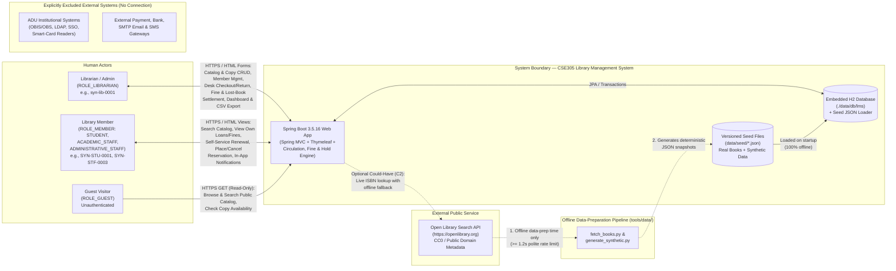

<!--
  Name(s) Surname(s) : Ibrahim Temur, Omer Faruk Kuş
  Student No(s)#: 231805033, 231805026
  General Comments: Product vision statement, problem recap, goals, target success metrics, stakeholder profiles, constraints, and system context diagram for the CSE305 Library Management System.
-->
# Vision and System Context — Library Management System (LMS)

- **Course:** CSE305 Software Engineering — Adnan Menderes University (ADU), Department of Computer Engineering
- **Course Instructor:** Assoc. Prof. Dr. Fatih Soygazi
- **Project Team & Scrum Roles:**
  - **Ibrahim Temur** (`231805033`) — **Product Owner (PO)** & Developer / Architect / QA / Reviewer
  - **Omer Faruk Kuş** (`231805026`) — **Scrum Master (SM)** & Developer / Architect / QA / Reviewer
- **Phase:** Inception (`HW02`)
- **Date:** 2026-10-22

---

## 1. Vision Statement

**For** university, faculty, and departmental libraries that manage physical book collections for academic staff, administrative staff, and students,  
**Who** struggle with error-prone manual ledgers, untracked physical book copies, inconsistent overdue penalty calculations, and lack of real-time shelf visibility,  
**The** **Library Management System (LMS)**  
**Is a** self-contained, web-based library catalog and circulation management application  
**That** automates bibliographic cataloging, barcode-level physical copy lifecycle tracking (`AVAILABLE`, `LOANED`, `RESERVED`, `MAINTENANCE`, `LOST`), policy-driven lending and renewal rules, First-In-First-Out (FIFO) title reservation queues, and deterministic overdue fine calculation,  
**Unlike** informal spreadsheet tracking or heavyweight commercial integrated library systems that require external institutional infrastructure,  
**Our product** operates 100% offline out-of-the-box with an embedded H2 database seeded from public-domain Open Library bibliographic metadata and strictly synthetic operational data, while enforcing confirmed Adnan Menderes University (ADU) library lending rules through modular Object-Oriented Design Patterns (GoF & GRASP) and a Test-Driven Development (TDD) test suite.

---

## 2. Problem Recap

As originally identified in [`docs/01-proposal/PROJECT_PROPOSAL.md`](../01-proposal/PROJECT_PROPOSAL.md), small-to-medium academic libraries face four interconnected operational bottlenecks when relying on manual logs or unvalidated spreadsheets:

1. **Manual Tracking Overhead & Clerical Errors:** Recording checkouts, due dates, renewals, post-renewal cooldown periods, and returns by hand slows circulation desk throughput and introduces transcription errors (e.g., mistyped ISBNs, duplicate member entries, or borrowing granted on someone else's behalf).
2. **Unaccounted & Lost Physical Copies:** A single book title (`Book`, identified by `isbn13`) often has multiple physical copies (`BookCopy`, each identified by a unique `barcode` such as `LMS-COPY-1001`), including non-circulating reference works (encyclopedias, dictionaries, catalogs). Without a strict copy-level state machine, copies that are loaned out, held for reservation pickup, under repair, or reported lost become indistinguishable from shelf-available inventory.
3. **Inconsistent Overdue Detection, Fine Calculation & Lost-Copy Handling:** Manually enforcing member-type quotas (`7` books for academic staff vs. `3` books for administrative staff and students), calculating daily overdue fines (`0.25 TRY/day`), freezing fines upon a lost-book petition, or blocking new loans for members with overdue items or unpaid fines leads to inconsistent policy enforcement.
4. **Lack of Real-Time Catalog Visibility & Member Self-Service:** Borrowers cannot easily inspect real-time copy availability before visiting the circulation desk, check their own active due dates and accrued fines online, renew eligible loans, or join a fair FIFO reservation queue when all copies of a high-demand textbook are currently checked out.

---

## 3. Project & Engineering Goals

| Goal ID | Category | Goal Description |
|---|---|---|
| **GOAL-01** | **Operational Automation** | Replace manual circulation ledgers with transactional checkout, renewal, return, reservation, and fine settlement workflows governed by confirmed ADU library rules and explicit project assumptions documented in [`BUSINESS_RULES.md`](BUSINESS_RULES.md). |
| **GOAL-02** | **Copy-Level Inventory Accuracy** | Track every physical book copy independently through a strict lifecycle state machine (`AVAILABLE`, `LOANED`, `RESERVED`, `MAINTENANCE`, `LOST`) and prevent checkout of non-circulating reference works (encyclopedias, dictionaries, catalogs). |
| **GOAL-03** | **Member Self-Service & Transparency** | Empower authenticated members (`STUDENT`, `ACADEMIC_STAFF`, `ADMINISTRATIVE_STAFF`) to browse the catalog, inspect personal active/historical loans and fines, renew eligible loans, and place/cancel holds when all copies are checked out. |
| **GOAL-04** | **Software Engineering Rigor (CSE305)** | Demonstrate disciplined application of Unified Process (UP) inception/elaboration modeling, Agile Scrum iterative delivery, UI-First prototyping via **Stitch MCP**, justified **GoF & GRASP** design patterns, and **Test-Driven Development (JUnit 5)**. |
| **GOAL-05** | **Offline Reproducibility & Privacy** | Guarantee 100% deterministic offline execution using versioned Open Library book metadata and 100% synthetic personal/circulation data (documented in [`data/README.md`](../../data/README.md)) with zero real personal data or committed secrets. |

---

## 4. Measurable Success Metrics (Targets)

> [!NOTE]
> Numerical performance and operational thresholds below are engineering **design targets (`ASSUMPTION`)** to be verified during Sprint 1–3 integration testing, not pre-measured production benchmarks.

| Metric ID | Dimension | Target Metric & Verification Method | Status |
|---|---|---|---|
| **MET-01** | **Circulation Policy Accuracy** | `100%` pass rate across JUnit 5 unit and integration tests covering member quotas (`7` / `3` / `3`), `30`-day loan periods, `0.25 TRY/day` fine calculation (no cap), post-renewal 1-month (`30`-day) re-borrowing cooldown, and borrowing blocks (`BR-002`..`BR-016`). | Target (`ASSUMPTION`) |
| **MET-02** | **Copy State Invariant Integrity** | `0` illegal state transitions or double-loaned copies allowed at runtime or in seed data; `100%` of `LOANED` copies correspond to exactly one `ACTIVE` loan, and `100%` of `RESERVED` copies correspond to exactly one `READY` reservation (`BR-017`). | Target (`ASSUMPTION`) |
| **MET-03** | **Local Query & Transaction Latency** | `< 200 ms` local server response time (target) for catalog search/filter queries and single-copy checkout/return transactions against the embedded H2 database seeded from `data/seed/*.json` (`NFR-005`). | Target (`ASSUMPTION`) |
| **MET-04** | **Offline Startup & Seed Readiness** | `< 10 seconds` application startup and seed initialization time (target) on the reference Windows 11 / JDK 25 LTS workstation with zero external network calls required at runtime (`NFR-004`, `NFR-006`). | Target (`ASSUMPTION`) |
| **MET-05** | **Privacy & Security Compliance** | `0` real student/staff names, national IDs, real emails, or plaintext production secrets in Git history; `100%` of member and librarian seed emails use `@synthetic.lms.local` (`NFR-008`, `NFR-009`). | Mandatory Constraint |

---

## 5. Stakeholders

| Stakeholder | Role / Type | Key Interests & Expectations |
|---|---|---|
| **Librarian / System Administrator** (`ROLE_LIBRARIAN`) | Primary Operational User | Fast barcode/ID lookup at the circulation desk, reliable eligibility enforcement, catalog and copy state maintenance, lost-copy and fine settlement controls, and an actionable overdue dashboard. |
| **Student Member** (`ROLE_MEMBER`, `STUDENT`) | Primary Self-Service User | Searching course textbooks by title/author/ISBN/category, checking shelf availability, borrowing up to `3` books for `30` days, renewing once if eligible, and queuing for loaned-out books. |
| **Academic Staff Member** (`ROLE_MEMBER`, `ACADEMIC_STAFF`) | Primary Self-Service User | Extended borrowing quota of up to `7` books for `30` days to support teaching and research, viewing personal loan/fine history, and reserving specialized literature. |
| **Administrative Staff Member** (`ROLE_MEMBER`, `ADMINISTRATIVE_STAFF`) | Primary Self-Service User | Borrowing up to `3` books for `30` days under institutional staff rules, viewing personal loans/fines, and placing holds on unavailable titles. |
| **Guest Visitor** (`ROLE_GUEST`) | Secondary Read-Only User | Browsing the public bibliographic catalog and checking copy availability without logging in, while being restricted from any circulation or member data access. |
| **Course Instructor (`Assoc. Prof. Dr. Fatih Soygazi`)** | Academic Evaluator (CSE305) | Clear traceability from Vision -> Requirements (`FR`/`NFR`/`BR`) -> Use Cases -> Scrum Backlog -> OO Design Patterns (GoF/GRASP) -> TDD JUnit 5 tests -> Working MVP across `HW01`–`HW05`. |
| **Project Scrum Team (`Ibrahim Temur` PO, `Omer Faruk Kuş` SM)** | Engineering & Governance Team | Clear scope boundaries (MoSCoW), sustainable velocity across the Weeks 8–9 midterm exam buffer, clean Git authorship discipline (`tools/set-author`), and zero file-lock regressions. |

---

## 6. Scope Boundaries & Constraints

### 6.1 Explicit Out-of-Scope Boundaries
To maintain a focused, high-quality MVP within the 15-week academic calendar, the following items are **strictly out of scope**:
1. **Periodicals & Unpublished Theses (`CONFIRMED` ADU Rule Context, Out of Scope for System):** Although official ADU library regulations specify short-term rules for periodicals (up to 2 non-latest issues for 2 days) and restrict unpublished theses, **this system manages books only**. Periodicals/serials and unpublished theses are excluded from the domain model.
2. **Live ADU IT / OBIS / Smart-Card Integration:** The system does not connect to Adnan Menderes University's Student Information System (OBIS/OBS), institutional LDAP/SSO, or physical RFID/smart-card readers. Personal ID card presentation (`BR-016`) is verified by the Librarian at the desk using the member's synthetic `memberId`.
3. **External Payment Gateways & Financial Accounting:** Overdue fines (`0.25 TRY/day`) and lost-book charges (`2x` appraised value) are calculated deterministically and settled/waived at the circulation desk; no banking or credit-card APIs are integrated.
4. **External SMTP Email or SMS Notification Gateways:** Reservation hold-ready alerts (`BR-013`) and overdue reminders are rendered as **in-app notifications** (`ASSUMPTION-13`) rather than dispatched via external email or SMS providers.

### 6.2 Technical, Environmental & Academic Constraints
- **Technology Baseline:** Java 17 target bytecode (`--release 17`, running on JDK 25 LTS), Spring Boot `3.5.16`, Spring MVC + Thymeleaf, Spring Data JPA, Jakarta Bean Validation, H2 Database (persistent file mode `./data/db/lms` at runtime; in-memory `jdbc:h2:mem:lms_test` in tests), and JUnit 5 via Apache Maven Wrapper (`.\mvnw.cmd`).
- **UI-First Workflow (`AGENTS.md` §6):** Every user interface screen must be prototyped via **Stitch MCP** and exported under `docs/03-design/ui/` prior to implementing Thymeleaf views.
- **Shared Workstation & OneDrive Constraint:** Both team members share a single Windows 11 workstation (`tools\set-author` enforces per-commit `--local` Git identity) and the workspace resides inside a OneDrive-synced folder (`target/` and `data/db/` are excluded from Git to prevent binary file locks).
- **Synthetic Data & Credential Hygiene (`AGENTS.md` §7):** Seed JSON files in `data/seed/` contain zero real personal data and zero password fields; synthetic demo passwords for local authentication are hashed (e.g., BCrypt) at application startup (`OPEN-05`).

---

## 7. System Context Diagram

The Mermaid diagram below illustrates the boundary of the **CSE305 Library Management System**, its three human actor roles (`Librarian / Admin`, `Member`, `Guest`), the offline-only relationship with the public **Open Library Search API**, and the explicit absence of any connection to live ADU institutional systems.

